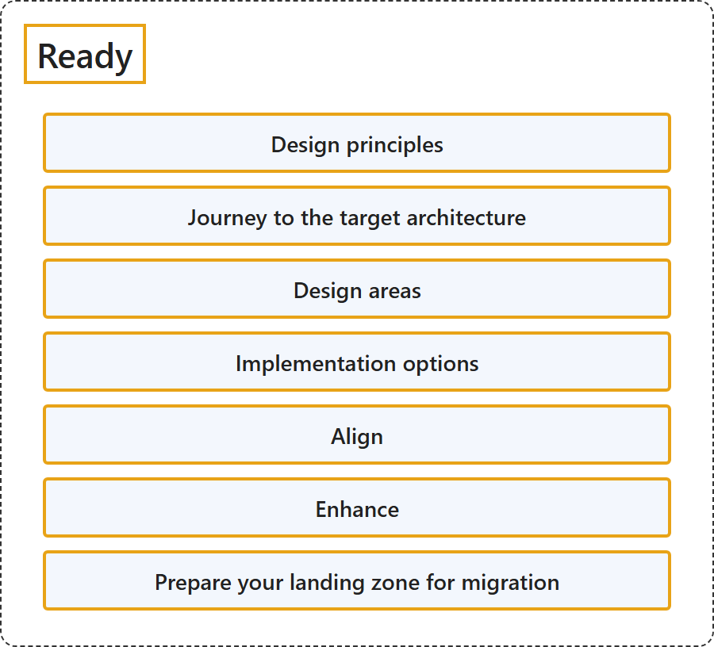

# 26.3 Ready

## Classification

## Glossary

| Term | Definition | 中文解释 | Source |
|---|---|---|---|
| **Ready** 就绪 | "The **Ready phase** of the Cloud Adoption Framework helps you **design your Azure landing zone** to meet your organization's requirements. An **Azure landing zone** is a **proven and flexible architecture** for governing, securing, and scaling a multi-subscription Azure environment." | Cloud Adoption Framework 的**就绪阶段**帮助你**设计 Azure 登陆区**，以满足组织的要求。**Azure 登陆区**是一种**经过验证且灵活的体系结构**，用于治理、保护和扩展多订阅的 Azure 环境。 | [Microsoft, 2026d, para. 1](https://learn.microsoft.com/en-us/azure/cloud-adoption-framework/ready/landing-zone/#:~:text=The%20Ready%20phase%20of%20the%20Cloud%20Adoption%20Framework) |
| **Design principles** 设计原则 | "At the foundation of the architecture, a set of **core design principles** serve as a **compass for subsequent design decisions** across critical technical domains." | 在该体系结构的基础上，一组**核心设计原则**充当**后续设计决策的指南针**，覆盖各个关键技术领域。 | [Microsoft, 2026b, para. 1](https://learn.microsoft.com/en-us/azure/cloud-adoption-framework/ready/landing-zone/design-principles#:~:text=a%20set%20of%20core%20design%20principles%20serve%20as%20a%20compass) |
| **Journey to the target architecture** 迈向目标体系结构的历程 | (context) "**Adopting cloud technologies is a journey.** Business priorities and the need to bring new technologies online to unlock capabilities or features influence **the speed at which an organization deploys and scales out a cloud environment**." | （语境）**采用云技术是一段历程**。业务优先级，以及为解锁能力或功能而上线新技术的需要，会影响**组织部署和横向扩展云环境的速度**。 | [Microsoft, 2025b, para. 1](https://learn.microsoft.com/en-us/azure/cloud-adoption-framework/ready/landing-zone/landing-zone-journey#:~:text=Adopting%20cloud%20technologies%20is%20a%20journey) |
| **Design areas** 设计领域 | (context) "Whatever the deployment option, you should carefully consider each **design area**. Your decisions affect the **platform foundation on which each landing zone depends**." | （语境）无论采用哪种部署选项，都应仔细考虑每个**设计领域**。你的决策会影响**每个登陆区所依赖的平台基础**。 | [Microsoft, 2026a, "Environment design areas" section, para. 1](https://learn.microsoft.com/en-us/azure/cloud-adoption-framework/ready/landing-zone/design-areas#:~:text=Whatever%20the%20deployment%20option%2C%20you%20should%20carefully%20consider%20each%20design%20area) |
| **Implementation options** 实现选项 | (context) "This article describes **options to deploy and manage the platform landing zone**, which is part of Azure landing zone." | （语境）本文介绍**部署和管理平台登陆区的选项**，平台登陆区是 Azure 登陆区的一部分。 | [Microsoft, 2026c, para. 1](https://learn.microsoft.com/en-us/azure/cloud-adoption-framework/ready/landing-zone/implementation-options#:~:text=options%20to%20deploy%20and%20manage%20the%20platform%20landing%20zone) |
| **Align** 对齐 | (context) "This article provides recommendations to help your organization **navigate changes based on your existing Azure environment** that's **transitioning into the Azure landing zone reference architecture**." | （语境）本文提供建议，帮助你的组织**根据现有 Azure 环境应对变化**，这个环境正在**过渡到 Azure 登陆区参考体系结构**。 | [Microsoft, 2025d, para. 2](https://learn.microsoft.com/en-us/azure/cloud-adoption-framework/ready/enterprise-scale/transition#:~:text=navigate%20changes%20based%20on%20your%20existing%20Azure%20environment) |
| **Enhance** 增强 | (context) "This series of articles assumes that you **deployed your first landing zone** and want to **expand that landing zone to meet enterprise requirements**." | （语境）本系列文章假设你**已经部署了第一个登陆区**，并希望**扩展该登陆区以满足企业要求**。 | [Microsoft, 2025a, para. 1](https://learn.microsoft.com/en-us/azure/cloud-adoption-framework/ready/considerations/#:~:text=This%20series%20of%20articles%20assumes%20that%20you%20deployed%20your%20first%20landing%20zone) |
| **Prepare your landing zone for migration** 为迁移准备登陆区 | (context) "This article describes how to **get your Azure landing zone ready for a migration**." | （语境）本文介绍如何**让你的 Azure 登陆区为迁移做好准备**。 | [Microsoft, 2025c, para. 1](https://learn.microsoft.com/en-us/azure/cloud-adoption-framework/ready/landing-zone/ready-azure-landing-zone#:~:text=This%20article%20describes%20how%20to%20get%20your) |

## References

- Microsoft. (2025a, October 29). *Expand your landing zone*. Cloud Adoption Framework. Microsoft Learn. https://learn.microsoft.com/en-us/azure/cloud-adoption-framework/ready/considerations/
- Microsoft. (2025b, December 19). *Journey toward the target architecture*. Cloud Adoption Framework. Microsoft Learn. https://learn.microsoft.com/en-us/azure/cloud-adoption-framework/ready/landing-zone/landing-zone-journey
- Microsoft. (2025c, October 29). *Prepare your landing zone for migration*. Cloud Adoption Framework. Microsoft Learn. https://learn.microsoft.com/en-us/azure/cloud-adoption-framework/ready/landing-zone/ready-azure-landing-zone
- Microsoft. (2025d, December 19). *Transition an existing Azure environment to the Azure landing zone reference architecture*. Cloud Adoption Framework. Microsoft Learn. https://learn.microsoft.com/en-us/azure/cloud-adoption-framework/ready/enterprise-scale/transition
- Microsoft. (2026a, October 13). *Azure landing zone design areas and conceptual architecture*. Cloud Adoption Framework. Microsoft Learn. https://learn.microsoft.com/en-us/azure/cloud-adoption-framework/ready/landing-zone/design-areas
- Microsoft. (2026b, October 1). *Azure landing zone design principles*. Cloud Adoption Framework. Microsoft Learn. https://learn.microsoft.com/en-us/azure/cloud-adoption-framework/ready/landing-zone/design-principles
- Microsoft. (2026c, October 1). *Platform landing zone implementation options*. Cloud Adoption Framework. Microsoft Learn. https://learn.microsoft.com/en-us/azure/cloud-adoption-framework/ready/landing-zone/implementation-options
- Microsoft. (2026d, September 30). *What is an Azure landing zone?* Cloud Adoption Framework. Microsoft Learn. https://learn.microsoft.com/en-us/azure/cloud-adoption-framework/ready/landing-zone/
