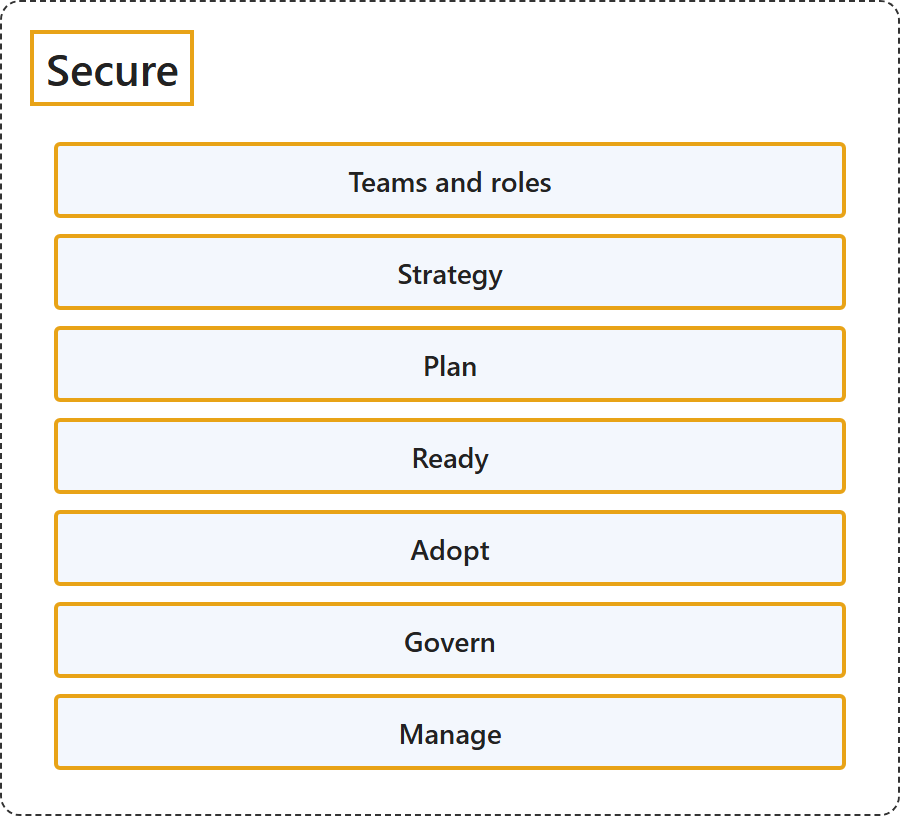

# 26.6 Secure

## Classification

## Glossary

| Term | Definition | 中文解释 | Source |
|---|---|---|---|
| **Secure** 安全 | "The Cloud Adoption Framework for Azure **Secure methodology** provides a **structured approach for securing your Azure cloud estate**." | Azure 云采用框架的**安全方法**提供了一种**保护 Azure 云资产的结构化方法**。 | [Microsoft, 2026f, para. 1](https://learn.microsoft.com/en-us/azure/cloud-adoption-framework/secure/overview#:~:text=The%20Cloud%20Adoption%20Framework%20for%20Azure%20Secure%20methodology) |
| **Teams and roles** 团队和角色 | (context) "This article describes the **security roles and functions** required for **cloud infrastructure and platforms**." | （语境）本文介绍**云基础结构和平台**所需的**安全角色和职能**。 | [Microsoft, 2026h, para. 1](https://learn.microsoft.com/en-us/azure/cloud-adoption-framework/secure/teams-roles#:~:text=This%20article%20describes%20the%20security%20roles%20and%20functions) |
| **Strategy** 战略 | (context) "To be successful in the cloud, your **security strategy** needs to **meet modern challenges that are inherent to cloud computing**." | （语境）要在云中取得成功，你的**安全战略**需要**应对云计算固有的现代挑战**。 | [Microsoft, 2026a, para. 1](https://learn.microsoft.com/en-us/azure/cloud-adoption-framework/secure/strategy#:~:text=your%20security%20strategy%20needs%20to%20meet%20modern%20challenges) |
| **Plan** 规划 | (context) "To build a secure cloud estate from the ground up, you need to **integrate security considerations into every phase of your adoption plan**." | （语境）要从头构建安全的云资产，你需要**把安全考量融入采用计划的每个阶段**。 | [Microsoft, 2026d, para. 1](https://learn.microsoft.com/en-us/azure/cloud-adoption-framework/secure/plan#:~:text=you%20need%20to%20integrate%20security%20considerations%20into%20every%20phase) |
| **Ready** 就绪 | (context) "During the Ready phase of a cloud adoption journey, you focus on **creating the foundation of the estate**." | （语境）在云采用历程的就绪阶段，你专注于**创建资产的基础**。 | [Microsoft, 2026e, para. 1](https://learn.microsoft.com/en-us/azure/cloud-adoption-framework/secure/ready#:~:text=you%20focus%20on%20creating%20the%20foundation%20of%20the%20estate) |
| **Adopt** 采用 | (context) "When you implement your cloud estate and migrate workloads in, it's essential to **establish robust security mechanisms and practices**." | （语境）在实现云资产并迁入工作负载时，**建立可靠的安全机制和做法**至关重要。 | [Microsoft, 2026c, para. 1](https://learn.microsoft.com/en-us/azure/cloud-adoption-framework/secure/adopt#:~:text=establish%20robust%20security%20mechanisms%20and%20practices) |
| **Govern** 治理 | "**Security governance** connects your **business priorities with technical implementations**, such as architecture, standards, and policies." | **安全治理**把你的**业务优先级与技术实现**联系起来，例如体系结构、标准和策略。 | [Microsoft, 2026g, para. 1](https://learn.microsoft.com/en-us/azure/cloud-adoption-framework/secure/govern#:~:text=Security%20governance%20connects%20your%20business%20priorities) |
| **Manage** 管理 | (context) "The Manage phase of a cloud adoption journey focuses on the **ongoing operation of your cloud estate**." | （语境）云采用历程的管理阶段关注**云资产的持续运营**。 | [Microsoft, 2026b, para. 1](https://learn.microsoft.com/en-us/azure/cloud-adoption-framework/secure/manage#:~:text=focuses%20on%20the%20ongoing%20operation%20of%20your%20cloud%20estate) |

## References

- Microsoft. (2026a, October 19). *Integrate security into your cloud adoption strategy*. Cloud Adoption Framework. Microsoft Learn. https://learn.microsoft.com/en-us/azure/cloud-adoption-framework/secure/strategy
- Microsoft. (2026b, March 25). *Manage your cloud estate with enhanced security*. Cloud Adoption Framework. Microsoft Learn. https://learn.microsoft.com/en-us/azure/cloud-adoption-framework/secure/manage
- Microsoft. (2026c, June 2). *Perform your cloud adoption securely*. Cloud Adoption Framework. Microsoft Learn. https://learn.microsoft.com/en-us/azure/cloud-adoption-framework/secure/adopt
- Microsoft. (2026d, October 19). *Plan for a secure cloud adoption*. Cloud Adoption Framework. Microsoft Learn. https://learn.microsoft.com/en-us/azure/cloud-adoption-framework/secure/plan
- Microsoft. (2026e, May 29). *Prepare your secure cloud estate*. Cloud Adoption Framework. Microsoft Learn. https://learn.microsoft.com/en-us/azure/cloud-adoption-framework/secure/ready
- Microsoft. (2026f, January 5). *Secure overview*. Cloud Adoption Framework. Microsoft Learn. https://learn.microsoft.com/en-us/azure/cloud-adoption-framework/secure/overview
- Microsoft. (2026g, March 2). *Securely govern your cloud estate*. Cloud Adoption Framework. Microsoft Learn. https://learn.microsoft.com/en-us/azure/cloud-adoption-framework/secure/govern
- Microsoft. (2026h, October 1). *Security teams, roles, and functions*. Cloud Adoption Framework. Microsoft Learn. https://learn.microsoft.com/en-us/azure/cloud-adoption-framework/secure/teams-roles
