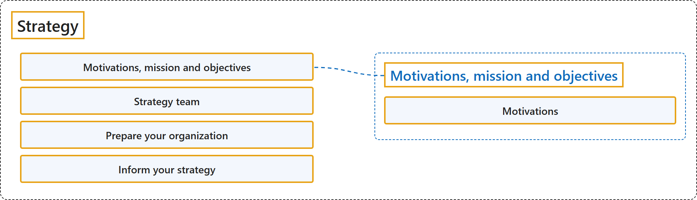

# 26.1 Strategy

## Classification

## Glossary

| Term | Definition | 中文解释 | Source |
|---|---|---|---|
| **Strategy** 战略 | "A **cloud adoption strategy** directs **how your business adopts cloud technology**." | **云采用战略**指导**你的企业如何采用云技术**。 | [Microsoft, 2026, para. 1](https://learn.microsoft.com/en-us/azure/cloud-adoption-framework/strategy/#:~:text=A%20cloud%20adoption%20strategy%20directs%20how%20your%20business) |
| **Motivations, mission and objectives** 动机、使命和目标 | "**Define motivations, mission, and objectives.** Establish the **business reasons for adopting cloud** and the outcomes by which success is measured." | **定义动机、使命和目标**。确立**采用云的业务原因**，以及衡量成功的结果。 | [Microsoft, 2026, "How to build a cloud adoption strategy" section, item 1](https://learn.microsoft.com/en-us/azure/cloud-adoption-framework/strategy/#:~:text=Define%20motivations%2C%20mission%2C%20and%20objectives.%20Establish%20the%20business) |
| **Motivations** 动机 | (context) "**Motivations for adopting and expanding your cloud footprint** can vary." | （语境）**采用和扩展云规模的动机**各不相同。 | [Microsoft, 2025, "Define your motivations" section, para. 1](https://learn.microsoft.com/en-us/azure/cloud-adoption-framework/strategy/motivations#:~:text=Motivations%20for%20adopting%20and%20expanding%20your%20cloud%20footprint) |
| **Strategy team** 战略团队 | "**Define your strategy team.** Identify the **leaders and stakeholders accountable for setting direction** and ensuring execution across the organization." | **定义战略团队**。确定**负责设定方向的领导者和利益相关者**，并确保在整个组织中执行。 | [Microsoft, 2026, "How to build a cloud adoption strategy" section, item 2](https://learn.microsoft.com/en-us/azure/cloud-adoption-framework/strategy/#:~:text=Define%20your%20strategy%20team.%20Identify%20the%20leaders%20and) |
| **Prepare your organization** 准备组织 | "**Prepare the organization.** Secure **executive sponsorship**, align organizational strategies, evaluate your operating model's fit for cloud, and decide whether to shift toward a **product-oriented model**." | **准备组织**。争取**高管支持**，协调组织战略，评估运营模式是否适合云，并决定是否转向**面向产品的模式**。 | [Microsoft, 2026, "How to build a cloud adoption strategy" section, item 3](https://learn.microsoft.com/en-us/azure/cloud-adoption-framework/strategy/#:~:text=Prepare%20the%20organization.%20Secure%20executive%20sponsorship%2C%20align%20organizational) |
| **Inform your strategy** 为战略提供依据 | "**Inform your strategy.** Apply strategic considerations across the **dimensions that shape cloud outcomes**: cost efficiency, resiliency, security, and sustainability." | **为战略提供依据**。在**影响云成果的各个维度**上运用战略考量：成本效率、复原能力、安全性和可持续性。 | [Microsoft, 2026, "How to build a cloud adoption strategy" section, item 4](https://learn.microsoft.com/en-us/azure/cloud-adoption-framework/strategy/#:~:text=Inform%20your%20strategy.%20Apply%20strategic%20considerations%20across%20the) |

## References

- Microsoft. (2025, February 3). *Determine your motivations, mission, and objectives*. Cloud Adoption Framework. Microsoft Learn. https://learn.microsoft.com/en-us/azure/cloud-adoption-framework/strategy/motivations
- Microsoft. (2026, May 14). *Develop a cloud adoption strategy*. Cloud Adoption Framework. Microsoft Learn. https://learn.microsoft.com/en-us/azure/cloud-adoption-framework/strategy/
