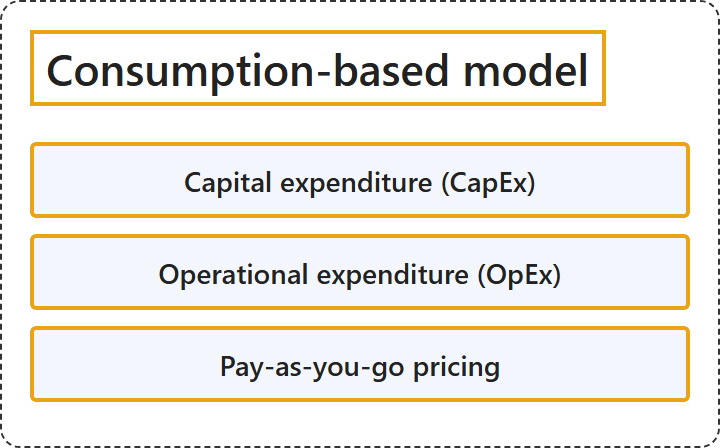

# 1.6 Consumption-based model

Sources: [AZ-900 unit: Describe the consumption-based model](https://learn.microsoft.com/en-us/training/modules/describe-cloud-compute/6-describe-consumption-based-model).

## Classification

## Glossary

| Term | Definition | 中文解释 | Source |
|---|---|---|---|
| **Consumption-based model** 基于消耗的模型 | "Cloud computing operates on a **consumption-based model**. You **pay for the IT resources you use**, and nothing more." | 云计算采用**基于消耗的模型**。你**只为所使用的 IT 资源付费**，仅此而已。 | [Microsoft, n.d., "Describe the consumption-based model" unit, para. 1](https://learn.microsoft.com/en-us/training/modules/describe-cloud-compute/6-describe-consumption-based-model#:~:text=Cloud%20computing%20operates%20on%20a%20consumption%2Dbased%20model) |
| **Capital expenditure (CapEx)** 资本支出 (CapEx) | "CapEx refers to **up-front spending** on **physical infrastructure** like servers, network hardware, and datacenter space." | CapEx 是指**前期支出**，用于**物理基础结构**，例如服务器、网络硬件和数据中心空间。 | [Microsoft, n.d., "Describe the consumption-based model" unit, para. 2](https://learn.microsoft.com/en-us/training/modules/describe-cloud-compute/6-describe-consumption-based-model#:~:text=CapEx%20refers%20to%20up%2Dfront%20spending%20on%20physical%20infrastructure) |
| **Operational expenditure (OpEx)** 运营支出 (OpEx) | "OpEx refers to **ongoing spending** on **services** over time." | OpEx 是指一段时间内在**服务**上的**持续支出**。 | [Microsoft, n.d., "Describe the consumption-based model" unit, para. 2](https://learn.microsoft.com/en-us/training/modules/describe-cloud-compute/6-describe-consumption-based-model#:~:text=OpEx%20refers%20to%20ongoing%20spending%20on%20services%20over%20time) |
| **Pay-as-you-go pricing** 即用即付定价 | "Cloud providers use a **pay-as-you-go pricing model**. You typically **pay only for the services you consume** ..." | 云提供商使用**即用即付定价模型**。你通常**只为所使用的服务付费**…… | [Microsoft, n.d., "Cloud pricing" section, para. 1](https://learn.microsoft.com/en-us/training/modules/describe-cloud-compute/6-describe-consumption-based-model#:~:text=Cloud%20providers%20use%20a%20pay%2Das%2Dyou%2Dgo%20pricing%20model) |

## References

- Microsoft. (n.d.). *Describe the consumption-based model* [Training unit]. Microsoft Learn. Retrieved October 18, 2026, from <https://learn.microsoft.com/en-us/training/modules/describe-cloud-compute/6-describe-consumption-based-model>
