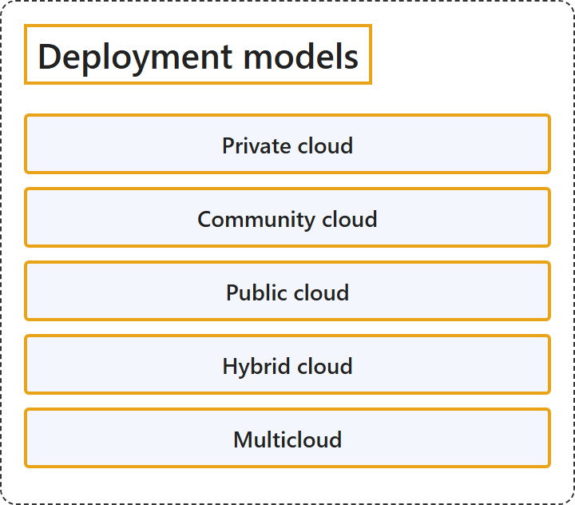

# 1.1 Deployment Models

## Classification

## Glossary

| Term | Definition | 中文解释 | Source |
|---|---|---|---|
| **Deployment models** 部署模型 | "**Deployment models** describe how cloud environments are **structured**, who **manages** them, and how they are **accessed**." | **部署模型**描述云环境如何**构建**、由谁**管理**，以及如何**访问**。 | [Microsoft, n.d.-b, "Types of cloud deployment models" section, para. 1](https://azure.microsoft.com/en-us/resources/cloud-computing-dictionary/types-of-cloud-computing#:~:text=Deployment%20models%20describe%20how%20cloud%20environments%20are%20structured) |
| **Private cloud** 私有云 | "A private cloud is a **cloud environment** used by a **single entity**." | 私有云是一种**云环境**，由**单个实体**使用。 | [Microsoft, n.d.-a, "Private cloud" section, para. 1](https://learn.microsoft.com/en-us/training/modules/describe-cloud-compute/5-define-cloud-models#:~:text=A%20private%20cloud%20is%20a%20cloud%20environment%20used%20by%20a%20single%20entity) |
| **Community cloud** 社区云 | "The cloud infrastructure is provisioned for **exclusive use** by a **specific community of consumers** from organizations that have **shared concerns** (e.g., mission, security requirements, policy, and compliance considerations)." | 云基础结构被预配为**专用**，供**特定的使用者社区**使用，这些使用者来自具有**共同关注点**（例如使命、安全要求、策略和合规考虑）的组织。 | [Mell &amp; Grance, 2011, Section 2, Deployment Models, item 2](https://doi.org/10.6028/NIST.SP.800-145) |
| **Public cloud** 公有云 | "A public cloud is **built, controlled, and maintained** by a **third-party cloud provider**." | 公有云的**构建、控制和维护**由**第三方云提供商**负责。 | [Microsoft, n.d.-a, "Public cloud" section, para. 1](https://learn.microsoft.com/en-us/training/modules/describe-cloud-compute/5-define-cloud-models#:~:text=A%20public%20cloud%20is%20built%2C%20controlled%2C%20and%20maintained) |
| **Hybrid cloud** 混合云 | "A hybrid cloud is a computing environment that uses **both public and private clouds** in an **inter-connected environment**." | 混合云是一种计算环境，它同时使用**公有云和私有云**，并处于**互连的环境**中。 | [Microsoft, n.d.-a, "Hybrid cloud" section, para. 1](https://learn.microsoft.com/en-us/training/modules/describe-cloud-compute/5-define-cloud-models#:~:text=A%20hybrid%20cloud%20is%20a%20computing%20environment%20that%20uses%20both%20public%20and%20private%20clouds) |
| **Multicloud** 多云 | "In a **multicloud scenario**, you use **multiple public cloud providers**." | 在**多云方案**中，你使用**多个公有云提供商**。 | [Microsoft, n.d.-a, "Multicloud" section, para. 1](https://learn.microsoft.com/en-us/training/modules/describe-cloud-compute/5-define-cloud-models#:~:text=In%20a%20multicloud%20scenario%2C%20you%20use%20multiple%20public%20cloud%20providers) |

## References

- Mell, P., & Grance, T. (2011). *The NIST definition of cloud computing* (NIST Special Publication 800-145). National Institute of Standards and Technology. <https://doi.org/10.6028/NIST.SP.800-145>
- Microsoft. (n.d.-a). *Define cloud models* [Training unit]. Microsoft Learn. Retrieved October 18, 2026, from <https://learn.microsoft.com/en-us/training/modules/describe-cloud-compute/5-define-cloud-models>
- Microsoft. (n.d.-b). *Types of cloud computing*. Microsoft Azure. Retrieved October 19, 2026, from <https://azure.microsoft.com/en-us/resources/cloud-computing-dictionary/types-of-cloud-computing>
