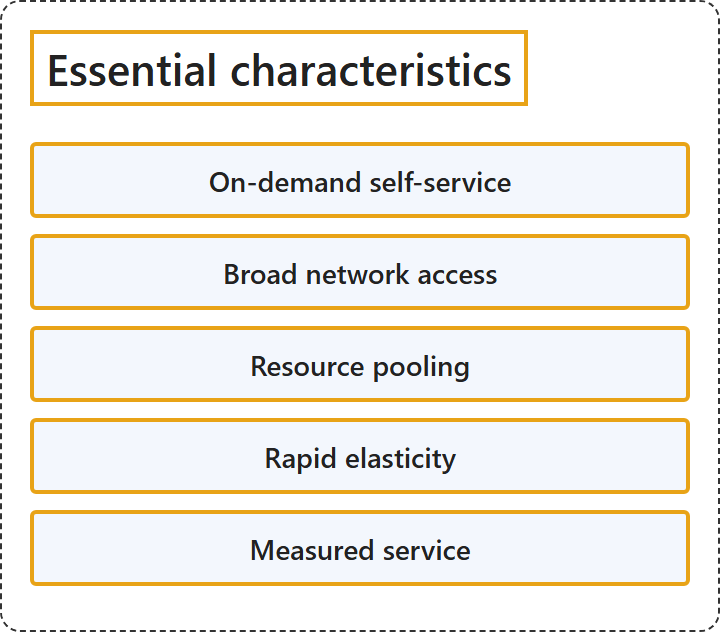

# 1.4 Essential characteristics

## Classification

## Glossary

| Term | Definition | 中文解释 | Source |
|---|---|---|---|
| **Essential characteristics** 基本特征 | "This cloud model is composed of **five essential characteristics**, **three service models**, and **four deployment models**." | 这种云模型由**五个基本特征**、**三种服务模型**和**四种部署模型**组成。 | [Mell &amp; Grance, 2011, Section 2, para. 1](https://doi.org/10.6028/NIST.SP.800-145) |
| **On-demand self-service** 按需自助服务 | "A consumer can **unilaterally provision computing capabilities**, such as server time and network storage, **as needed automatically** without requiring **human interaction** with each service provider." | 使用者可以**单方面预配计算能力**（例如服务器时间和网络存储），**根据需要自动完成**，而无需与每个服务提供商进行**人工交互**。 | [Mell &amp; Grance, 2011, Section 2, Essential Characteristics, item 1](https://doi.org/10.6028/NIST.SP.800-145) |
| **Broad network access** 广泛的网络访问 | "Capabilities are **available over the network** and accessed through **standard mechanisms** that promote use by **heterogeneous thin or thick client platforms** (e.g., mobile phones, tablets, laptops, and workstations)." | 能力**可通过网络获得**，并通过**标准机制**访问，这些机制便于**各种瘦客户端或胖客户端平台**（例如手机、平板电脑、笔记本电脑和工作站）使用。 | [Mell &amp; Grance, 2011, Section 2, Essential Characteristics, item 2](https://doi.org/10.6028/NIST.SP.800-145) |
| **Resource pooling** 资源池 | "The provider's computing resources are **pooled to serve multiple consumers** using a **multi-tenant model**, with different physical and virtual resources **dynamically assigned and reassigned** according to consumer demand." | 提供商的计算资源被**汇集起来为多个使用者服务**，采用**多租户模型**，不同的物理和虚拟资源根据使用者的需求**动态分配和重新分配**。 | [Mell &amp; Grance, 2011, Section 2, Essential Characteristics, item 3](https://doi.org/10.6028/NIST.SP.800-145) |
| **Rapid elasticity** 快速弹性 | "Capabilities can be **elastically provisioned and released**, in some cases automatically, to **scale rapidly outward and inward** commensurate with demand." | 能力可以**弹性地预配和释放**（某些情况下自动完成），以便根据需求**快速向外和向内缩放**。 | [Mell &amp; Grance, 2011, Section 2, Essential Characteristics, item 4](https://doi.org/10.6028/NIST.SP.800-145) |
| **Measured service** 可计量的服务 | "Cloud systems **automatically control and optimize resource use** by leveraging a **metering capability** at some level of abstraction appropriate to the type of service (e.g., storage, processing, bandwidth, and active user accounts)." | 云系统**自动控制和优化资源使用**，方法是利用某个与服务类型相适应的抽象级别上的**计量能力**（例如存储、处理、带宽和活动用户帐户）。 | [Mell &amp; Grance, 2011, Section 2, Essential Characteristics, item 5](https://doi.org/10.6028/NIST.SP.800-145) |

## References

- Mell, P., & Grance, T. (2011). *The NIST definition of cloud computing* (NIST Special Publication 800-145). National Institute of Standards and Technology. <https://doi.org/10.6028/NIST.SP.800-145>
