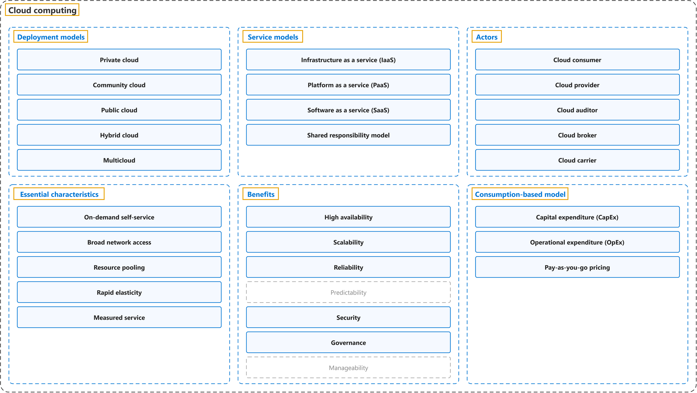

# 1. Cloud computing

## Classification

## Glossary

| Term | Definition | 中文翻译 | Source |
|---|---|---|---|
| **Cloud computing** 云计算 | "**Cloud computing** is the **delivery of computing services** over the **internet**. Computing services include **common IT infrastructure** such as virtual machines, storage, databases, and networking." | **云计算**是指**计算服务的交付**，通过**互联网**进行。计算服务包括**常见的 IT 基础结构**，例如虚拟机、存储、数据库和网络。 | [Microsoft, n.d.-a, "What is cloud computing" unit, para. 1](https://learn.microsoft.com/en-us/training/modules/describe-cloud-compute/3-what-cloud-compute#:~:text=Cloud%20computing%20is%20the%20delivery%20of%20computing%20services%20over%20the%20internet) |
| **[Deployment models](deployment-models.md)** 部署模型 | "**Deployment models** describe how cloud environments are **structured**, who **manages** them, and how they are **accessed**." | **部署模型**描述云环境如何**构建**、由谁**管理**，以及如何**访问**。 | [Microsoft, n.d.-b, "Types of cloud deployment models" section, para. 1](https://azure.microsoft.com/en-us/resources/cloud-computing-dictionary/types-of-cloud-computing#:~:text=Deployment%20models%20describe%20how%20cloud%20environments%20are%20structured) |
| **[Service models](service-models.md)** 服务模型 | "**Service models** describe how cloud resources are **delivered to users**. They determine how much **control** an organization has over infrastructure, platforms, or applications." | **服务模型**描述云资源如何**交付给用户**。它们决定组织对基础结构、平台或应用程序拥有多少**控制权**。 | [Microsoft, n.d.-b, "Types of cloud service models" section, para. 1](https://azure.microsoft.com/en-us/resources/cloud-computing-dictionary/types-of-cloud-computing#:~:text=Service%20models%20describe%20how%20cloud%20resources%20are%20delivered%20to%20users.%20They) |
| **[Actors](actors.md)** 参与者 | "... the NIST cloud computing reference architecture defines **five major actors**: cloud consumer, cloud provider, cloud carrier, cloud auditor and cloud broker. Each actor is an **entity (a person or an organization)** that **participates in a transaction or process** and/or performs tasks in cloud computing." | ……NIST 云计算参考架构定义了**五个主要参与者**：云使用者、云提供者、云运营商、云审计者和云代理。每个参与者都是一个**实体（个人或组织）**，它**参与事务或流程**，和/或在云计算中执行任务。 | [Liu et al., 2011, Section 2.1, para. 2](https://doi.org/10.6028/NIST.SP.500-292) |
| **[Essential characteristics](essential-characteristics.md)** 基本特征 | "This cloud model is composed of **five essential characteristics**, **three service models**, and **four deployment models**." | 这种云模型由**五个基本特征**、**三种服务模型**和**四种部署模型**组成。 | [Mell &amp; Grance, 2011, Section 2, para. 1](https://doi.org/10.6028/NIST.SP.800-145) |
| **[Benefits](benefits.md)** 优势 | "You learn how cloud computing can help you **meet variable demand** while providing a **good experience** for your customer. You also learn about **security**, **governance**, sustainability, and overall **manageability** in the cloud." | 你将了解云计算如何帮助你**满足可变需求**，同时为客户提供**良好的体验**。你还将了解云中的**安全性**、**治理**、可持续性和整体**可管理性**。 | [Microsoft, n.d.-a, "Introduction" unit of "Describe the benefits of using cloud services", para. 1](https://learn.microsoft.com/en-us/training/modules/describe-benefits-use-cloud-services/1-introduction#:~:text=You%20learn%20how%20cloud%20computing%20can%20help%20you%20meet%20variable%20demand) |
| **[Consumption-based model](consumption-based-model.md)** 基于消耗的模型 | "Cloud computing operates on a **consumption-based model**. You **pay for the IT resources you use**, and nothing more." | 云计算采用**基于消耗的模型**。你**只为所使用的 IT 资源付费**，仅此而已。 | [Microsoft, n.d.-a, "Describe the consumption-based model" unit, para. 1](https://learn.microsoft.com/en-us/training/modules/describe-cloud-compute/6-describe-consumption-based-model#:~:text=Cloud%20computing%20operates%20on%20a%20consumption%2Dbased%20model) |

## Coverage

| Certification | Skill area |
|---|---|
| AZ-900 Microsoft Azure Fundamentals | [Describe cloud concepts (25–30%)](https://learn.microsoft.com/en-us/credentials/certifications/resources/study-guides/az-900#describe-cloud-concepts-2530) |

**CST8911 Introduction to Cloud Computing**

| Week | Terms in the course | Source |
|---|---|---|
| 1 | **Cloud computing**: cloud computing, Gartner's definition of cloud computing **Deployment models**: public cloud, private cloud, hybrid cloud **Service models**: service model (service delivery model), Infrastructure as a Service (IaaS), Platform as a Service (PaaS), Software as a Service (SaaS), shared responsibility model **Actors**: cloud provider **Essential characteristics**: essential characteristics of cloud computing, on-demand self-service, broad network access, resource pooling, rapid elasticity, measured service **Benefits**: scalability **Consumption-based model**: pay-as-you-go | Introduction to Cloud Computing (Lecture 1): slides 3, 4, 5, 6, 7, 8, 10, 13, 14 |
| 2 | **Benefits**: high availability | Introduction to Cloud Computing (Lecture 2): slide 5 |
| 4 | **Cloud computing**: cloud computing (cloud environment) **Deployment models**: deployment model, hybrid cloud | Introduction to Cloud Computing (Lecture 3): slides 4, 5 |
| 6 | **Service models**: Infrastructure Platform (IaaS), Application Platform (PaaS / aPaaS), Software Platform (SaaS) | Introduction to Cloud Computing (Lecture 5): slide 7 |
| 7 | **Deployment models**: cloud deployment model, community cloud, hybrid cloud, multi-cloud **Service models**: cloud service model **Actors**: cloud consumer, cloud provider, cloud auditor, cloud broker, cloud carrier **Benefits**: reliability, governance | Introduction to Cloud Computing (Lecture 6): slides 3, 5, 9, 10, 15 |

**CST8912 Cloud Solution Architecture**

| Week | Terms in the course | Source |
|---|---|---|
| 1 | **Deployment models**: deployment model, public cloud, private cloud, hybrid cloud, multi-cloud **Service models**: service model, Infrastructure as a Service (IaaS), Platform as a Service (PaaS), Software as a Service (SaaS), shared responsibility model **Essential characteristics**: resource pooling, elasticity **Benefits**: scalability, high availability **Consumption-based model**: pay-as-you-go, capital expenditure (CapEx), operational expenditure (OpEx) | Introduction to Cloud Solution Architecture: slides 6, 7, 8, 9, 10, 11, 12, 14, 15, 16, 17, 18 |
| 3 | **Deployment models**: deployment model | Design Cloud Networking Solution: slides 15, 16 |
| 5 | **Benefits**: dynamic scalability, governance | Design Cloud Database Solution: slides 9, 15 |
| 6 | **Deployment models**: hybrid cloud, multi-cloud **Service models**: shared responsibility model **Actors**: cloud provider **Benefits**: reliability, cloud governance | Week 6 – Cloud Architecture best practices: slides 16, 23, 24, 26, 28 |

**CST8913 Cloud Migration**

| Week | Terms in the course | Source |
|---|---|---|
| 2 | **Cloud computing**: cloud computing **Deployment models**: deployment model (cloud model), public cloud, private cloud, hybrid cloud, multi-cloud **Service models**: service model (service type), Infrastructure as a Service (IaaS), Platform as a Service (PaaS), Software as a Service (SaaS), shared responsibility model **Actors**: cloud provider **Benefits**: scalability, high availability **Consumption-based model**: consumption-based model, capital expenditure (CapEx), operational expenditure (OpEx) | Introduction to Cloud Computing: slides 5, 6, 7, 9, 10, 12, 13, 14, 16 Cloud Adoption Framework (CAF) (Online Quiz reading module): Manage and Secure (Units 9–10) |
| 3 | **Essential characteristics**: elasticity **Consumption-based model**: CapEx to OpEx shift | Cloud adoption strategy: slides 9, 10 |

**CST8915 Full-stack Cloud-native Development**

| Week | Terms in the course | Source |
|---|---|---|
| 1 | **Cloud computing**: cloud computing **Deployment models**: public cloud, private cloud, hybrid cloud **Service models**: service model, Infrastructure as a Service (IaaS), Platform as a Service (PaaS), Software as a Service (SaaS) **Essential characteristics**: elasticity **Benefits**: scalability **Consumption-based model**: pay-as-you-go (pay for what you use) | Introduction to Cloud-Native Applications: slides 6, 31, 32, 33, 34, 35 |
| 2 | **Benefits**: high availability | The Twelve-Factor Application: slide 37 |
| 4 | **Essential characteristics**: resource pooling, rapid elasticity | Containers I: slide 19 |

**CST8916 Remote Data and Real-time Applications**

| Week | Terms in the course | Source |
|---|---|---|
| 1 | **Cloud computing**: cloud computing **Deployment models**: public cloud, private cloud, hybrid cloud **Service models**: service model, Infrastructure as a Service (IaaS), Platform as a Service (PaaS), Software as a Service (SaaS) **Essential characteristics**: elasticity **Benefits**: scalability, reliability **Consumption-based model**: pay-as-you-go | Introduction to Remote Data and Real-time Applications: slides 4, 13, 14, 15, 16, 17, 28 |
| 5 | **Deployment models**: multi-cloud **Benefits**: high availability | Popular Cloud Services for Real-time Applications I: slides 31, 33 |
| 6 | **Service models**: service model | Popular Cloud Services for Real-time Applications II: slide 3 |

## References

- Liu, F., Tong, J., Mao, J., Bohn, R., Messina, J., Badger, L., & Leaf, D. (2011). *NIST cloud computing reference architecture* (NIST Special Publication 500-292). National Institute of Standards and Technology. https://doi.org/10.6028/NIST.SP.500-292
- Mell, P., & Grance, T. (2011). *The NIST definition of cloud computing* (NIST Special Publication 800-145). National Institute of Standards and Technology. https://doi.org/10.6028/NIST.SP.800-145
- Microsoft. (n.d.-a). *Microsoft Azure Fundamentals: Describe cloud concepts* [Learning path]. Microsoft Learn. Retrieved October 21, 2026, from https://learn.microsoft.com/en-us/training/paths/microsoft-azure-fundamentals-describe-cloud-concepts/
- Microsoft. (n.d.-b). *Types of cloud computing*. Microsoft Azure. Retrieved October 22, 2026, from https://azure.microsoft.com/en-us/resources/cloud-computing-dictionary/types-of-cloud-computing
- Microsoft. (2026). *Study guide for Exam AZ-900: Microsoft Azure Fundamentals*. Microsoft Learn. https://learn.microsoft.com/en-us/credentials/certifications/resources/study-guides/az-900
