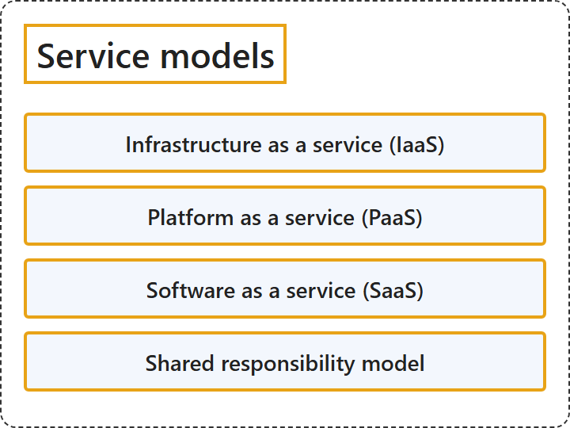

# 1.2 Service Models

## Classification

## Glossary

| Term | Definition | 中文解释 | Source |
|---|---|---|---|
| **Service models** 服务模型 | "**Service models** describe how cloud resources are **delivered to users**. They determine how much **control** an organization has over infrastructure, platforms, or applications." | **服务模型**描述云资源如何**交付给用户**。它们决定组织对基础结构、平台或应用程序拥有多少**控制权**。 | [Microsoft, n.d.-e, "Types of cloud service models" section, para. 1](https://azure.microsoft.com/en-us/resources/cloud-computing-dictionary/types-of-cloud-computing#:~:text=Service%20models%20describe%20how%20cloud%20resources%20are%20delivered%20to%20users.%20They) |
| **Infrastructure as a service (IaaS)** 基础结构即服务 (IaaS) | "Infrastructure as a service (IaaS) is the **most flexible category** of cloud services. It provides the **maximum amount of control** for your cloud resources." | 基础结构即服务 (IaaS) 是云服务中**最灵活的类别**。它为你的云资源提供**最大程度的控制**。 | [Microsoft, n.d.-a, "Describe Infrastructure as a Service" unit, para. 1](https://learn.microsoft.com/en-us/training/modules/describe-cloud-service-types/2-describe-infrastructure-service#:~:text=Infrastructure%20as%20a%20service%20%28IaaS%29%20is%20the%20most%20flexible%20category) |
| **Platform as a service (PaaS)** 平台即服务 (PaaS) | "Platform as a service (PaaS) is a **middle ground** between **renting space in a datacenter** (infrastructure as a service) and **paying for a complete and deployed solution** (software as a service)." | 平台即服务 (PaaS) 是一个**中间地带**，介于**租用数据中心中的空间**（基础结构即服务）和**购买完整且已部署的解决方案**（软件即服务）之间。 | [Microsoft, n.d.-b, "Describe Platform as a Service" unit, para. 1](https://learn.microsoft.com/en-us/training/modules/describe-cloud-service-types/3-describe-platform-service#:~:text=Platform%20as%20a%20service%20%28PaaS%29%20is%20a%20middle%20ground) |
| **Software as a service (SaaS)** 软件即服务 (SaaS) | "Software as a service (SaaS) is the **most complete cloud service model** from a product perspective. With SaaS, you're essentially **renting or using a fully developed application**." | 从产品角度看，软件即服务 (SaaS) 是**最完整的云服务模型**。使用 SaaS 时，你实际上是在**租用或使用一个完全开发好的应用程序**。 | [Microsoft, n.d.-c, "Describe Software as a Service" unit, para. 1](https://learn.microsoft.com/en-us/training/modules/describe-cloud-service-types/4-describe-software-service#:~:text=Software%20as%20a%20service%20%28SaaS%29%20is%20the%20most%20complete%20cloud%20service%20model) |
| **Shared responsibility model** 共同责任模型 | "With the **shared responsibility model**, these responsibilities get **shared between the cloud provider and the consumer**." | 在**共同责任模型**下，这些责任**由云提供商和使用者共同承担**。 | [Microsoft, n.d.-d, "How responsibilities shift in cloud" section, para. 2](https://learn.microsoft.com/en-us/training/modules/describe-cloud-compute/4-describe-shared-responsibility-model#:~:text=With%20the%20shared%20responsibility%20model%2C%20these%20responsibilities%20get%20shared) |

## References

- Microsoft. (n.d.-a). *Describe Infrastructure as a Service* [Training unit]. Microsoft Learn. Retrieved October 18, 2026, from <https://learn.microsoft.com/en-us/training/modules/describe-cloud-service-types/2-describe-infrastructure-service>
- Microsoft. (n.d.-b). *Describe Platform as a Service* [Training unit]. Microsoft Learn. Retrieved October 18, 2026, from <https://learn.microsoft.com/en-us/training/modules/describe-cloud-service-types/3-describe-platform-service>
- Microsoft. (n.d.-c). *Describe Software as a Service* [Training unit]. Microsoft Learn. Retrieved October 18, 2026, from <https://learn.microsoft.com/en-us/training/modules/describe-cloud-service-types/4-describe-software-service>
- Microsoft. (n.d.-d). *Describe the shared responsibility model* [Training unit]. Microsoft Learn. Retrieved October 18, 2026, from <https://learn.microsoft.com/en-us/training/modules/describe-cloud-compute/4-describe-shared-responsibility-model>
- Microsoft. (n.d.-e). *Types of cloud computing*. Microsoft Azure. Retrieved October 19, 2026, from <https://azure.microsoft.com/en-us/resources/cloud-computing-dictionary/types-of-cloud-computing>
