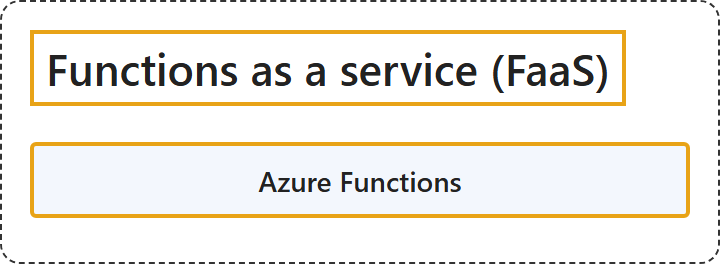

# 4.3 Functions as a Service (FaaS)

## Classification

## Glossary

| Term | Definition | 中文翻译 | Source |
|---|---|---|---|
| **Azure Functions** Azure 函数 | "Azure Functions is a service that provides **managed functions** that run based on **various trigger types** for event-driven applications." | Azure Functions 是一项服务，提供**托管函数**，这些函数基于**各种触发器类型**运行，用于事件驱动的应用程序。 | [Microsoft, 2026, "Understand the basic features" section, list item 3](https://learn.microsoft.com/en-us/azure/architecture/guide/technology-choices/compute-decision-tree#:~:text=is%20a%20service%20that%20provides%20managed%20functions) |

## References

- Microsoft. (2026, February 19). *Choose an Azure compute service*. Azure Architecture Center. https://learn.microsoft.com/en-us/azure/architecture/guide/technology-choices/compute-decision-tree
