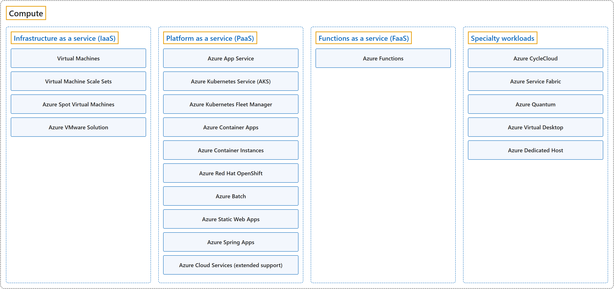

# 3. Compute

## Classification

## Glossary

| Term | Definition | 中文翻译 | Source |
|---|---|---|---|
| **Compute** 计算 | "The term **compute** refers to the **hosting model** for the **resources** that your **application runs on**." | **计算**这一术语指的是一种**托管模型**，用于托管**资源**，供你的**应用程序在其上运行**。 | [Microsoft, n.d., para. 1](https://learn.microsoft.com/en-us/azure/architecture/guide/technology-choices/compute-decision-tree#:~:text=The%20term%20compute%20refers%20to%20the%20hosting%20model) |
| **[Infrastructure as a service (IaaS)](infrastructure-as-a-service.md)** 基础结构即服务 | "**Infrastructure as a service (IaaS)** lets you **provision VMs** along with the associated **networking and storage components**. You can then deploy **any software and applications** on those VMs." | **基础结构即服务 (IaaS)** 让你可以**预配 VM**，以及相关的**网络和存储组件**。然后你可以在这些 VM 上部署**任何软件和应用程序**。 | [Microsoft, n.d., "Understand the hosting models" section, list item 1](https://learn.microsoft.com/en-us/azure/architecture/guide/technology-choices/compute-decision-tree#understand-the-hosting-models:~:text=Infrastructure%20as%20a%20service%20%28IaaS%29%20lets%20you%20provision%20VMs) |
| **[Platform as a service (PaaS)](platform-as-a-service.md)** 平台即服务 | "**Platform as a service (PaaS)** provides a **managed hosting environment** where you can **deploy your application** without the need to **manage VMs**." | **平台即服务 (PaaS)** 提供一个**托管的宿主环境**，你可以在其中**部署应用程序**，而无需**管理 VM**。 | [Microsoft, n.d., "Understand the hosting models" section, list item 2](https://learn.microsoft.com/en-us/azure/architecture/guide/technology-choices/compute-decision-tree#understand-the-hosting-models:~:text=Platform%20as%20a%20service%20%28PaaS%29%20provides%20a%20managed%20hosting%20environment) |
| **[Functions as a service (FaaS)](functions-as-a-service.md)** 函数即服务 | "**Functions as a service (FaaS)** lets you **deploy your code** to the service, which **automatically runs it**." | **函数即服务 (FaaS)** 让你把**代码部署**到服务中，由服务**自动运行**它。 | [Microsoft, n.d., "Understand the hosting models" section, list item 3](https://learn.microsoft.com/en-us/azure/architecture/guide/technology-choices/compute-decision-tree#understand-the-hosting-models:~:text=Functions%20as%20a%20service%20%28FaaS%29%20lets%20you%20deploy%20your%20code) |
| **[Specialty workloads](specialty-workloads.md)** 特殊工作负载 | "Some **workloads** have **specific requirements** and don't typically follow the **general recommendations** in this application platform selection guide." | 有些**工作负载**有**特定要求**，通常不遵循本应用程序平台选择指南中的**一般建议**。 | [Microsoft, n.d., "Specialty workloads" section, para. 1](https://learn.microsoft.com/en-us/azure/architecture/guide/technology-choices/compute-decision-tree#specialty-workloads:~:text=Some%20workloads%20have%20specific%20requirements) |

## Coverage

| Certification | Skill area |
|---|---|
| AZ-900 Microsoft Azure Fundamentals | [Describe Azure architecture and services (35–40%)](https://learn.microsoft.com/en-us/credentials/certifications/resources/study-guides/az-900#describe-azure-architecture-and-services-3540) |

**CST8911 Introduction to Cloud Computing**

| Week | Terms in the course | Source |
|---|---|---|
| 1 | **IaaS**: virtual machine (VM) **FaaS**: serverless computing, Function as a Service (FaaS) | Introduction to Cloud Computing (Lecture 1): slides 9, 11, 14 |
| 2 | **IaaS**: Virtual Machine Scale Sets, Spot Virtual Machines | Introduction to Cloud Computing (Lecture 2): slide 5 Week 2 readings: Amazon EC2 and Azure Virtual Machines (product pages) |
| 3 | **FaaS**: Azure Functions | Lab 2: Azure Functions: Function app and hosting plan (tasks 1–2) |
| 4 | **FaaS**: Azure Functions | Introduction to Cloud Computing (Lecture 3): slide 9 |
| 6 | **IaaS**: Azure Virtual Machines (Azure VMs) **PaaS**: OpenShift **FaaS**: Function Platform (FaaS) | Introduction to Cloud Computing (Lecture 5): slide 7 |

**CST8912 Cloud Solution Architecture**

| Week | Terms in the course | Source |
|---|---|---|
| 2 | **Compute**: compute service, hosting model **IaaS**: Azure Virtual Machines, Virtual Machine Scale Sets (VMSS), Azure Spot Virtual Machines **PaaS**: Azure App Service, Azure Kubernetes Service (AKS), Azure Container Apps (ACA), Azure Container Instances (ACI), Azure Red Hat OpenShift (ARO), Azure Batch, Azure Spring Apps **FaaS**: Azure Functions, Function as a Service (FaaS) **Specialty workloads**: Azure Service Fabric | Design Cloud Compute Solution: slides 4, 6, 7, 9, 10, 11, 12, 13 Provisioning and Managing an Azure Virtual Machine (Lab 1): Virtual machine settings (Tasks 2, 5) |

**CST8913 Cloud Migration**

| Week | Terms in the course | Source |
|---|---|---|
| 2 | **IaaS**: virtual machine (VM) **PaaS**: Azure Kubernetes Service (AKS) | Introduction to Cloud Computing: slide 5 Cloud Migration (slides 18–20 + Lab 2): Azure services (Lab 2 case study) |
| 4 | **IaaS**: Azure Virtual Machines, Azure VMware Solution node | Lab 4 — Cloud Migration Discovery and Assessment (Lab 4): Scenario and On-Premises Environment Migration Assessment Process: slide 7 |
| 5 | **IaaS**: Azure VMware Solution (AVS) | Lab 5 Rehosting to Microsoft Azure (Lab 5): Questions and submission |
| 6 | **PaaS**: Azure App Service | Refactoring Migration: slide 7 |

**CST8915 Full-stack Cloud-native Development**

| Week | Terms in the course | Source |
|---|---|---|
| 1 | **IaaS**: virtual machine (VM) **FaaS**: serverless | Introduction to Cloud-Native Applications: slides 33, 37 |
| 3 | **PaaS**: App Services, Azure Spring Apps **FaaS**: Function Apps | Microservices: slides 32, 33 |
| 4 | **PaaS**: Azure App Service, Azure Static Web Apps **FaaS**: Azure Functions | Lab 3: Deploying the Algonquin Pet Store on Azure (Lab 3 + slide 33): Understanding Azure Web App and Azure Static Web Apps |

**CST8916 Remote Data and Real-time Applications**

| Week | Terms in the course | Source |
|---|---|---|
| 1 | **IaaS**: virtual machine (VM) **FaaS**: serverless function | Introduction to Remote Data and Real-time Applications: slides 8, 15 |
| 2 | **IaaS**: VM option (IaaS) **PaaS**: Azure App Service | REST (Representational State Transfer): slides 43, 44, 45 |
| 5 | **Compute**: compute service **PaaS**: Azure App Service **FaaS**: Azure Functions, Function as a Service (FaaS) | Popular Cloud Services for Real-time Applications I: slides 19, 20, 21, 26 |
| 6 | **PaaS**: Azure App Service, Azure Spring Apps **FaaS**: Azure Functions | Popular Cloud Services for Real-time Applications II: slides 3, 7 |

## References

- Microsoft. (n.d.). *Choose an Azure compute service*. Azure Architecture Center. Retrieved October 22, 2026, from https://learn.microsoft.com/en-us/azure/architecture/guide/technology-choices/compute-decision-tree
- Microsoft. (2026). *Study guide for Exam AZ-900: Microsoft Azure Fundamentals*. Microsoft Learn. https://learn.microsoft.com/en-us/credentials/certifications/resources/study-guides/az-900
