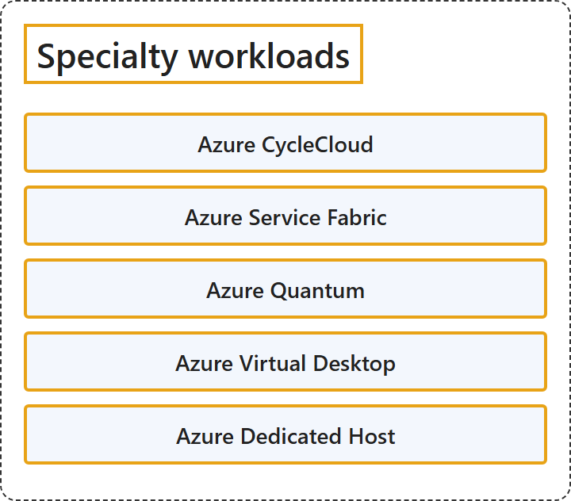

# 4.4 Specialty workloads

Sources: [Azure documentation: Compute](https://learn.microsoft.com/en-us/azure/?product=compute); [Azure Architecture Center: Choose an Azure compute service](https://learn.microsoft.com/en-us/azure/architecture/guide/technology-choices/compute-decision-tree); and each product's own documentation.

## Classification

## Glossary

| Term | Definition | 中文翻译 | Source |
|---|---|---|---|
| **Azure CycleCloud** Azure CycleCloud | "Azure CycleCloud is an **enterprise-friendly tool** for **orchestrating and managing High Performance Computing (HPC) environments** on Azure." | Azure CycleCloud 是一个**适合企业使用的工具**，用于在 Azure 上**编排和管理高性能计算（HPC）环境**。 | [Microsoft, 2026d, para. 1](https://learn.microsoft.com/en-us/azure/cyclecloud/overview#:~:text=is%20an%20enterprise-friendly%20tool) |
| **Azure Service Fabric** Azure Service Fabric | "Azure Service Fabric is a **distributed systems platform** that makes it easy to **package, deploy, and manage** scalable and reliable **microservices and containers**." | Azure Service Fabric 是一个**分布式系统平台**，它让**打包、部署和管理**可扩展、可靠的**微服务和容器**变得容易。 | [Microsoft, 2026c, para. 1](https://learn.microsoft.com/en-us/azure/service-fabric/service-fabric-overview#:~:text=is%20a%20distributed%20systems%20platform) |
| **Azure Quantum** Azure 量子 | "Azure Quantum is Microsoft Azure's **cloud quantum computing service**." | Azure Quantum 是 Microsoft Azure 的**云量子计算服务**。 | [Microsoft, 2026e, para. 1](https://learn.microsoft.com/en-us/azure/quantum/overview-azure-quantum#:~:text=cloud%20quantum%20computing%20service) |
| **Azure Virtual Desktop** Azure 虚拟桌面 | "Azure Virtual Desktop is a **desktop and app virtualization service** that **runs on Azure**." | Azure 虚拟桌面是一种**桌面和应用虚拟化服务**，它**运行在 Azure 上**。 | [Microsoft, 2026f, para. 1](https://learn.microsoft.com/en-us/azure/virtual-desktop/overview#:~:text=is%20a%20desktop%20and%20app%20virtualization%20service) |
| **Azure Dedicated Host** Azure 专用主机 | "Azure Dedicated Host is a service that provides **physical servers** able to **host one or more virtual machines** assigned to **one Azure subscription**." | Azure 专用主机是一种服务，它提供**物理服务器**，这些服务器能**托管一台或多台虚拟机**，这些虚拟机分配给**同一个 Azure 订阅**。 | [Microsoft, 2026a, para. 1](https://learn.microsoft.com/en-us/azure/virtual-machines/dedicated-hosts#:~:text=provides%20physical%20servers%20able%20to%20host) |

## References

- Microsoft. (n.d.). *Azure documentation*. Microsoft Learn. Retrieved October 26, 2026, from https://learn.microsoft.com/en-us/azure/
- Microsoft. (2026a, September 27). *Azure Dedicated Hosts*. Microsoft Learn. https://learn.microsoft.com/en-us/azure/virtual-machines/dedicated-hosts
- Microsoft. (2026b, February 19). *Choose an Azure compute service*. Azure Architecture Center. https://learn.microsoft.com/en-us/azure/architecture/guide/technology-choices/compute-decision-tree
- Microsoft. (2026c, March 22). *Overview of Azure Service Fabric*. Microsoft Learn. https://learn.microsoft.com/en-us/azure/service-fabric/service-fabric-overview
- Microsoft. (2026d, September 18). *What is Azure CycleCloud?* Microsoft Learn. https://learn.microsoft.com/en-us/azure/cyclecloud/overview
- Microsoft. (2026e, June 17). *What is Azure Quantum?* Microsoft Learn. https://learn.microsoft.com/en-us/azure/quantum/overview-azure-quantum
- Microsoft. (2026f, September 17). *What is Azure Virtual Desktop?* Microsoft Learn. https://learn.microsoft.com/en-us/azure/virtual-desktop/overview
