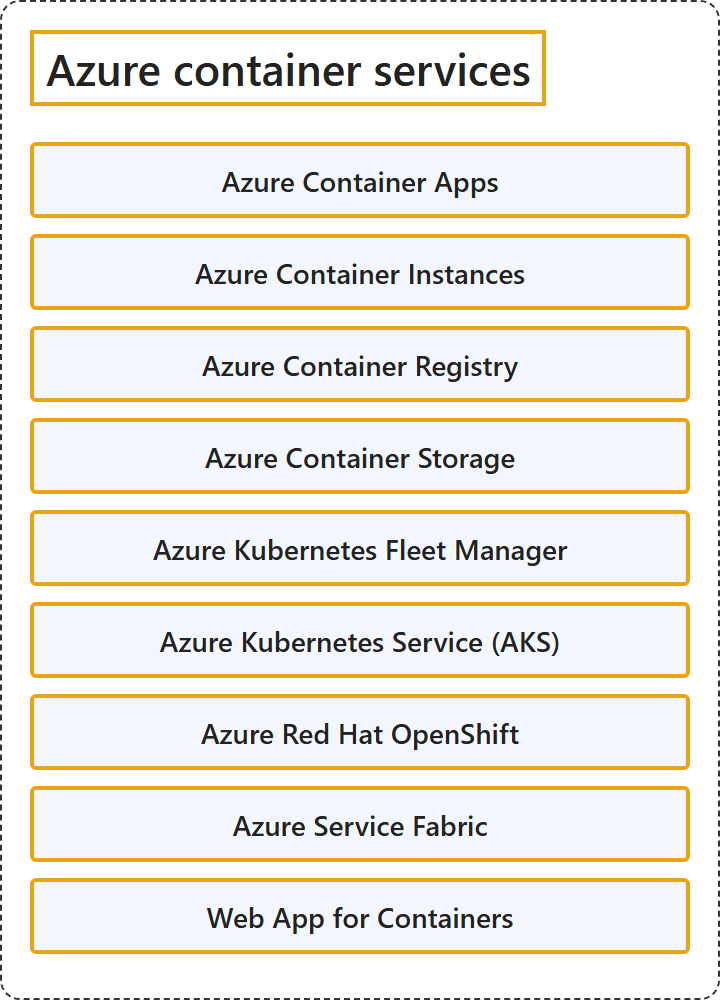

# 5.3 Azure container services

## Classification

## Glossary

| Term | Definition | 中文翻译 | Source |
|---|---|---|---|
| **Azure Container Apps** Azure 容器应用 | "Azure Container Apps is a **serverless platform** for **running containerized applications** without managing the underlying infrastructure." | Azure 容器应用是一个**无服务器平台**，用于**运行容器化应用程序**，无需管理底层基础结构。 | [Microsoft, 2026b, para. 1](https://learn.microsoft.com/en-us/azure/container-apps/overview#:~:text=is%20a%20serverless%20platform%20for%20running%20containerized%20applications) |
| **Azure Container Instances** Azure 容器实例 | "Azure Container Instances offers the **fastest and simplest way to run Linux or Windows containers** in Azure, **without having to manage any virtual machines** and without having to adopt a higher-level service." | Azure 容器实例提供在 Azure 中**运行 Linux 或 Windows 容器的最快、最简单的方法**，**无需管理任何虚拟机**，也无需采用更高级别的服务。 | [Microsoft, 2026f, para. 1](https://learn.microsoft.com/en-us/azure/container-instances/container-instances-overview#:~:text=offers%20the%20fastest%20and%20simplest%20way%20to%20run) |
| **Azure Container Registry** Azure 容器注册表 | "Azure Container Registry is a **managed registry service** based on the **open-source Docker platform**." | Azure 容器注册表是一种**托管的注册表服务**，基于**开源 Docker 平台**。 | [Microsoft, 2026d, para. 1](https://learn.microsoft.com/en-us/azure/container-registry/container-registry-intro#:~:text=is%20a%20managed%20registry%20service) |
| **Azure Container Storage** Azure 容器存储 | "Azure Container Storage is a **cloud-based volume management, deployment, and orchestration service** **built for containers**." | Azure 容器存储是一种**基于云的卷管理、部署和编排服务**，**专为容器构建**。 | [Microsoft, 2026g, para. 1](https://learn.microsoft.com/en-us/azure/storage/container-storage/container-storage-introduction#:~:text=is%20a%20cloud-based%20volume%20management) |
| **Azure Kubernetes Fleet Manager** Azure Kubernetes 舰队管理器 | "Azure Kubernetes Fleet Manager enables **at-scale management** of **multiple supported Kubernetes clusters**." | Azure Kubernetes 舰队管理器支持对**多个受支持的 Kubernetes 群集**进行**大规模管理**。 | [Microsoft, 2026h, para. 1](https://learn.microsoft.com/en-us/azure/kubernetes-fleet/overview#:~:text=enables%20at-scale%20management%20of%20multiple) |
| **Azure Kubernetes Service (AKS)** Azure Kubernetes 服务（AKS） | "Azure Kubernetes Service (AKS) is a **managed Kubernetes service** for **deploying and managing containerized applications**." | Azure Kubernetes 服务（AKS）是一种**托管的 Kubernetes 服务**，用于**部署和管理容器化应用程序**。 | [Microsoft, 2026i, para. 1](https://learn.microsoft.com/en-us/azure/aks/what-is-aks#:~:text=is%20a%20managed%20Kubernetes%20service%20for%20deploying) |
| **Azure Red Hat OpenShift** Azure Red Hat OpenShift | "The Microsoft Azure Red Hat OpenShift service enables you to **deploy fully managed OpenShift clusters** on Azure." | Microsoft Azure Red Hat OpenShift 服务让你可以在 Azure 上**部署完全托管的 OpenShift 群集**。 | [Microsoft, 2026c, para. 1](https://learn.microsoft.com/en-us/azure/openshift/intro-openshift#:~:text=enables%20you%20to%20deploy%20fully%20managed%20OpenShift%20clusters) |
| **Azure Service Fabric** Azure Service Fabric | "Azure Service Fabric is a **distributed systems platform** that makes it easy to **package, deploy, and manage** scalable and reliable **microservices and containers**." | Azure Service Fabric 是一个**分布式系统平台**，它让**打包、部署和管理**可扩展、可靠的**微服务和容器**变得容易。 | [Microsoft, 2026e, para. 1](https://learn.microsoft.com/en-us/azure/service-fabric/service-fabric-overview#:~:text=is%20a%20distributed%20systems%20platform) |
| **Web App for Containers** 用于容器的 Web 应用 | (context) "Or, if your app is containerized, you can just **deploy it as a custom container**." | （语境）或者，如果你的应用已容器化，可以直接**把它部署为自定义容器**。 | [Microsoft, 2026a, para. 2](https://learn.microsoft.com/en-us/azure/app-service/overview#:~:text=you%20can%20just%20deploy%20it%20as%20a%20custom%20container) |

## References

- Microsoft. (n.d.). *Azure documentation*. Microsoft Learn. Retrieved October 27, 2026, from https://learn.microsoft.com/en-us/azure/
- Microsoft. (2026a, August 18). *App Service overview*. Microsoft Learn. https://learn.microsoft.com/en-us/azure/app-service/overview
- Microsoft. (2026b, July 7). *Azure Container Apps overview*. Microsoft Learn. https://learn.microsoft.com/en-us/azure/container-apps/overview
- Microsoft. (2026c, September 15). *Azure Red Hat OpenShift*. Microsoft Learn. https://learn.microsoft.com/en-us/azure/openshift/intro-openshift
- Microsoft. (2026d, February 11). *Introduction to Azure Container Registry*. Microsoft Learn. https://learn.microsoft.com/en-us/azure/container-registry/container-registry-intro
- Microsoft. (2026e, March 22). *Overview of Azure Service Fabric*. Microsoft Learn. https://learn.microsoft.com/en-us/azure/service-fabric/service-fabric-overview
- Microsoft. (2026f, July 25). *What is Azure Container Instances?* Microsoft Learn. https://learn.microsoft.com/en-us/azure/container-instances/container-instances-overview
- Microsoft. (2026g, February 5). *What is Azure Container Storage?* Microsoft Learn. https://learn.microsoft.com/en-us/azure/storage/container-storage/container-storage-introduction
- Microsoft. (2026h, June 15). *What is Azure Kubernetes Fleet Manager?* Microsoft Learn. https://learn.microsoft.com/en-us/azure/kubernetes-fleet/overview
- Microsoft. (2026i, June 4). *What is Azure Kubernetes Service (AKS)?* Microsoft Learn. https://learn.microsoft.com/en-us/azure/aks/what-is-aks
