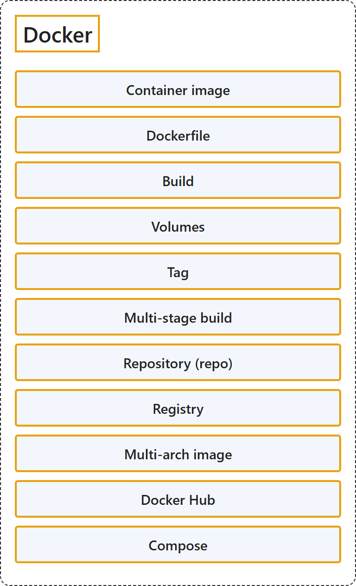

# 5.1 Docker

Sources: [Docker terminology](https://learn.microsoft.com/en-us/dotnet/architecture/microservices/container-docker-introduction/docker-terminology).

## Classification

## Glossary

| Term | Definition | 中文翻译 | Source |
|---|---|---|---|
| **Container image** 容器镜像 | "A **package with all the dependencies and information** needed to **create a container**." | 一个**包含所有依赖项和信息的包**，这些依赖项和信息是**创建容器**所需要的。 | [Microsoft, 2021, "Container image" entry](https://learn.microsoft.com/en-us/dotnet/architecture/microservices/container-docker-introduction/docker-terminology#:~:text=A%20package%20with%20all%20the%20dependencies%20and%20information) |
| **Dockerfile** Dockerfile | "A **text file** that contains **instructions for building a Docker image**." | 一个**文本文件**，其中包含**构建 Docker 镜像的指令**。 | [Microsoft, 2021, "Dockerfile" entry](https://learn.microsoft.com/en-us/dotnet/architecture/microservices/container-docker-introduction/docker-terminology#:~:text=A%20text%20file%20that%20contains%20instructions%20for%20building%20a%20Docker%20image) |
| **Build** 构建 | "The action of **building a container image** based on the information and context provided by **its Dockerfile**, plus additional files in the folder where the image is built." | 根据**其 Dockerfile** 提供的信息和上下文，加上构建镜像所在文件夹中的其他文件，**构建容器镜像**的操作。 | [Microsoft, 2021, "Build" entry](https://learn.microsoft.com/en-us/dotnet/architecture/microservices/container-docker-introduction/docker-terminology#:~:text=The%20action%20of%20building%20a%20container%20image) |
| **Volumes** 卷 | "Offer a **writable filesystem** that the container can use." | 提供容器可以使用的**可写文件系统**。 | [Microsoft, 2021, "Volumes" entry](https://learn.microsoft.com/en-us/dotnet/architecture/microservices/container-docker-introduction/docker-terminology#:~:text=Offer%20a%20writable%20filesystem%20that%20the%20container%20can%20use) |
| **Tag** 标记 | "A **mark or label you can apply to images** so that **different images or versions of the same image** (depending on the version number or the target environment) can be identified." | 一种**可以应用到镜像上的标记或标签**，用来识别**不同的镜像或同一镜像的不同版本**（取决于版本号或目标环境）。 | [Microsoft, 2021, "Tag" entry](https://learn.microsoft.com/en-us/dotnet/architecture/microservices/container-docker-introduction/docker-terminology#:~:text=A%20mark%20or%20label%20you%20can%20apply%20to%20images) |
| **Multi-stage build** 多阶段构建 | "Is a feature, since Docker 17.05 or higher, that helps to **reduce the size of the final images**." | 是从 Docker 17.05 起提供的一项功能，有助于**减小最终镜像的大小**。 | [Microsoft, 2021, "Multi-stage Build" entry](https://learn.microsoft.com/en-us/dotnet/architecture/microservices/container-docker-introduction/docker-terminology#:~:text=helps%20to%20reduce%20the%20size%20of%20the%20final%20images) |
| **Repository (repo)** 存储库（repo） | "A **collection of related Docker images**, labeled with **a tag that indicates the image version**." | **相关 Docker 镜像的集合**，用**表示镜像版本的标记**加以标注。 | [Microsoft, 2021, "Repository (repo)" entry](https://learn.microsoft.com/en-us/dotnet/architecture/microservices/container-docker-introduction/docker-terminology#:~:text=A%20collection%20of%20related%20Docker%20images) |
| **Registry** 注册表 | "A **service that provides access to repositories**." | 一种**提供存储库访问的服务**。 | [Microsoft, 2021, "Registry" entry](https://learn.microsoft.com/en-us/dotnet/architecture/microservices/container-docker-introduction/docker-terminology#:~:text=A%20service%20that%20provides%20access%20to%20repositories) |
| **Multi-arch image** 多体系结构镜像 | "For multi-architecture (or multi-platform), it's a Docker feature that **simplifies the selection of the appropriate image**, according to **the platform where Docker is running**." | 即多体系结构（或多平台）镜像，是一项 Docker 功能，它根据 **Docker 运行所在的平台**，**简化合适镜像的选择**。 | [Microsoft, 2021, "Multi-arch image" entry](https://learn.microsoft.com/en-us/dotnet/architecture/microservices/container-docker-introduction/docker-terminology#:~:text=simplifies%20the%20selection%20of%20the%20appropriate%20image) |
| **Docker Hub** Docker Hub | "A **public registry** to **upload images and work with them**." | 一个**公共注册表**，用于**上传镜像并使用这些镜像**。 | [Microsoft, 2021, "Docker Hub" entry](https://learn.microsoft.com/en-us/dotnet/architecture/microservices/container-docker-introduction/docker-terminology#:~:text=A%20public%20registry%20to%20upload%20images%20and%20work%20with%20them) |
| **Compose** Compose | "A **command-line tool and YAML file format** with metadata for **defining and running multi-container applications**." | 一种**命令行工具和 YAML 文件格式**，带有用于**定义和运行多容器应用程序**的元数据。 | [Microsoft, 2021, "Compose" entry](https://learn.microsoft.com/en-us/dotnet/architecture/microservices/container-docker-introduction/docker-terminology#:~:text=A%20command-line%20tool%20and%20YAML%20file%20format) |

## References

- Microsoft. (2021). *Docker terminology*. .NET Microservices: Architecture for Containerized .NET Applications. Microsoft Learn. https://learn.microsoft.com/en-us/dotnet/architecture/microservices/container-docker-introduction/docker-terminology
