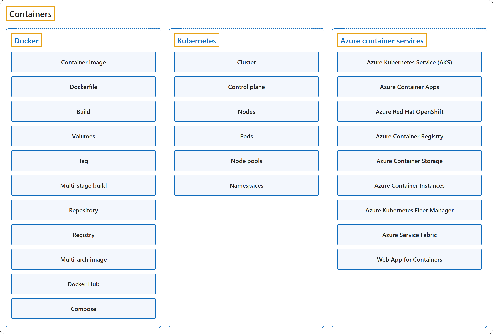

# 4. Containers

## Classification

## Glossary

| Term | Definition | 中文翻译 | Source |
|---|---|---|---|
| **Containers** 容器 | "A **container** is a **standardized package of software** that can be **quickly and reliably deployed** across **cloud and other environments** to support fast, efficient innovation." | **容器**是一种**标准化的软件包**，可以**快速、可靠地部署**到**云和其他环境**中，从而支持快速、高效的创新。 | [Microsoft, n.d.-b, para. 1](https://azure.microsoft.com/en-us/resources/cloud-computing-dictionary/what-is-a-container#:~:text=A%20container%20is%20a%20standardized%20package%20of%20software) |
| **[Docker](docker.md)** Docker | "**Docker** is an **open-source project** for **automating the deployment of applications** as **portable, self-sufficient containers** that can run on the cloud or on-premises." | **Docker** 是一个**开源项目**，用于**自动完成应用程序的部署**，把它们部署成**可移植、自给自足的容器**，这些容器可以在云中或本地运行。 | [Microsoft, 2018, para. 1](https://learn.microsoft.com/en-us/dotnet/architecture/microservices/container-docker-introduction/docker-defined#:~:text=Docker%20is%20an%20open-source%20project%20for%20automating) |
| **[Kubernetes](kubernetes.md)** Kubernetes | "**Kubernetes** is an **open-source container orchestration platform** for automating the **deployment, scaling, and management** of **containerized applications**." | **Kubernetes** 是一个**开源的容器编排平台**，用于自动**部署、扩缩和管理**各类**容器化应用程序**。 | [Microsoft, 2026a, "What is Kubernetes?" section, para. 1](https://learn.microsoft.com/en-us/azure/aks/core-aks-concepts#what-is-kubernetes:~:text=Kubernetes%20is%20an%20open-source%20container%20orchestration%20platform) |
| **[Azure container services](azure-container-services.md)** Azure 容器服务 | "**Azure** provides **several container-related services**. These include **Azure Kubernetes Service**, Azure Container Apps, Azure Red Hat OpenShift, **Azure Container Registry**, and Azure Container Storage." | **Azure** 提供**多种与容器相关的服务**，包括 **Azure Kubernetes Service**、Azure Container Apps、Azure Red Hat OpenShift、**Azure Container Registry** 和 Azure Container Storage。 | [Microsoft, n.d.-a, "Frequently asked questions" section, question 1](https://azure.microsoft.com/en-us/products/category/containers#:~:text=Azure%20provides%20several%20container-related%20services) |

## Coverage

| Certification | Skill area |
|---|---|
| AZ-900 Microsoft Azure Fundamentals | [Describe Azure architecture and services (35–40%)](https://learn.microsoft.com/en-us/credentials/certifications/resources/study-guides/az-900#describe-azure-architecture-and-services-3540) |

**CST8911 Introduction to Cloud Computing**

| Week | Group | Terms in the course | Source |
|---|---|---|---|
| 1 | Containers | container (Docker container) | Lecture 1: slide 15 |
|  | Docker | Docker Dockerfile Docker image registry repository Docker Hub | Lecture 1: slide 15 |
|  | Kubernetes | Kubernetes management | Lecture 1: slide 11 |
| 6 | Kubernetes | Kubernetes | Lecture 5: slide 6 |
|  | Azure container services | Azure Container Service (ACS) | Lecture 5: slide 7 |

**CST8912 Cloud Solution Architecture**

| Week | Group | Terms in the course | Source |
|---|---|---|---|
| 2 | Containers | container | Design Cloud Compute Solution: slide 8 |
|  | Docker | container image | Design Cloud Compute Solution: slide 8 |
|  | Kubernetes | Kubernetes (K8s) cluster control plane node node pool | Design Cloud Compute Solution: slides 10, 14, 15 |
|  | Azure container services | Azure Kubernetes Service (AKS) Azure Container Apps (ACA) Azure Red Hat OpenShift (ARO) Azure Container Instances (ACI) Azure Service Fabric | Design Cloud Compute Solution: slides 9, 10, 13 |

**CST8913 Cloud Migration**

| Week | Group | Terms in the course | Source |
|---|---|---|---|
| 2 | Azure container services | Azure Kubernetes Service (AKS) | Lab 2: Azure services (Lab 2 case study) |
| 3 | Azure container services | Azure Container Registry | Target Cloud Architecture: slide 10 |
| 5 | Containers | container | Lab 5: Case study: Washington State Department of Labor & Industries |

**CST8915 Full-stack Cloud-native Development**

| Week | Group | Terms in the course | Source |
|---|---|---|---|
| 1 | Containers | container | Introduction to Cloud-Native Applications: slide 37 |
|  | Docker | Docker | Introduction to Cloud-Native Applications: slide 38 |
|  | Kubernetes | Kubernetes (K8s) | Introduction to Cloud-Native Applications: slide 38 |
| 2 | Docker | container image release ID (version tag) container registry | The Twelve-Factor Application: slides 26, 27, 28 |
| 3 | Docker | Docker container image compose | Microservices: slides 26, 38 |
| 4 | Docker | Docker Dockerfile repository (library) for images Docker Hub public registry | Containers I: slides 27, 28, 29, 30 |
|  | Kubernetes | Kubernetes (K8s) | Containers I: slide 28 |
| 5 | Docker | Docker image (Docker image) Dockerfile build the image volume (Docker volume) registry private registry Docker Hub Docker Compose | Containers II: Docker: slides 2, 7, 12, 13, 15, 16, 19 |
|  | Kubernetes | Kubernetes (K8s) | Containers II: Docker: slide 7 |
| 6 | Docker | Docker Hub repository | Lab 5: Step 4: Push Images to Docker Hub |
|  | Kubernetes | Kubernetes (K8s) cluster | Container Orchestrator: slides 19, 20 |
|  | Azure container services | Azure Container Registry | Container Orchestrator: slides 5, 6 |

**CST8916 Remote Data and Real-time Applications**

| Week | Group | Terms in the course | Source |
|---|---|---|---|
| 5 | Containers | container | Popular Cloud Services for Real-time Applications I: slide 22 |
|  | Docker | Docker | Popular Cloud Services for Real-time Applications I: slide 15 |
|  | Kubernetes | Kubernetes | Popular Cloud Services for Real-time Applications I: slide 15 |

## References

- Microsoft. (n.d.-a). *Containers on Azure*. Microsoft Azure. Retrieved October 22, 2026, from https://azure.microsoft.com/en-us/products/category/containers
- Microsoft. (n.d.-b). *What is a container?* Microsoft Azure. Retrieved October 22, 2026, from https://azure.microsoft.com/en-us/resources/cloud-computing-dictionary/what-is-a-container
- Microsoft. (2018). *What is Docker?* .NET Microservices: Architecture for Containerized .NET Applications. Microsoft Learn. https://learn.microsoft.com/en-us/dotnet/architecture/microservices/container-docker-introduction/docker-defined
- Microsoft. (2021). *Docker terminology*. .NET Microservices: Architecture for Containerized .NET Applications. Microsoft Learn. https://learn.microsoft.com/en-us/dotnet/architecture/microservices/container-docker-introduction/docker-terminology
- Microsoft. (2026a). *Core Kubernetes concepts for Azure Kubernetes Service (AKS)*. Microsoft Learn. https://learn.microsoft.com/en-us/azure/aks/core-aks-concepts
- Microsoft. (2026b). *Study guide for Exam AZ-900: Microsoft Azure Fundamentals*. Microsoft Learn. https://learn.microsoft.com/en-us/credentials/certifications/resources/study-guides/az-900
