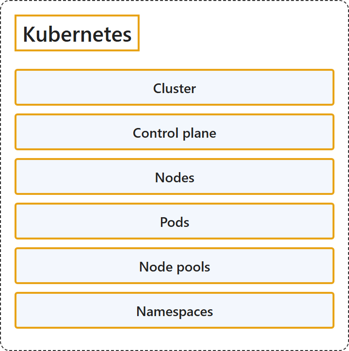

# 5.2 Kubernetes

Sources: [Docker terminology](https://learn.microsoft.com/en-us/dotnet/architecture/microservices/container-docker-introduction/docker-terminology); [Core Kubernetes concepts for Azure Kubernetes Service (AKS)](https://learn.microsoft.com/en-us/azure/aks/core-aks-concepts).

## Classification

## Glossary

| Term | Definition | 中文翻译 | Source |
|---|---|---|---|
| **Cluster** 群集 | "A **collection of Docker hosts** exposed as if it were **a single virtual Docker host**, so that the application can scale to multiple instances of the services spread across multiple hosts within the cluster." | **一组 Docker 主机**，对外表现得就像**单个虚拟 Docker 主机**，这样应用程序就可以扩展到分布在群集内多个主机上的多个服务实例。 | [Microsoft, 2021, "Cluster" entry](https://learn.microsoft.com/en-us/dotnet/architecture/microservices/container-docker-introduction/docker-terminology#:~:text=A%20collection%20of%20Docker%20hosts%20exposed%20as%20if%20it%20were%20a%20single%20virtual%20Docker%20host) |
| **Control plane** 控制平面 | "The control plane provides the **core Kubernetes services** and **orchestration of application workloads**." | 控制平面提供**核心 Kubernetes 服务**和**应用程序工作负载的编排**。 | [Microsoft, 2026, "Cluster components" section](https://learn.microsoft.com/en-us/azure/aks/core-aks-concepts#:~:text=The%20control%20plane%20provides%20the%20core%20Kubernetes%20services) |
| **Nodes** 节点 | "Nodes are the **underlying virtual machines (VMs)** that **run your applications**." | 节点是**运行你的应用程序**的**底层虚拟机（VM）**。 | [Microsoft, 2026, "Cluster components" section](https://learn.microsoft.com/en-us/azure/aks/core-aks-concepts#:~:text=Nodes%20are%20the%20underlying%20virtual%20machines) |
| **Pods** Pod | "A pod is a **group of one or more containers** that **share the same network and storage resources** and a specification for how to run the containers." | Pod 是**一个或多个容器组成的组**，这些容器**共享相同的网络和存储资源**，以及一份如何运行这些容器的规范。 | [Microsoft, 2026, "Pods" section](https://learn.microsoft.com/en-us/azure/aks/core-aks-concepts#:~:text=is%20a%20group%20of%20one%20or%20more%20containers) |
| **Node pools** 节点池 | "In AKS, **nodes are grouped together** into **node pools**." | 在 AKS 中，**节点被分组**到**节点池**中。 | [Microsoft, 2026, "Node pools" section](https://learn.microsoft.com/en-us/azure/aks/core-aks-concepts#:~:text=nodes%20are%20grouped%20together%20into) |
| **Namespaces** 命名空间 | "Kubernetes resources, such as pods and deployments, are **logically grouped into namespaces** to **divide an AKS cluster** and create, view, or manage access to resources." | Kubernetes 资源（例如 Pod 和部署）被**按逻辑分组到命名空间中**，用来**划分 AKS 群集**，并创建、查看或管理对资源的访问。 | [Microsoft, 2026, "Namespaces" section](https://learn.microsoft.com/en-us/azure/aks/core-aks-concepts#:~:text=are%20logically%20grouped%20into) |

## References

- Microsoft. (2021). *Docker terminology*. .NET Microservices: Architecture for Containerized .NET Applications. Microsoft Learn. https://learn.microsoft.com/en-us/dotnet/architecture/microservices/container-docker-introduction/docker-terminology
- Microsoft. (2026). *Core Kubernetes concepts for Azure Kubernetes Service (AKS)*. Microsoft Learn. https://learn.microsoft.com/en-us/azure/aks/core-aks-concepts
