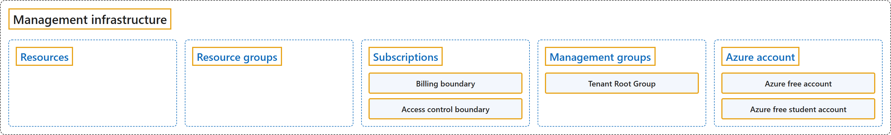

# 2.2 Management infrastructure

Sources: [AZ-900 unit: Describe Azure management infrastructure](https://learn.microsoft.com/en-us/training/modules/describe-core-architectural-components-of-azure/6-describe-azure-management-infrastructure); [AZ-900 unit: Get started with Azure accounts](https://learn.microsoft.com/en-us/training/modules/describe-core-architectural-components-of-azure/3-get-started-azure-accounts).

## Classification

## Glossary

| Term | Definition | 中文解释 | Source |
|---|---|---|---|
| **Management infrastructure** 管理基础结构 | "The **management infrastructure** includes Azure **resources and resource groups**, **subscriptions**, and **accounts**." | **管理基础结构**包括 Azure **资源和资源组**、**订阅**以及**帐户**。 | [Microsoft, n.d.-b, unit introduction, para. 1](https://learn.microsoft.com/en-us/training/modules/describe-core-architectural-components-of-azure/6-describe-azure-management-infrastructure#:~:text=The%20management%20infrastructure%20includes%20Azure%20resources) |
| **Resources** 资源 | "A resource is the **basic building block** of Azure. **Anything you create, provision, or deploy** is a resource." | 资源是 Azure 的**基本构建基块**。**你创建、预配或部署的任何内容**都是资源。 | [Microsoft, n.d.-b, "Azure resources and resource groups" section, para. 1](https://learn.microsoft.com/en-us/training/modules/describe-core-architectural-components-of-azure/6-describe-azure-management-infrastructure#:~:text=A%20resource%20is%20the%20basic%20building%20block%20of%20Azure) |
| **Resource groups** 资源组 | "Resource groups are **groupings of resources**. Every resource must belong to **exactly one resource group**." | 资源组是**资源的分组**。每个资源都必须属于**恰好一个资源组**。 | [Microsoft, n.d.-b, "Azure resources and resource groups" section, para. 2](https://learn.microsoft.com/en-us/training/modules/describe-core-architectural-components-of-azure/6-describe-azure-management-infrastructure#:~:text=Resource%20groups%20are%20groupings%20of%20resources) |
| **Subscriptions** 订阅 | "In Azure, subscriptions are a **unit of management, billing, and scale**." | 在 Azure 中，订阅是**管理、计费和缩放的单位**。 | [Microsoft, n.d.-b, "Azure subscriptions" section, para. 1](https://learn.microsoft.com/en-us/training/modules/describe-core-architectural-components-of-azure/6-describe-azure-management-infrastructure#:~:text=In%20Azure%2C%20subscriptions%20are%20a%20unit%20of%20management) |
| **Billing boundary** 计费边界 | "**Billing boundary**: Determines **how an Azure account is billed**." | **计费边界**：决定 **Azure 帐户如何计费**。 | [Microsoft, n.d.-b, "Azure subscriptions" section, list item 1](https://learn.microsoft.com/en-us/training/modules/describe-core-architectural-components-of-azure/6-describe-azure-management-infrastructure#:~:text=Determines%20how%20an%20Azure%20account%20is%20billed) |
| **Access control boundary** 访问控制边界 | "**Access control boundary**: Azure applies **access-management policies** at the **subscription level**." | **访问控制边界**：Azure 在**订阅级别**应用**访问管理策略**。 | [Microsoft, n.d.-b, "Azure subscriptions" section, list item 2](https://learn.microsoft.com/en-us/training/modules/describe-core-architectural-components-of-azure/6-describe-azure-management-infrastructure#:~:text=Azure%20applies%20access%2Dmanagement%20policies%20at%20the%20subscription%20level) |
| **Management groups** 管理组 | "Azure management groups **sit above subscriptions**. You **organize subscriptions into management groups** and **apply governance conditions** — like access policies or compliance rules — to the group." | Azure 管理组**位于订阅之上**。你**把订阅组织到管理组中**，并对该组**应用治理条件**（如访问策略或合规性规则）。 | [Microsoft, n.d.-b, "Azure management groups" section, para. 2](https://learn.microsoft.com/en-us/training/modules/describe-core-architectural-components-of-azure/6-describe-azure-management-infrastructure#:~:text=Azure%20management%20groups%20sit%20above%20subscriptions) |
| **Tenant Root Group** 租户根组 | "Every Microsoft Entra tenant has a **single top-level Tenant Root Group**. **All other management groups and subscriptions fold up** to this root group, which lets you **apply governance policies globally**." | 每个 Microsoft Entra 租户都有**一个顶级租户根组**。**所有其他管理组和订阅都向上归入**这个根组，这样你就可以**在全局应用治理策略**。 | [Microsoft, n.d.-b, "Azure management groups" section, para. 3](https://learn.microsoft.com/en-us/training/modules/describe-core-architectural-components-of-azure/6-describe-azure-management-infrastructure#:~:text=Every%20Microsoft%20Entra%20tenant%20has%20a%20single%20top%2Dlevel%20Tenant%20Root%20Group) |
| **Azure account** Azure 帐户 | "An Azure subscription links to an Azure account, which is an **identity in Microsoft Entra ID** or in a **directory that Microsoft Entra ID trusts**." | Azure 订阅链接到一个 Azure 帐户，该帐户是 **Microsoft Entra ID 中的标识**，或 **Microsoft Entra ID 信任的目录**中的标识。 | [Microsoft, n.d.-b, "Azure subscriptions" section, para. 2](https://learn.microsoft.com/en-us/training/modules/describe-core-architectural-components-of-azure/6-describe-azure-management-infrastructure#:~:text=An%20Azure%20subscription%20links%20to%20an%20Azure%20account) |
| **Azure free account** Azure 免费帐户 | "The Azure free account is an **excellent way for new users** to **get started and explore**." | Azure 免费帐户是**新用户的绝佳方式**，可用来**入门和探索**。 | [Microsoft, n.d.-a, "What is the Azure free account?" section, para. 2](https://learn.microsoft.com/en-us/training/modules/describe-core-architectural-components-of-azure/3-get-started-azure-accounts#:~:text=is%20an%20excellent%20way%20for%20new%20users%20to%20get%20started%20and%20explore) |
| **Azure free student account** Azure 免费学生帐户 | "The Azure free student account is an **offer for students** that gives **$100 credit** and **free developer tools**." | Azure 免费学生帐户是**面向学生的优惠**，提供 **100 美元额度**和**免费开发人员工具**。 | [Microsoft, n.d.-a, "What is the Azure free student account?" section, para. 2](https://learn.microsoft.com/en-us/training/modules/describe-core-architectural-components-of-azure/3-get-started-azure-accounts#:~:text=is%20an%20offer%20for%20students%20that%20gives) |

## References

- Microsoft. (n.d.-a). *Get started with Azure accounts* [Training unit]. Microsoft Learn. Retrieved October 26, 2026, from <https://learn.microsoft.com/en-us/training/modules/describe-core-architectural-components-of-azure/3-get-started-azure-accounts>
- Microsoft. (n.d.-b). *Describe Azure management infrastructure* [Training unit]. Microsoft Learn. Retrieved October 18, 2026, from <https://learn.microsoft.com/en-us/training/modules/describe-core-architectural-components-of-azure/6-describe-azure-management-infrastructure>
