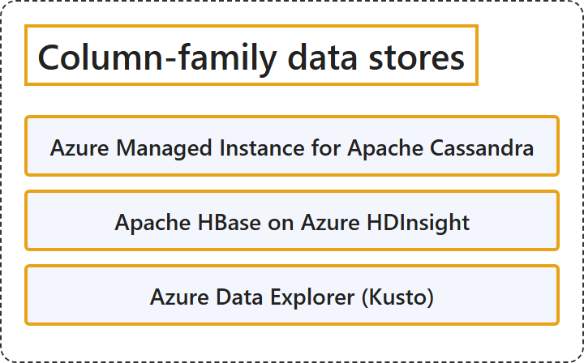

# 9.3 Column-Family Data Stores

## Classification

## Glossary

| Term | Definition | 中文翻译 | Source |
|---|---|---|---|
| **Azure Managed Instance for Apache Cassandra** Azure Managed Instance for Apache Cassandra | "Azure Managed Instance for Apache Cassandra is a **managed service** for **open-source Apache Cassandra clusters**." | Azure Managed Instance for Apache Cassandra 是一项**托管服务**，用于**开源 Apache Cassandra 群集**。 | [Microsoft, 2025, "Select an Azure service for column-family data stores" section, list item 1](https://learn.microsoft.com/en-us/azure/architecture/data-guide/technology-choices/understand-data-store-models#:~:text=is%20a%20managed%20service%20for%20open-source%20Apache%20Cassandra%20clusters) |
| **Apache HBase on Azure HDInsight** Azure HDInsight 上的 Apache HBase | "Apache HBase on Azure HDInsight is a **scalable NoSQL store for big data workloads** built on **Apache HBase and the Hadoop ecosystem**." | Azure HDInsight 上的 Apache HBase 是一种**面向大数据工作负载的可扩展 NoSQL 存储**，构建在 **Apache HBase 和 Hadoop 生态系统**之上。 | [Microsoft, 2025, "Select an Azure service for column-family data stores" section, list item 2](https://learn.microsoft.com/en-us/azure/architecture/data-guide/technology-choices/understand-data-store-models#:~:text=is%20a%20scalable%20NoSQL%20store%20for%20big%20data%20workloads) |
| **Azure Data Explorer (Kusto)** Azure 数据资源管理器（Kusto） | "Azure Data Explorer (Kusto) is an **analytics engine for telemetry, logs, and time-series data** that uses **Kusto Query Language (KQL)**." | Azure 数据资源管理器（Kusto）是一种**用于遥测、日志和时间序列数据的分析引擎**，使用 **Kusto 查询语言 (KQL)**。 | [Microsoft, 2025, "Select an Azure service for column-family data stores" section, list item 3](https://learn.microsoft.com/en-us/azure/architecture/data-guide/technology-choices/understand-data-store-models#:~:text=is%20an%20analytics%20engine%20for%20telemetry%2C%20logs%2C%20and%20time-series%20data) |

## References

- Microsoft. (2025, September 23). *Understand data models*. Azure Architecture Center. https://learn.microsoft.com/en-us/azure/architecture/data-guide/technology-choices/understand-data-store-models
