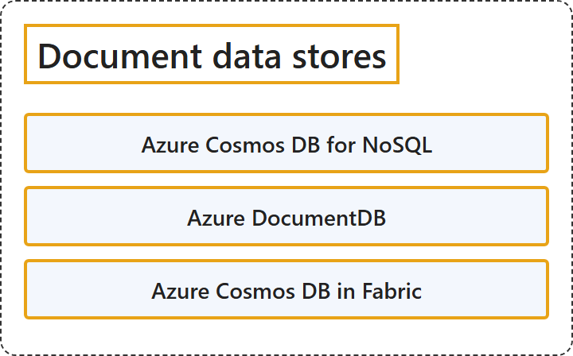

# 9.2 Document Data Stores

## Classification

## Glossary

| Term | Definition | 中文翻译 | Source |
|---|---|---|---|
| **Azure Cosmos DB for NoSQL** Azure Cosmos DB for NoSQL | "Azure Cosmos DB for NoSQL is a **schema-less, multi-region NoSQL database** that has **low-latency reads and writes**." | Azure Cosmos DB for NoSQL 是一种**无架构、多区域的 NoSQL 数据库**，具有**低延迟的读写**。 | [Microsoft, 2025, "Select an Azure service for document data stores" section, list item 1](https://learn.microsoft.com/en-us/azure/architecture/data-guide/technology-choices/understand-data-store-models#:~:text=is%20a%20schema-less%2C%20multi-region%20NoSQL%20database) |
| **Azure DocumentDB** Azure DocumentDB | "Azure DocumentDB is a **globally distributed database** that has **MongoDB wire protocol compatibility** and autoscaling." | Azure DocumentDB 是一种**全球分布式数据库**，具有 **MongoDB 线路协议兼容性**和自动缩放功能。 | [Microsoft, 2025, "Select an Azure service for document data stores" section, list item 2](https://learn.microsoft.com/en-us/azure/architecture/data-guide/technology-choices/understand-data-store-models#:~:text=is%20a%20globally%20distributed%20database%20that%20has%20MongoDB%20wire%20protocol%20compatibility) |
| **Azure Cosmos DB in Fabric** Fabric 中的 Azure Cosmos DB | "Azure Cosmos DB in Fabric is a **schema-less, NoSQL database** that has low-latency reads and writes, simplified management, and **built-in Fabric analytics**." | Fabric 中的 Azure Cosmos DB 是一种**无架构的 NoSQL 数据库**，具有低延迟读写、简化的管理和**内置的 Fabric 分析**。 | [Microsoft, 2025, "Select an Azure service for document data stores" section, list item 3](https://learn.microsoft.com/en-us/azure/architecture/data-guide/technology-choices/understand-data-store-models#:~:text=is%20a%20schema-less%2C%20NoSQL%20database%20that%20has%20low-latency%20reads%20and%20writes%2C%20simplified%20management) |

## References

- Microsoft. (2025, September 23). *Understand data models*. Azure Architecture Center. https://learn.microsoft.com/en-us/azure/architecture/data-guide/technology-choices/understand-data-store-models
