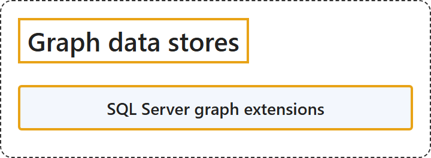

# 9.5 Graph Data Stores

## Classification

## Glossary

| Term | Definition | 中文翻译 | Source |
|---|---|---|---|
| **SQL Server graph extensions** SQL Server 图扩展 | "The graph extension **extends the capabilities of SQL Server, SQL Database, and SQL Managed Instance** to enable **modeling and querying complex relationships** by using **graph structures directly within a relational database**." | 图扩展**扩展了 SQL Server、SQL 数据库和 SQL 托管实例的功能**，使其能够**建模和查询复杂关系**，方法是**直接在关系数据库中使用图结构**。 | [Microsoft, 2025, "Select an Azure service for graph data stores" section, para. 1](https://learn.microsoft.com/en-us/azure/architecture/data-guide/technology-choices/understand-data-store-models#:~:text=The%20graph%20extension%20extends%20the%20capabilities%20of%20SQL%20Server) |

## References

- Microsoft. (2025, September 23). *Understand data models*. Azure Architecture Center. https://learn.microsoft.com/en-us/azure/architecture/data-guide/technology-choices/understand-data-store-models
