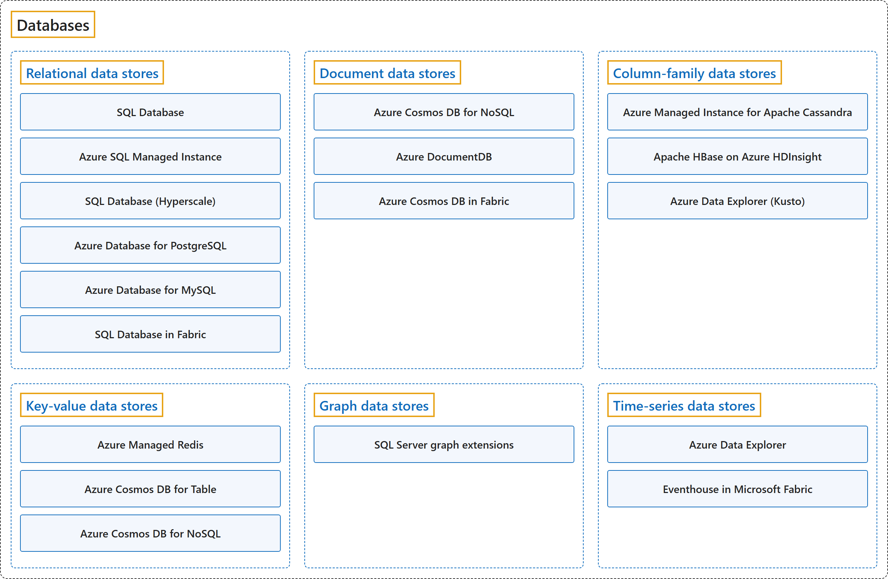

# 7. Databases

## Classification

## Glossary

| Term | Definition | 中文翻译 | Source |
|---|---|---|---|
| **Databases** 数据库 | "A **database** is a **structured system** for **storing, managing, and retrieving data**, enabling everything from simple recordkeeping to powering complex applications and services." | **数据库**是一种**结构化系统**，用于**存储、管理和检索数据**，用途从简单的记录保存到驱动复杂的应用程序和服务。 | [Microsoft, n.d., para. 1](https://azure.microsoft.com/en-us/resources/cloud-computing-dictionary/what-are-databases#:~:text=A%20database%20is%20a%20structured%20system) |
| **[Relational data stores](relational-data-stores.md)** 关系数据存储 | "**Relational database management systems** organize data into **normalized tables** by using **schema-on-write**." | **关系数据库管理系统**使用**写入时架构**，把数据组织成**规范化的表**。 | [Microsoft, 2025, "Relational data stores" section, para. 1](https://learn.microsoft.com/en-us/azure/architecture/data-guide/technology-choices/understand-data-store-models#:~:text=Relational%20database%20management%20systems%20organize%20data) |
| **[Document data stores](document-data-stores.md)** 文档数据存储 | "Use **document data stores** to store **semi-structured documents**, often in **JSON format**, where each document includes **named fields and data**." | 使用**文档数据存储**来存放**半结构化文档**，通常是 **JSON 格式**，每个文档都包含**命名字段和数据**。 | [Microsoft, 2025, "Document data stores" section, para. 1](https://learn.microsoft.com/en-us/azure/architecture/data-guide/technology-choices/understand-data-store-models#:~:text=Use%20document%20data%20stores%20to%20store) |
| **[Column-family data stores](column-family-data-stores.md)** 列族数据存储 | "A **column-family database**, also known as a **wide-column database**, stores **sparse data into rows** and organizes **dynamic columns into column families** to support co-access." | **列族数据库**也叫**宽列数据库**，它把**稀疏数据存成行**，并把**动态列组织成列族**，以便一起访问。 | [Microsoft, 2025, "Column-family data stores" section, para. 1](https://learn.microsoft.com/en-us/azure/architecture/data-guide/technology-choices/understand-data-store-models#:~:text=A%20column-family%20database%2C%20also%20known%20as) |
| **[Key-value data stores](key-value-data-stores.md)** 键值数据存储 | "A **key-value data store** associates **each data value** with a **unique key**." | **键值数据存储**把**每个数据值**和一个**唯一的键**关联起来。 | [Microsoft, 2025, "Key-value data stores" section, para. 1](https://learn.microsoft.com/en-us/azure/architecture/data-guide/technology-choices/understand-data-store-models#:~:text=A%20key-value%20data%20store%20associates%20each) |
| **[Graph data stores](graph-data-stores.md)** 图数据存储 | "A **graph database** stores information as **nodes and edges**." | **图数据库**把信息存成**节点和边**。 | [Microsoft, 2025, "Graph data stores" section, para. 1](https://learn.microsoft.com/en-us/azure/architecture/data-guide/technology-choices/understand-data-store-models#:~:text=A%20graph%20database%20stores%20information) |
| **[Time-series data stores](time-series-data-stores.md)** 时间序列数据存储 | "**Time-series data stores** manage a **set of values** organized **by time**." | **时间序列数据存储**管理一组**按时间**组织的**值**。 | [Microsoft, 2025, "Time-series data stores" section, para. 1](https://learn.microsoft.com/en-us/azure/architecture/data-guide/technology-choices/understand-data-store-models#:~:text=Time-series%20data%20stores%20manage%20a%20set) |

## Coverage

| Certification | Skill area |
|---|---|
| DP-900 Microsoft Azure Data Fundamentals | [Identify considerations for relational data on Azure (20–25%)](https://learn.microsoft.com/en-us/credentials/certifications/resources/study-guides/dp-900#identify-considerations-for-relational-data-on-azure-2025) [Describe considerations for working with non-relational data on Azure (15–20%)](https://learn.microsoft.com/en-us/credentials/certifications/resources/study-guides/dp-900#describe-considerations-for-working-with-non-relational-data-on-azure-1520) |

## References

- Microsoft. (n.d.). *What is a database?* Microsoft Azure. Retrieved October 24, 2026, from https://azure.microsoft.com/en-us/resources/cloud-computing-dictionary/what-are-databases
- Microsoft. (2025). *Understand data models*. Azure Architecture Center. https://learn.microsoft.com/en-us/azure/architecture/data-guide/technology-choices/understand-data-store-models
- Microsoft. (2026a). *Study guide for Exam DP-900: Microsoft Azure Data Fundamentals*. Microsoft Learn. https://learn.microsoft.com/en-us/credentials/certifications/resources/study-guides/dp-900
- Microsoft. (2026b). *Unified AI database: Azure Cosmos DB*. Microsoft Learn. https://learn.microsoft.com/en-us/azure/cosmos-db/overview
