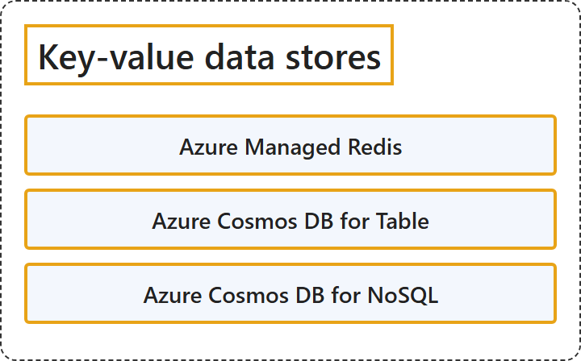

# 9.4 Key-Value Data Stores

## Classification

## Glossary

| Term | Definition | 中文翻译 | Source |
|---|---|---|---|
| **Azure Managed Redis** Azure 托管 Redis | "Azure Managed Redis is a **managed in-memory data store** based on the latest Redis Enterprise version that provides **low latency and high throughput**." | Azure 托管 Redis 是一种**托管的内存数据存储**，基于最新的 Redis Enterprise 版本，提供**低延迟和高吞吐量**。 | [Microsoft, 2025, "Select an Azure service for key-value data stores" section, list item 1](https://learn.microsoft.com/en-us/azure/architecture/data-guide/technology-choices/understand-data-store-models#:~:text=is%20a%20managed%20in-memory%20data%20store) |
| **Azure Cosmos DB for Table** Azure Cosmos DB for Table | "Azure Cosmos DB for Table is a **key-value store** optimized for **fast access to structured NoSQL data**." | Azure Cosmos DB for Table 是一种**键值存储**，针对**快速访问结构化 NoSQL 数据**进行了优化。 | [Microsoft, 2025, "Select an Azure service for key-value data stores" section, list item 2](https://learn.microsoft.com/en-us/azure/architecture/data-guide/technology-choices/understand-data-store-models#:~:text=is%20a%20key-value%20store%20optimized%20for%20fast%20access) |
| **Azure Cosmos DB for NoSQL** Azure Cosmos DB for NoSQL | "Azure Cosmos DB for NoSQL is a **document data store** that's optimized for **fast access to structured NoSQL data** and provides **horizontal scalability**." | Azure Cosmos DB for NoSQL 是一种**文档数据存储**，针对**快速访问结构化 NoSQL 数据**进行了优化，并提供**水平可伸缩性**。 | [Microsoft, 2025, "Select an Azure service for key-value data stores" section, list item 3](https://learn.microsoft.com/en-us/azure/architecture/data-guide/technology-choices/understand-data-store-models#:~:text=is%20a%20document%20data%20store%20that) |

## References

- Microsoft. (2025, September 23). *Understand data models*. Azure Architecture Center. https://learn.microsoft.com/en-us/azure/architecture/data-guide/technology-choices/understand-data-store-models
