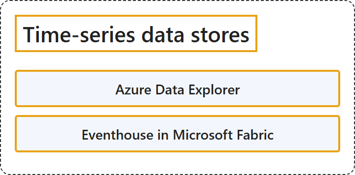

# 9.6 Time-series data stores

## Classification

## Glossary

| Term | Definition | 中文翻译 | Source |
|---|---|---|---|
| **Azure Data Explorer** Azure 数据资源管理器 | "Azure Data Explorer is a **managed big data storage platform**. Use it to **query and visualize high volumes of data in near real time**." | Azure 数据资源管理器是一个**托管的大数据存储平台**。用它来**近实时地查询和可视化大量数据**。 | [Microsoft, 2025, "Select an Azure service for time-series data stores" section, list item 1](https://learn.microsoft.com/en-us/azure/architecture/data-guide/technology-choices/understand-data-store-models#:~:text=is%20a%20managed%20big%20data%20storage%20platform) |
| **Eventhouse in Microsoft Fabric** Microsoft Fabric 中的 Eventhouse | "Eventhouse in Microsoft Fabric is part of the **Real-Time Intelligence experience in Fabric**. It uses **KQL databases to handle streaming data**." | Microsoft Fabric 中的 Eventhouse 是 **Fabric 中实时智能体验**的一部分。它使用 **KQL 数据库处理流数据**。 | [Microsoft, 2025, "Select an Azure service for time-series data stores" section, list item 2](https://learn.microsoft.com/en-us/azure/architecture/data-guide/technology-choices/understand-data-store-models#:~:text=is%20part%20of%20the%20Real-Time%20Intelligence%20experience%20in%20Fabric) |

## References

- Microsoft. (2025, September 23). *Understand data models*. Azure Architecture Center. https://learn.microsoft.com/en-us/azure/architecture/data-guide/technology-choices/understand-data-store-models
