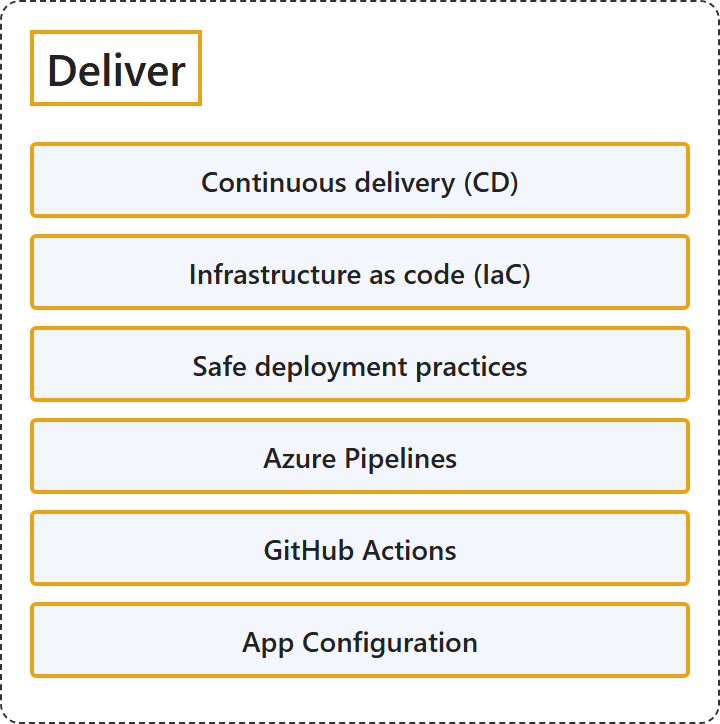

# 23.3 Deliver

## Classification

## Glossary

| Term | Definition | 中文翻译 | Source |
|---|---|---|---|
| **Continuous delivery (CD)** 持续交付 (CD) | "Continuous Delivery (CD) is a process by which code is **built, tested, and deployed** to **one or more test and production environments**." | 持续交付 (CD) 是一个过程，通过它把代码**构建、测试并部署**到**一个或多个测试和生产环境**。 | [Microsoft, 2023, "Continuous integration and continuous delivery (CI/CD)" section, para. 2](https://learn.microsoft.com/en-us/devops/what-is-devops#:~:text=is%20a%20process%20by%20which%20code%20is%20built%2C%20tested%2C%20and%20deployed) |
| **Infrastructure as code (IaC)** 基础结构即代码 (IaC) | "Infrastructure as code defines **system resources and topologies** in a **descriptive manner** that allows teams to **manage those resources as they would code**." | 基础结构即代码定义**系统资源和拓扑**，方式是**描述性的**，让团队能够**像管理代码一样管理这些资源**。 | [Microsoft, 2023, "Infrastructure as code" section, para. 1](https://learn.microsoft.com/en-us/devops/what-is-devops#:~:text=Infrastructure%20as%20code%20defines%20system%20resources%20and%20topologies) |
| **Safe deployment practices** 安全部署做法 | (context) "DevOps teams are encouraged to adopt a **progressive exposure** strategy that **balances the exposure of a given release with its proven performance**." | （语境）鼓励 DevOps 团队采用**渐进式公开**策略，**在某个发布的公开范围与其已验证的性能之间取得平衡**。 | [Microsoft, 2022, para. 1](https://learn.microsoft.com/en-us/devops/operate/safe-deployment-practices#:~:text=DevOps%20teams%20are%20encouraged%20to%20adopt%20a) |
| **Azure Pipelines** Azure Pipelines | "Azure Pipelines is the part of Azure DevOps that combines **continuous integration, continuous testing, and continuous delivery** to **automatically build, test, and deploy code projects** to any destination." | Azure Pipelines 是 Azure DevOps 的一部分，它结合**持续集成、持续测试和持续交付**，**自动构建、测试和部署代码项目**到任何目标。 | [Microsoft, 2026, para. 1](https://learn.microsoft.com/en-us/azure/devops/pipelines/get-started/what-is-azure-pipelines?view=azure-devops#:~:text=is%20the%20part%20of%20Azure%20DevOps%20that%20combines) |
| **GitHub Actions** GitHub Actions | "GitHub Actions is a **continuous integration and continuous delivery (CI/CD) platform** that allows you to **automate your build, test, and deployment pipeline**." | GitHub Actions 是一个**持续集成和持续交付 (CI/CD) 平台**，让你可以**自动化构建、测试和部署管道**。 | [GitHub, n.d., "Overview" section, para. 1](https://docs.github.com/en/actions/get-started/understand-github-actions#:~:text=GitHub%20Actions%20is%20a%20continuous%20integration%20and%20continuous%20delivery) |
| **App Configuration** 应用程序配置 | "Azure App Configuration provides a service to **centrally manage application settings and feature flags**." | Azure 应用程序配置提供一项服务，用于**集中管理应用程序设置和功能标志**。 | [Microsoft, 2025, para. 1](https://learn.microsoft.com/en-us/azure/azure-app-configuration/overview#:~:text=provides%20a%20service%20to%20centrally%20manage%20application%20settings) |

## References

- GitHub. (n.d.). *Understanding GitHub Actions*. GitHub Docs. Retrieved October 27, 2026, from https://docs.github.com/en/actions/get-started/understand-github-actions
- Microsoft. (2022, November 28). *Safe deployment practices*. Microsoft Learn. https://learn.microsoft.com/en-us/devops/operate/safe-deployment-practices
- Microsoft. (2023, January 24). *What is DevOps?* Microsoft Learn. https://learn.microsoft.com/en-us/devops/what-is-devops
- Microsoft. (2025, November 21). *What is Azure App Configuration?* Microsoft Learn. https://learn.microsoft.com/en-us/azure/azure-app-configuration/overview
- Microsoft. (2026, June 22). *What is Azure Pipelines?* Microsoft Learn. https://learn.microsoft.com/en-us/azure/devops/pipelines/get-started/what-is-azure-pipelines?view=azure-devops
