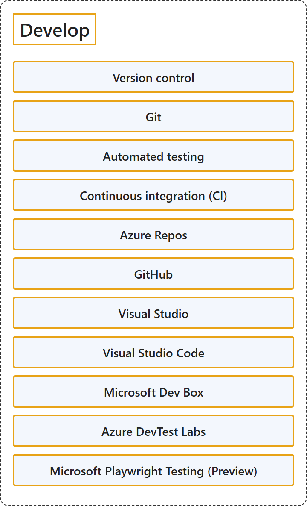

# 23.2 Develop

## Classification

## Glossary

| Term | Definition | 中文翻译 | Source |
|---|---|---|---|
| **Version control** 版本控制 | "Version control is the practice of **managing code in versions**—tracking revisions and change history to make code **easy to review and recover**." | 版本控制是**按版本管理代码**的做法，即跟踪修订和变更历史，使代码**易于审查和恢复**。 | [Microsoft, 2023, "Version Control" section, para. 1](https://learn.microsoft.com/en-us/devops/what-is-devops#:~:text=Version%20control%20is%20the%20practice%20of%20managing%20code%20in%20versions) |
| **Git** Git | "Git is a **distributed version control system**, which means that a **local clone of the project is a complete version control repository**." | Git 是一种**分布式版本控制系统**，这意味着**项目的本地克隆就是一个完整的版本控制存储库**。 | [Microsoft, 2022, para. 2](https://learn.microsoft.com/en-us/devops/develop/git/what-is-git#:~:text=is%20a%20distributed%20version%20control%20system) |
| **Automated testing** 自动化测试 | (context) "**Automated tests** execute as **part of the CI process** to **ensure quality**." | （语境）**自动化测试**作为 **CI 过程的一部分**执行，以**确保质量**。 | [Microsoft, 2023, "Continuous integration and continuous delivery (CI/CD)" section, para. 1](https://learn.microsoft.com/en-us/devops/what-is-devops#:~:text=Automated%20tests%20execute%20as%20part%20of%20the%20CI%20process) |
| **Continuous integration (CI)** 持续集成 (CI) | "Continuous Integration (CI) is the practice used by development teams to **automate, merge, and test code**." | 持续集成 (CI) 是开发团队用来**自动化、合并和测试代码**的做法。 | [Microsoft, 2023, "Continuous integration and continuous delivery (CI/CD)" section, para. 1](https://learn.microsoft.com/en-us/devops/what-is-devops#:~:text=is%20the%20practice%20used%20by%20development%20teams%20to%20automate%2C%20merge%2C%20and%20test%20code) |
| **Azure Repos** Azure Repos | "Azure Repos is a **set of version control tools** that you can use to **manage your code**." | Azure Repos 是一套**版本控制工具**，可用来**管理你的代码**。 | [Microsoft, 2026a, para. 1](https://learn.microsoft.com/en-us/azure/devops/repos/get-started/what-is-repos?view=azure-devops#:~:text=is%20a%20set%20of%20version%20control%20tools) |
| **GitHub** GitHub | "GitHub is a **platform** that supports your **entire software development process**, from **planning work to deploying and operating software**." | GitHub 是一个**平台**，支持你的**整个软件开发过程**，**从规划工作到部署和运营软件**。 | [GitHub, n.d., para. 1](https://docs.github.com/en/get-started/start-your-journey/about-github-and-git#:~:text=is%20a%20platform%20that%20supports%20your%20entire%20software%20development%20process) |
| **Visual Studio** Visual Studio | "Visual Studio is a powerful **integrated development environment (IDE)** for Windows where you can **develop, build, debug, test, and deploy your apps**, all in one place." | Visual Studio 是一个功能强大的 Windows **集成开发环境（IDE）**，你可以在同一个地方**开发、构建、调试、测试和部署你的应用**。 | [Microsoft, 2026d, para. 1](https://learn.microsoft.com/en-us/visualstudio/get-started/visual-studio-ide?view=visualstudio#:~:text=is%20a%20powerful%20integrated%20development%20environment) |
| **Visual Studio Code** Visual Studio Code | "Visual Studio Code combines the **simplicity of a source code editor** with **powerful developer tooling**, like IntelliSense code completion and debugging." | Visual Studio Code 把**源代码编辑器的简洁**和**强大的开发者工具**结合在一起，例如 IntelliSense 代码补全和调试。 | [Microsoft, n.d., para. 1](https://code.visualstudio.com/docs/editor/whyvscode#:~:text=combines%20the%20simplicity%20of%20a%20source%20code%20editor) |
| **Microsoft Dev Box** Microsoft 开发箱 | "Microsoft Dev Box gives developers **self-service access** to **ready-to-code cloud workstations** called dev boxes." | Microsoft Dev Box 为开发人员提供**自助访问**，可以使用称为 dev box 的**随时可编码的云工作站**。 | [Microsoft, 2026b, para. 1](https://learn.microsoft.com/en-us/azure/dev-box/overview-what-is-microsoft-dev-box#:~:text=gives%20developers%20self-service%20access%20to%20ready-to-code) |
| **Azure DevTest Labs** Azure 开发测试实验室 | "Azure DevTest Labs is a service that enables developers and testers to **quickly create and manage Azure virtual machines** **for development and testing**." | Azure 开发测试实验室是一项服务，让开发人员和测试人员可以**快速创建和管理 Azure 虚拟机**，**用于开发和测试**。 | [Microsoft, 2025, para. 1](https://learn.microsoft.com/en-us/azure/devtest-labs/devtest-lab-overview#:~:text=enables%20developers%20and%20testers%20to%20quickly%20create%20and%20manage) |
| **Microsoft Playwright Testing (Preview)** Microsoft Playwright Testing（预览版） | "Playwright Workspaces is a **fully managed cloud browser platform** for **testing applications**, automating browser workflows, and powering AI agents through browser interactions." | Playwright Workspaces 是一个**完全托管的云浏览器平台**，用于**测试应用程序**、自动化浏览器工作流，以及通过浏览器交互为 AI 智能体提供支持。 | [Microsoft, 2026c, para. 1](https://learn.microsoft.com/en-us/azure/app-testing/playwright-workspaces/overview-what-is-microsoft-playwright-workspaces#:~:text=is%20a%20fully%20managed%20cloud%20browser%20platform) |

## References

- GitHub. (n.d.). *What is GitHub?* GitHub Docs. Retrieved October 27, 2026, from https://docs.github.com/en/get-started/start-your-journey/about-github-and-git
- Microsoft. (n.d.). *Why did we build Visual Studio Code?* Visual Studio Code. Retrieved October 27, 2026, from https://code.visualstudio.com/docs/editor/whyvscode
- Microsoft. (2022, November 28). *What is Git?* Microsoft Learn. https://learn.microsoft.com/en-us/devops/develop/git/what-is-git
- Microsoft. (2023, January 24). *What is DevOps?* Microsoft Learn. https://learn.microsoft.com/en-us/devops/what-is-devops
- Microsoft. (2025, May 30). *What is Azure DevTest Labs?* Microsoft Learn. https://learn.microsoft.com/en-us/azure/devtest-labs/devtest-lab-overview
- Microsoft. (2026a, February 16). *What is Azure Repos?* Microsoft Learn. https://learn.microsoft.com/en-us/azure/devops/repos/get-started/what-is-repos?view=azure-devops
- Microsoft. (2026b, March 21). *What is Microsoft Dev Box?* Microsoft Learn. https://learn.microsoft.com/en-us/azure/dev-box/overview-what-is-microsoft-dev-box
- Microsoft. (2026c, September 15). *What is Playwright Workspaces?* Microsoft Learn. https://learn.microsoft.com/en-us/azure/app-testing/playwright-workspaces/overview-what-is-microsoft-playwright-workspaces
- Microsoft. (2026d, March 20). *What is Visual Studio?* Microsoft Learn. https://learn.microsoft.com/en-us/visualstudio/get-started/visual-studio-ide?view=visualstudio
