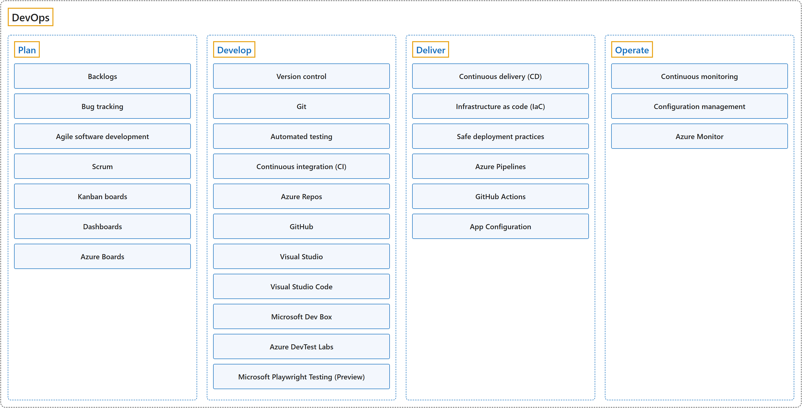

# 15. DevOps

## Classification

## Glossary

| Term | Definition | 中文翻译 | Source |
|---|---|---|---|
| **DevOps** DevOps | "**DevOps** combines **development (Dev) and operations (Ops)** to **unite people, process, and technology** in application planning, development, delivery, and operations." | **DevOps** 把**开发（Dev）和运维（Ops）**结合起来，在应用的规划、开发、交付和运维中**把人员、流程和技术统一起来**。 | [Microsoft, 2023, para. 1](https://learn.microsoft.com/en-us/devops/what-is-devops#:~:text=DevOps%20combines%20development%20(Dev)%20and%20operations) |
| **[Plan](plan.md)** 规划 | "In the **planning phase**, DevOps teams **ideate, define, and describe the features and capabilities** of the applications and systems they plan to build." | 在**规划阶段**，DevOps 团队**构思、定义并描述**他们打算构建的应用和系统的**功能和能力**。 | [Microsoft, 2023, "Planning" section, para. 1](https://learn.microsoft.com/en-us/devops/what-is-devops#:~:text=In%20the%20planning%20phase%2C%20DevOps%20teams%20ideate) |
| **[Develop](develop.md)** 开发 | "The **development phase** includes **all aspects of developing software code**." | **开发阶段**包括**开发软件代码的所有方面**。 | [Microsoft, 2023, "Development" section, para. 1](https://learn.microsoft.com/en-us/devops/what-is-devops#:~:text=The%20development%20phase%20includes%20all%20aspects) |
| **[Deliver](deliver.md)** 交付 | "**Delivery** is the process of **consistently and reliably deploying applications into production environments**, ideally via **continuous delivery (CD)**." | **交付**是**持续、可靠地把应用部署到生产环境**的过程，理想情况下通过**持续交付（CD）**完成。 | [Microsoft, 2023, "Deliver" section, para. 1](https://learn.microsoft.com/en-us/devops/what-is-devops#:~:text=Delivery%20is%20the%20process%20of%20consistently) |
| **[Operate](operate.md)** 运维 | "The **operations phase** involves **maintaining, monitoring, and troubleshooting applications in production environments**, including hybrid or public clouds like Azure." | **运维阶段**包括在生产环境（包括混合云或 Azure 这样的公有云）中**维护、监视应用并排除故障**。 | [Microsoft, 2023, "Operations" section, para. 1](https://learn.microsoft.com/en-us/devops/what-is-devops#:~:text=The%20operations%20phase%20involves%20maintaining) |

## Coverage

| Certification | Skill area |
|---|---|
| AZ-400 Designing and Implementing Microsoft DevOps Solutions | [Design and implement a source control strategy (10–15%)](https://learn.microsoft.com/en-us/credentials/certifications/resources/study-guides/az-400#design-and-implement-a-source-control-strategy-1015) [Design and implement build and release pipelines (50–55%)](https://learn.microsoft.com/en-us/credentials/certifications/resources/study-guides/az-400#design-and-implement-build-and-release-pipelines-5055) |

## References

- Microsoft. (2023). *What is DevOps?* Microsoft Learn. https://learn.microsoft.com/en-us/devops/what-is-devops
- Microsoft. (2026a). *Study guide for Exam AZ-400: Designing and implementing Microsoft DevOps solutions*. Microsoft Learn. https://learn.microsoft.com/en-us/credentials/certifications/resources/study-guides/az-400
- Microsoft. (2026b). *What is Azure DevOps?* Microsoft Learn. https://learn.microsoft.com/en-us/azure/devops/user-guide/what-is-azure-devops
