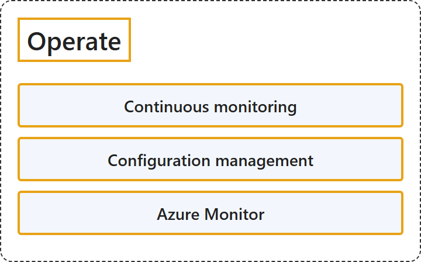

# 23.4 Operate

## Classification

## Glossary

| Term | Definition | 中文翻译 | Source |
|---|---|---|---|
| **Continuous monitoring** 持续监视 | "Continuous monitoring means having **full, real-time visibility** into the **performance and health of the entire application stack**." | 持续监视意味着拥有**完整的实时可见性**，看清**整个应用程序堆栈的性能和运行状况**。 | [Microsoft, 2023, "Continuous monitoring" section, para. 1](https://learn.microsoft.com/en-us/devops/what-is-devops#:~:text=Continuous%20monitoring%20means%20having%20full%2C%20real-time%20visibility) |
| **Configuration management** 配置管理 | "Configuration management refers to **managing the state of resources in a system** including **servers, virtual machines, and databases**." | 配置管理是指**管理系统中资源的状态**，包括**服务器、虚拟机和数据库**。 | [Microsoft, 2023, "Configuration management" section, para. 1](https://learn.microsoft.com/en-us/devops/what-is-devops#:~:text=Configuration%20management%20refers%20to%20managing%20the%20state%20of%20resources) |
| **Azure Monitor** Azure Monitor | "Azure Monitor is Microsoft's **unified observability service** for **collecting, analyzing, and acting on telemetry** from cloud and hybrid environments." | Azure Monitor 是 Microsoft 的**统一可观测性服务**，用于**收集、分析遥测数据并据此采取行动**，数据来自云和混合环境。 | [Microsoft, 2026, para. 1](https://learn.microsoft.com/en-us/azure/azure-monitor/fundamentals/overview#:~:text=unified%20observability%20service) |

## References

- Microsoft. (2023, January 24). *What is DevOps?* Microsoft Learn. https://learn.microsoft.com/en-us/devops/what-is-devops
- Microsoft. (2026, June 23). *Azure Monitor overview*. Microsoft Learn. https://learn.microsoft.com/en-us/azure/azure-monitor/fundamentals/overview
