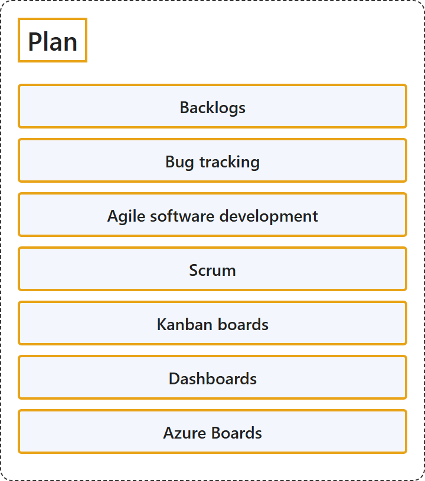

# 23.1 Plan

## Classification

## Glossary

| Term | Definition | 中文翻译 | Source |
|---|---|---|---|
| **Backlogs** 待办事项 | "A backlog is the **prioritized list of work** that **drives every sprint**." | 待办事项是**按优先级排列的工作列表**，它**驱动每一个冲刺**。 | [Microsoft, 2026c, para. 1](https://learn.microsoft.com/en-us/azure/devops/boards/backlogs/backlogs-overview?view=azure-devops#:~:text=is%20the%20prioritized%20list%20of%20work) |
| **Bug tracking** Bug 跟踪 | "Azure Boards provides a **Bug work item type** to **capture, prioritize, assign, and track code defects** in ways that align with your Agile practices." | Azure Boards 提供 **Bug 工作项类型**，用来以符合敏捷做法的方式**捕获、确定优先级、分配和跟踪代码缺陷**。 | [Microsoft, 2026b, para. 1](https://learn.microsoft.com/en-us/azure/devops/boards/backlogs/manage-bugs?view=azure-devops#:~:text=work%20item%20type%20to%20capture%2C%20prioritize%2C%20assign%2C%20and%20track%20code%20defects) |
| **Agile software development** 敏捷软件开发 | "Agile is a **software development approach** that emphasizes **team collaboration, customer and user feedback, and high adaptability to change** through **short release cycles**." | 敏捷是一种**软件开发方法**，它强调**团队协作、客户和用户反馈以及对变化的高度适应**，手段是**短发布周期**。 | [Microsoft, 2023, "Agile software development" section, para. 1](https://learn.microsoft.com/en-us/devops/what-is-devops#:~:text=Agile%20is%20a%20software%20development%20approach) |
| **Scrum** Scrum | "Scrum is a **framework** used by teams to **manage work and solve problems collaboratively in short cycles**." | Scrum 是团队使用的一种**框架**，用于**在短周期内协作管理工作和解决问题**。 | [Microsoft, 2022b, para. 1](https://learn.microsoft.com/en-us/devops/plan/what-is-scrum#:~:text=is%20a%20framework%20used%20by%20teams%20to%20manage%20work) |
| **Kanban boards** 看板 | "Visualization of work is a key principle that Kanban addresses primarily through **Kanban boards**. These boards use **cards organized by progress** to **communicate overall status**." | 工作可视化是 Kanban 主要通过**看板**来实现的关键原则。这些看板使用**按进度组织的卡片**来**传达整体状态**。 | [Microsoft, 2022a, "Visualize work" section, para. 1](https://learn.microsoft.com/en-us/devops/plan/what-is-kanban#:~:text=Visualization%20of%20work%20is%20a%20key%20principle) |
| **Dashboards** 仪表板 | (context) "**Customizable, highly configurable dashboards** provide you and your teams with the flexibility to **share information, monitor progress and trends, and improve your workflow processes**." | （语境）**可自定义、高度可配置的仪表板**让你和团队能够灵活地**共享信息、监视进度和趋势，并改进工作流程**。 | [Microsoft, 2026a, para. 1](https://learn.microsoft.com/en-us/azure/devops/report/dashboards/overview?view=azure-devops#:~:text=highly%20configurable%20dashboards%20provide%20you) |
| **Azure Boards** Azure Boards | "Azure Boards is a **web-based service** that teams use to **plan, track, and discuss work** throughout the development lifecycle." | Azure Boards 是一种**基于 Web 的服务**，团队用它在整个开发生命周期中**计划、跟踪和讨论工作**。 | [Microsoft, 2025, para. 1](https://learn.microsoft.com/en-us/azure/devops/boards/get-started/what-is-azure-boards?view=azure-devops#:~:text=is%20a%20web-based%20service%20that%20teams%20use%20to%20plan) |

## References

- Microsoft. (2022a, November 28). *What is Kanban?* Microsoft Learn. https://learn.microsoft.com/en-us/devops/plan/what-is-kanban
- Microsoft. (2022b, November 28). *What is Scrum?* Microsoft Learn. https://learn.microsoft.com/en-us/devops/plan/what-is-scrum
- Microsoft. (2023, January 24). *What is DevOps?* Microsoft Learn. https://learn.microsoft.com/en-us/devops/what-is-devops
- Microsoft. (2025, September 29). *What is Azure Boards?* Microsoft Learn. https://learn.microsoft.com/en-us/azure/devops/boards/get-started/what-is-azure-boards?view=azure-devops
- Microsoft. (2026a, February 17). *About dashboards, charts, reports, and widgets*. Microsoft Learn. https://learn.microsoft.com/en-us/azure/devops/report/dashboards/overview?view=azure-devops
- Microsoft. (2026b, April 3). *Define, capture, triage, and manage bugs in Azure Boards*. Microsoft Learn. https://learn.microsoft.com/en-us/azure/devops/boards/backlogs/manage-bugs?view=azure-devops
- Microsoft. (2026c, June 3). *Use backlogs to manage projects*. Microsoft Learn. https://learn.microsoft.com/en-us/azure/devops/boards/backlogs/backlogs-overview?view=azure-devops
