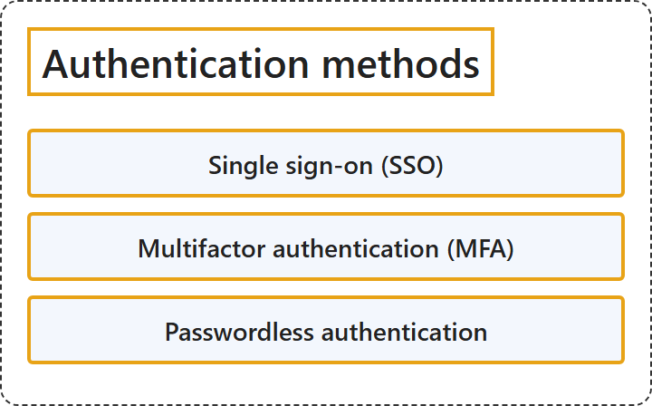

# 17.2 Authentication Methods

## Classification

## Glossary

| Term | Definition | 中文翻译 | Source |
|---|---|---|---|
| **Single sign-on (SSO)** 单一登录 (SSO) | "Single sign-on (SSO) lets users **sign in once** and **reach many applications**." | 单一登录 (SSO) 让用户**登录一次**，就能**访问许多应用程序**。 | [Microsoft, 2026b, para. 1](https://learn.microsoft.com/en-us/entra/identity/enterprise-apps/what-is-single-sign-on#:~:text=lets%20users%20sign%20in%20once%20and%20reach%20many%20applications) |
| **Multifactor authentication (MFA)** 多重身份验证 (MFA) | "Multifactor authentication is a process in which users are prompted during the sign-in process for an **additional form of identification**, such as **a code on their cellphone or a fingerprint scan**." | 多重身份验证是一种过程，在登录过程中提示用户提供**额外的身份证明**，例如**手机上的代码或指纹扫描**。 | [Microsoft, 2025, para. 1](https://learn.microsoft.com/en-us/entra/identity/authentication/concept-mfa-howitworks#:~:text=is%20a%20process%20in%20which%20users%20are%20prompted%20during%20the%20sign-in%20process) |
| **Passwordless authentication** 无密码身份验证 | (context) "Passkeys help **prevent remote phishing** by **replacing phishable methods like passwords, SMS, and email codes**." | （语境）通行密钥帮助**防止远程网络钓鱼**，方法是**替换密码、短信和电子邮件验证码等可被钓鱼的方式**。 | [Microsoft, 2026a, para. 2](https://learn.microsoft.com/en-us/entra/identity/authentication/concept-authentication-passwordless#:~:text=Passkeys%20help%20prevent%20remote%20phishing) |

## References

- Microsoft. (2025, July 15). *How it works: Microsoft Entra multifactor authentication*. Microsoft Learn. https://learn.microsoft.com/en-us/entra/identity/authentication/concept-mfa-howitworks
- Microsoft. (2026a, April 6). *Authentication methods in Microsoft Entra ID - passkeys (FIDO2)*. Microsoft Learn. https://learn.microsoft.com/en-us/entra/identity/authentication/concept-authentication-passwordless
- Microsoft. (2026b, June 23). *What is single sign-on in Microsoft Entra ID?* Microsoft Learn. https://learn.microsoft.com/en-us/entra/identity/enterprise-apps/what-is-single-sign-on
