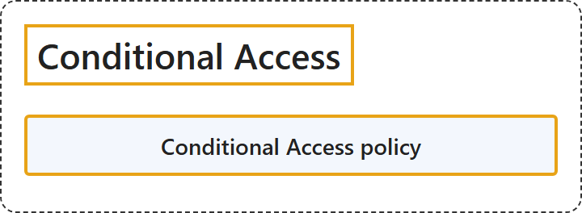

# 17.4 Conditional Access

## Classification

## Glossary

| Term | Definition | 中文翻译 | Source |
|---|---|---|---|
| **Conditional Access policy** 条件访问策略 | "Conditional Access policies at their simplest are **if-then statements**: if a user wants to access a resource, then they **must complete an action**." | 条件访问策略最简单的形式就是**if-then 语句**：如果用户想访问某个资源，那么他们**必须完成某个操作**。 | [Microsoft, 2026, "Overview" section, para. 2](https://learn.microsoft.com/en-us/entra/identity/conditional-access/overview#:~:text=Conditional%20Access%20policies%20at%20their%20simplest%20are%20if-then%20statements) |

## References

- Microsoft. (2026, April 27). *What is Conditional Access?* Microsoft Learn. https://learn.microsoft.com/en-us/entra/identity/conditional-access/overview
