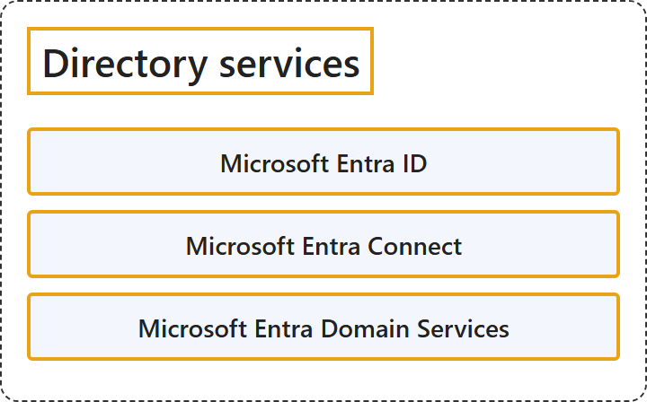

# 17.1 Directory Services

## Classification

## Glossary

| Term | Definition | 中文翻译 | Source |
|---|---|---|---|
| **Microsoft Entra ID** Microsoft Entra ID | "Microsoft Entra ID is the **foundational product of Microsoft Entra**. It's a **cloud-based identity and access management service** that provides **authentication, policy enforcement, and protection** for users, devices, apps, and resources." | Microsoft Entra ID 是 **Microsoft Entra 的基础产品**。它是一种**基于云的身份和访问管理服务**，为用户、设备、应用和资源提供**身份验证、策略实施和保护**。 | [Microsoft, 2026c, "Microsoft Entra ID" section, para. 1](https://learn.microsoft.com/en-us/entra/fundamentals/what-is-entra#:~:text=is%20the%20foundational%20product%20of%20Microsoft%20Entra) |
| **Microsoft Entra Connect** Microsoft Entra Connect | "Microsoft Entra Connect is an **on-premises Microsoft application** designed to **meet and accomplish your hybrid identity goals**." | Microsoft Entra Connect 是一个**本地 Microsoft 应用程序**，旨在**满足并实现你的混合身份目标**。 | [Microsoft, 2026a, para. 1](https://learn.microsoft.com/en-us/entra/identity/hybrid/connect/whatis-azure-ad-connect#:~:text=is%20an%20on-premises%20Microsoft%20application%20designed%20to%20meet) |
| **Microsoft Entra Domain Services** Microsoft Entra 域服务 | "Microsoft Entra Domain Services provides **managed domain services** such as domain join, group policy, lightweight directory access protocol (LDAP), and Kerberos/NTLM authentication. You use these domain services **without the need to deploy, manage, and patch domain controllers (DCs)** in the cloud." | Microsoft Entra 域服务提供**托管域服务**，例如域加入、组策略、轻量级目录访问协议 (LDAP) 和 Kerberos/NTLM 身份验证。使用这些域服务，**无需在云中部署、管理和修补域控制器 (DC)**。 | [Microsoft, 2026b, para. 1](https://learn.microsoft.com/en-us/entra/identity/domain-services/overview#:~:text=provides%20managed%20domain%20services%20such%20as%20domain%20join) |

## References

- Microsoft. (2026a, September 16). *What is Microsoft Entra Connect?* Microsoft Learn. https://learn.microsoft.com/en-us/entra/identity/hybrid/connect/whatis-azure-ad-connect
- Microsoft. (2026b, March 3). *What is Microsoft Entra Domain Services?* Microsoft Learn. https://learn.microsoft.com/en-us/entra/identity/domain-services/overview
- Microsoft. (2026c, June 18). *What is Microsoft Entra?* Microsoft Learn. https://learn.microsoft.com/en-us/entra/fundamentals/what-is-entra
