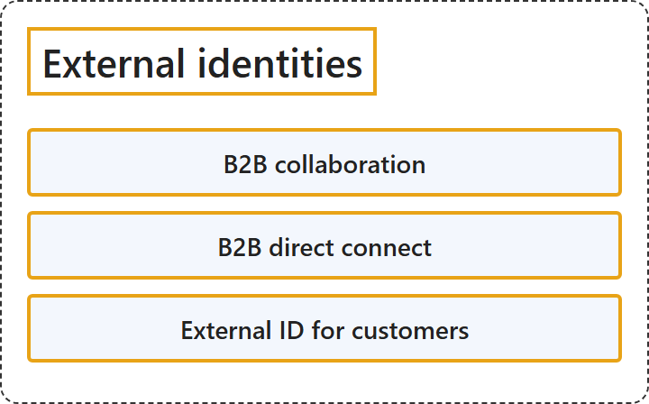

# 17.3 External identities

## Classification

## Glossary

| Term | Definition | 中文翻译 | Source |
|---|---|---|---|
| **B2B collaboration** B2B 协作 | "In your workforce tenant, you can use **B2B collaboration** to **share your company's applications and services with guests**, while **maintaining control over your own corporate data**." | 在员工租户中，你可以使用 **B2B 协作**，**与来宾共享公司的应用程序和服务**，同时**保持对自己公司数据的控制**。 | [Microsoft, 2026c, para. 1](https://learn.microsoft.com/en-us/entra/external-id/what-is-b2b#:~:text=you%20can%20use%20B2B%20collaboration%20to%20share) |
| **B2B direct connect** B2B 直接连接 | "B2B direct connect is a feature of Microsoft Entra External ID that lets you **set up a mutual trust relationship** with **another Microsoft Entra organization** for seamless collaboration." | B2B 直接连接是 Microsoft Entra External ID 的一项功能，让你可以**建立相互信任关系**，对象是**另一个 Microsoft Entra 组织**，实现无缝协作。 | [Microsoft, 2026a, para. 1](https://learn.microsoft.com/en-us/entra/external-id/b2b-direct-connect-overview#:~:text=lets%20you%20set%20up%20a%20mutual%20trust%20relationship) |
| **External ID for customers** 面向客户的 External ID | "Microsoft Entra External ID includes Microsoft's **customer identity and access management (CIAM) solution**." | Microsoft Entra External ID 包含 Microsoft 的**客户身份和访问管理 (CIAM) 解决方案**。 | [Microsoft, 2026b, para. 1](https://learn.microsoft.com/en-us/entra/external-id/customers/overview-customers-ciam#:~:text=customer%20identity%20and%20access%20management%20%28CIAM%29%20solution) |

## References

- Microsoft. (2026a, April 24). *B2B direct connect overview*. Microsoft Learn. https://learn.microsoft.com/en-us/entra/external-id/b2b-direct-connect-overview
- Microsoft. (2026b, January 30). *Overview: Secure your apps using External ID in an external tenant*. Microsoft Learn. https://learn.microsoft.com/en-us/entra/external-id/customers/overview-customers-ciam
- Microsoft. (2026c, April 25). *What is Microsoft Entra B2B collaboration?* Microsoft Learn. https://learn.microsoft.com/en-us/entra/external-id/what-is-b2b
