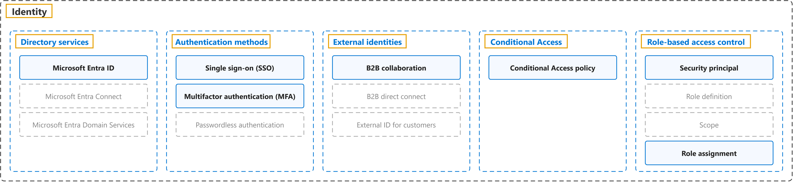

# 12. Identity

## Classification

## Glossary

| Term | Definition | 中文翻译 | Source |
|---|---|---|---|
| **Identity** 身份 | "**Identity and access management** is for making sure that **only the right people** can **access an organization's data and resources**." | **身份和访问管理**的作用是确保**只有合适的人**才能**访问组织的数据和资源**。 | [Microsoft, n.d., "What is identity and access management for?" question, para. 1](https://www.microsoft.com/en-us/security/business/security-101/what-is-identity-access-management-iam#:~:text=Identity%20and%20access%20management%20is%20for%20making%20sure) |
| **[Directory services](directory-services.md)** 目录服务 | "**Microsoft Entra ID** is Microsoft's **cloud-based identity and access management service**." | **Microsoft Entra ID** 是微软**基于云的身份和访问管理服务**。 | [Microsoft, 2026a, "Describe Azure directory services" unit, para. 1](https://learn.microsoft.com/en-us/training/modules/describe-azure-identity-access-security/2-directory-services#:~:text=Microsoft%20Entra%20ID%20is%20Microsoft%27s%20cloud-based) |
| **[Authentication methods](authentication-methods.md)** 身份验证方法 | "**Authentication** establishes the **identity of a person, service, or device** by **requiring credentials**." | **身份验证**通过**要求提供凭据**来确认**一个人、服务或设备的身份**。 | [Microsoft, 2026a, "Describe Azure authentication methods" unit, para. 1](https://learn.microsoft.com/en-us/training/modules/describe-azure-identity-access-security/3-authentication-methods#:~:text=Authentication%20establishes%20the%20identity%20of%20a%20person) |
| **[External identities](external-identities.md)** 外部身份 | "An **external identity** is a person, device, or service that **exists outside your tenant**." | **外部身份**是**存在于你的租户之外**的人、设备或服务。 | [Microsoft, 2026a, "Describe Azure external identities" unit, para. 1](https://learn.microsoft.com/en-us/training/modules/describe-azure-identity-access-security/4-external-identities#:~:text=An%20external%20identity%20is%20a%20person) |
| **[Conditional Access](conditional-access.md)** 条件访问 | "**Conditional Access** is a tool that Microsoft Entra ID uses to **allow (or deny) access** to resources based on **identity signals**." | **条件访问**是 Microsoft Entra ID 使用的一种工具，根据**身份信号**来**允许（或拒绝）访问**资源。 | [Microsoft, 2026a, "Describe Azure conditional access" unit, para. 1](https://learn.microsoft.com/en-us/training/modules/describe-azure-identity-access-security/5-conditional-access#:~:text=Conditional%20Access%20is%20a%20tool) |
| **[Role-based access control](role-based-access-control.md)** 基于角色的访问控制 | "**Azure role-based access control (Azure RBAC)** helps you manage **who has access** to Azure resources, **what they can do** with those resources, and **what areas they have access to**." | **Azure 基于角色的访问控制（Azure RBAC）**帮助你管理**谁可以访问** Azure 资源、**能对这些资源做什么**，以及**能访问哪些范围**。 | [Microsoft, 2024, para. 1](https://learn.microsoft.com/en-us/azure/role-based-access-control/overview#:~:text=Azure%20role-based%20access%20control%20(Azure%20RBAC)%20helps) |

## Coverage

| Certification | Skill area |
|---|---|
| AZ-900 Microsoft Azure Fundamentals | [Describe Azure architecture and services (35–40%)](https://learn.microsoft.com/en-us/credentials/certifications/resources/study-guides/az-900#describe-azure-architecture-and-services-3540) |
| AZ-104 Microsoft Azure Administrator | [Manage Azure identities and governance (20–25%)](https://learn.microsoft.com/en-us/credentials/certifications/resources/study-guides/az-104#manage-azure-identities-and-governance-2025) |
| AZ-305 Designing Microsoft Azure Infrastructure Solutions | [Design identity, governance, and monitoring solutions (25–30%)](https://learn.microsoft.com/en-us/credentials/certifications/resources/study-guides/az-305#design-identity-governance-and-monitoring-solutions-2530) |
| SC-300 Microsoft Identity and Access Administrator | [Implement and manage user identities (20–25%)](https://learn.microsoft.com/en-us/credentials/certifications/resources/study-guides/sc-300#implement-and-manage-user-identities-2025) [Implement authentication and access management (20–25%)](https://learn.microsoft.com/en-us/credentials/certifications/resources/study-guides/sc-300#implement-authentication-and-access-management-2025) |

**CST8911 Introduction to Cloud Computing**

| Week | Group | Terms in the course | Source |
|---|---|---|---|
| 2 | Directory services | Microsoft Entra ID | Lab 1: Authentication and SAS (tasks 4–5) |
|  | Authentication methods | authentication | Lab 1: Authentication and SAS (tasks 4–5) |
|  | Role-based access control | Azure role-based access control (Azure RBAC) role assignment security principal | Lab 1: Access control (IAM) (tasks 6–7) |
| 6 | Identity | use an identity service | Lecture 5: slide 8 |
|  | Directory services | Microsoft Entra ID | Lecture 5: slide 8 |

**CST8912 Cloud Solution Architecture**

| Week | Group | Terms in the course | Source |
|---|---|---|---|
| 1 | Directory services | Microsoft Entra ID | Reading: How to connect to Azure |
|  | Authentication methods | single sign-on (SSO) | Reading: How to connect to Azure |
| 2 | Identity | identity and access management (IAM) | Design Cloud Compute Solution: slides 14, 15 |
| 3 | Authentication methods | multi-factor authentication (MFA) | Lab 2: Fallback, report, and cleanup (Exercises 4, 8, 9) |
| 5 | Directory services | Azure Active Directory (Azure AD) | Design Cloud Database Solution: slide 16 |
|  | Authentication methods | authentication | Design Cloud Database Solution: slide 16 |
| 6 | Identity | identity | Week 6 – Cloud Architecture best practices: slide 29 |
|  | Directory services | Azure Active Directory (Azure AD) identity provider (IdP) Microsoft Entra ID | Week 6 – Cloud Architecture best practices: slide 29 Lab 5: Lab Scenario |
|  | Authentication methods | authentication | Week 6 – Cloud Architecture best practices: slide 29 |
|  | External identities | guest user (external user) | Lab 5: Task 1: Create and configure Azure AD users |
|  | Conditional Access | conditional access conditional access policy | Week 6 – Cloud Architecture best practices: slide 29 Lab 5: Lab Scenario |
|  | Role-based access control | role-based access control (RBAC) role assignment security principal | Week 6 – Cloud Architecture best practices: slides 4, 30, 31 |

**CST8913 Cloud Migration**

| Week | Group | Terms in the course | Source |
|---|---|---|---|
| 1 | Identity | identity | Lab 1: Identity and security |
|  | Authentication methods | authentication | Lab 1: Identity and security |
| 2 | Identity | identity management | Lab 2: Migration execution and operations |
|  | Directory services | Microsoft Entra ID | Reading: Cloud Adoption Framework (Units 9–10) |
|  | Conditional Access | Conditional Access | Reading: Cloud Adoption Framework (Units 9–10) |
|  | Role-based access control | role-based access control (RBAC) | Reading: Cloud Adoption Framework (Units 9–10) |
| 3 | Directory services | Azure Active Directory (Azure AD) | Target Cloud Architecture: slide 10 |
| 4 | Identity | identity and access | Migration Assessment Process: slide 4 |

**CST8915 Full-stack Cloud-native Development**

| Week | Group | Terms in the course | Source |
|---|---|---|---|
| 1 | Identity | Identity & Access Management (IAM) | Introduction to Cloud-Native Applications: slide 28 |
| 3 | Authentication methods | authentication | Microservices: slide 11 |

**CST8916 Remote Data and Real-time Applications**

| Week | Group | Terms in the course | Source |
|---|---|---|---|
| 1 | Identity | identity and access management (IAM) | Introduction to Remote Data and Real-time Applications: slide 10 |
| 5 | Directory services | Azure Active Directory (Azure AD) | Popular Cloud Services for Real-time Applications I: slide 39 |
|  | Authentication methods | authentication | Popular Cloud Services for Real-time Applications I: slide 30 |

## References

- Microsoft. (n.d.). *What is identity and access management (IAM)?* Microsoft Security. Retrieved October 24, 2026, from https://www.microsoft.com/en-us/security/business/security-101/what-is-identity-access-management-iam
- Microsoft. (2024). *What is Azure role-based access control (Azure RBAC)?* Microsoft Learn. https://learn.microsoft.com/en-us/azure/role-based-access-control/overview
- Microsoft. (2026a). *Describe Azure identity, access, and security* [Training module]. Microsoft Learn. https://learn.microsoft.com/en-us/training/modules/describe-azure-identity-access-security/
- Microsoft. (2026b). *Study guide for Exam AZ-104: Microsoft Azure Administrator*. Microsoft Learn. https://learn.microsoft.com/en-us/credentials/certifications/resources/study-guides/az-104
- Microsoft. (2026c). *Study guide for Exam AZ-305: Designing Microsoft Azure infrastructure solutions*. Microsoft Learn. https://learn.microsoft.com/en-us/credentials/certifications/resources/study-guides/az-305
- Microsoft. (2026d). *Study guide for Exam SC-300: Microsoft Identity and Access Administrator*. Microsoft Learn. https://learn.microsoft.com/en-us/credentials/certifications/resources/study-guides/sc-300
