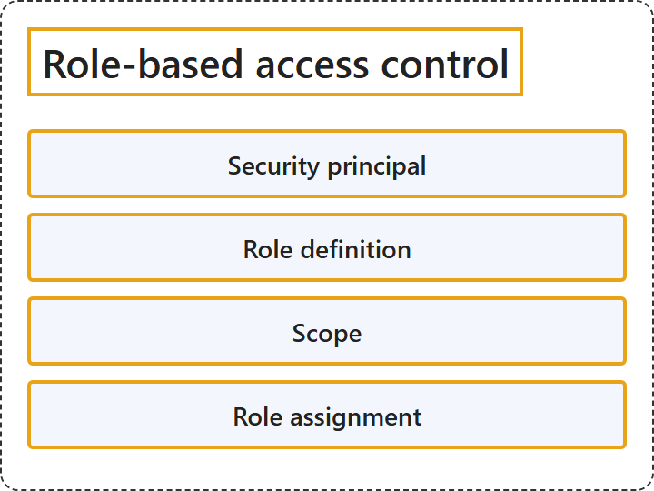

# 17.5 Role-Based Access Control

## Classification

## Glossary

| Term | Definition | 中文翻译 | Source |
|---|---|---|---|
| **Security principal** 安全主体 | "A security principal is an **object that represents a user, group, service principal, or managed identity** that is **requesting access to Azure resources**." | 安全主体是一个**代表用户、组、服务主体或托管标识的对象**，该对象**正在请求访问 Azure 资源**。 | [Microsoft, 2024, "Security principal" section, para. 1](https://learn.microsoft.com/en-us/azure/role-based-access-control/overview#:~:text=is%20an%20object%20that%20represents%20a%20user%2C%20group%2C%20service%20principal%2C%20or%20managed%20identity) |
| **Role definition** 角色定义 | "A role definition is a **collection of permissions**." | 角色定义是**权限的集合**。 | [Microsoft, 2024, "Role definition" section, para. 1](https://learn.microsoft.com/en-us/azure/role-based-access-control/overview#:~:text=is%20a%20collection%20of%20permissions) |
| **Scope** 作用域 | "Scope is the **set of resources** that the **access applies to**." | 作用域是**资源集合**，即**访问权限所适用的**范围。 | [Microsoft, 2024, "Scope" section, para. 1](https://learn.microsoft.com/en-us/azure/role-based-access-control/overview#:~:text=is%20the%20set%20of%20resources%20that%20the%20access%20applies%20to) |
| **Role assignment** 角色分配 | "A role assignment is the process of **attaching a role definition** to a user, group, service principal, or managed identity **at a particular scope** for the purpose of **granting access**." | 角色分配是把**角色定义附加**到用户、组、服务主体或托管标识上、范围是**特定作用域**、以**授予访问权限**的过程。 | [Microsoft, 2024, "Role assignments" section, para. 1](https://learn.microsoft.com/en-us/azure/role-based-access-control/overview#:~:text=is%20the%20process%20of%20attaching%20a%20role%20definition) |

## References

- Microsoft. (2024, March 12). *What is Azure role-based access control (Azure RBAC)?* Microsoft Learn. https://learn.microsoft.com/en-us/azure/role-based-access-control/overview
