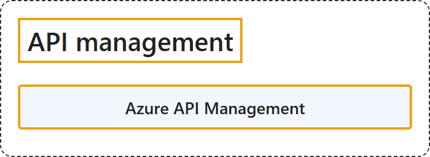

# 10.2 API management

## Classification

## Glossary

| Term | Definition | 中文翻译 | Source |
|---|---|---|---|
| **Azure API Management** Azure API 管理 | "Azure API Management is a **hybrid, multicloud management platform for APIs** across **all environments**. As a platform-as-a-service, API Management supports the **complete API lifecycle**." | Azure API 管理是一个**混合、多云的 API 管理平台**，适用于**所有环境**。作为平台即服务，API 管理支持**完整的 API 生命周期**。 | [Microsoft, 2025, para. 1](https://learn.microsoft.com/en-us/azure/api-management/api-management-key-concepts#:~:text=is%20a%20hybrid%2C%20multicloud%20management%20platform%20for%20APIs) |

## References

- Microsoft. (2025, October 13). *What is Azure API Management?* Microsoft Learn. https://learn.microsoft.com/en-us/azure/api-management/api-management-key-concepts
