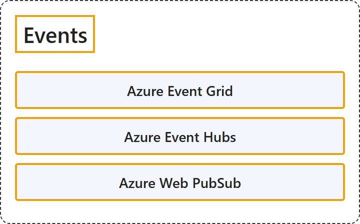

# 10.4 Events

## Classification

## Glossary

| Term | Definition | 中文翻译 | Source |
|---|---|---|---|
| **Azure Event Grid** Azure 事件网格 | "Azure Event Grid is a **highly scalable and fully managed publish-subscribe service** for **message distribution**." | Azure 事件网格是一种**高度可扩展、完全托管的发布-订阅服务**，用于**消息分发**。 | [Microsoft, 2026a, para. 1](https://learn.microsoft.com/en-us/azure/event-grid/overview#:~:text=is%20a%20highly%20scalable%20and%20fully%20managed%20publish-subscribe%20service) |
| **Azure Event Hubs** Azure 事件中心 | "Azure Event Hubs is a **fully managed, real-time data streaming platform** that can **ingest millions of events per second** with low latency." | Azure 事件中心是一个**完全托管的实时数据流式处理平台**，能够以低延迟**每秒引入数百万个事件**。 | [Microsoft, 2026b, para. 1](https://learn.microsoft.com/en-us/azure/event-hubs/event-hubs-about#:~:text=is%20a%20fully%20managed%2C%20real-time%20data%20streaming%20platform) |
| **Azure Web PubSub** Azure Web PubSub | "Azure Web PubSub is a **fully managed service** for **building applications that deliver updates in real time**." | Azure Web PubSub 是一种**完全托管的服务**，用于**构建实时推送更新的应用程序**。 | [Microsoft, 2026c, para. 1](https://learn.microsoft.com/en-us/azure/azure-web-pubsub/overview#:~:text=is%20a%20fully%20managed%20service%20for%20building%20applications%20that%20deliver%20updates) |

## References

- Microsoft. (2026a, July 23). *What is Azure Event Grid?* Microsoft Learn. https://learn.microsoft.com/en-us/azure/event-grid/overview
- Microsoft. (2026b, January 28). *What is Azure Event Hubs?* Microsoft Learn. https://learn.microsoft.com/en-us/azure/event-hubs/event-hubs-about
- Microsoft. (2026c, August 6). *What is Azure Web PubSub service?* Microsoft Learn. https://learn.microsoft.com/en-us/azure/azure-web-pubsub/overview
