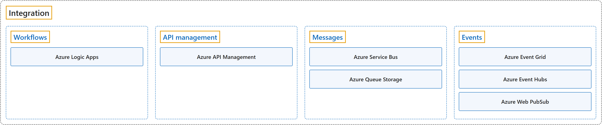

# 8. Integration

## Classification

## Glossary

| Term | Definition | 中文翻译 | Source |
|---|---|---|---|
| **Integration** 集成 | "... **integrating services, systems, apps, and data** across **cloud, on-premises, and hybrid environments** ..." | ……**把服务、系统、应用和数据集成起来**，范围涵盖**云端、本地和混合环境**…… | [Microsoft, 2026c, para. 1](https://learn.microsoft.com/en-us/azure/logic-apps/logic-apps-overview#:~:text=integrating%20services%2C%20systems%2C%20apps%2C%20and%20data) |
| **[Workflows](workflows.md)** 工作流 | "In **Azure Logic Apps**, a **workflow** coordinates **operations called actions**." | 在 **Azure Logic Apps** 中，**工作流**负责协调**称为操作（action）的各项操作**。 | [Microsoft, 2026d, "Compare Azure Functions and Azure Logic Apps" section, para. 1](https://learn.microsoft.com/en-us/azure/azure-functions/functions-compare-logic-apps-ms-flow-webjobs#:~:text=In%20Azure%20Logic%20Apps%2C%20a%20workflow%20coordinates) |
| **[API management](api-management.md)** API 管理 | "**Azure API Management** is a **hybrid, multicloud management platform** for **APIs** across all environments." | **Azure API Management** 是一个**混合、多云的管理平台**，用于管理所有环境中的 **API**。 | [Microsoft, 2025, para. 1](https://learn.microsoft.com/en-us/azure/api-management/api-management-key-concepts#:~:text=Azure%20API%20Management%20is%20a%20hybrid) |
| **[Messages](messages.md)** 消息 | "**Message**: **Raw data** produced by a service to be **consumed or stored elsewhere**." | **消息**：由一个服务产生、要在**别处被使用或存储**的**原始数据**。 | [Microsoft, 2026b, "Events vs. messages in Azure messaging services" section, para. 3](https://learn.microsoft.com/en-us/azure/service-bus-messaging/compare-messaging-services#:~:text=Raw%20data%20produced%20by%20a%20service) |
| **[Events](events.md)** 事件 | "**Event**: A **lightweight notification** of a **condition or state change**." | **事件**：关于某个**状况或状态变化**的**轻量级通知**。 | [Microsoft, 2026b, "Events vs. messages in Azure messaging services" section, para. 2](https://learn.microsoft.com/en-us/azure/service-bus-messaging/compare-messaging-services#:~:text=A%20lightweight%20notification%20of%20a%20condition) |

## Coverage

| Certification | Skill area |
|---|---|
| AZ-204 Developing Solutions for Microsoft Azure | [Connect to and consume Azure services and third-party services (20–25%)](https://learn.microsoft.com/en-us/credentials/certifications/resources/study-guides/az-204#connect-to-and-consume-azure-services-and-third-party-services-2025) |

**CST8911 Introduction to Cloud Computing**

| Week | Group | Terms in the course | Source |
|---|---|---|---|
| 4 | Integration | integration | Lecture 3: slide 9 |
|  | Workflows | Azure Logic Apps | Lecture 3: slide 9 |
|  | Messages | queue | Lecture 3: slide 9 |
|  | Events | event | Lecture 3: slide 9 |
| 6 | Messages | Azure Queue Storage | Lecture 5: slide 10 |
|  | Events | Event Grid topic | Lecture 5: slide 10 |

**CST8912 Cloud Solution Architecture**

| Week | Group | Terms in the course | Source |
|---|---|---|---|
| 2 | Workflows | Azure Logic Apps workflow | Design Cloud Compute Solution: slide 13 |
|  | Events | event-driven | Design Cloud Compute Solution: slide 13 |
| 4 | Messages | Azure Queue Storage message queue | Design Cloud Storage Solution: slide 16 |
|  | Events | event-driven architecture | Design Cloud Storage Solution: slide 16 |

**CST8913 Cloud Migration**

| Week | Group | Terms in the course | Source |
|---|---|---|---|
| 3 | Events | Azure Event Hubs | Target Cloud Architecture: slide 8 |

**CST8915 Full-stack Cloud-native Development**

| Week | Group | Terms in the course | Source |
|---|---|---|---|
| 1 | API management | API gateway | Introduction to Cloud-Native Applications: slide 42 |
|  | Events | event bus publish-subscribe | Introduction to Cloud-Native Applications: slide 42 |
| 2 | Messages | messaging system (queueing system) message broker message queue | The Twelve-Factor Application: slides 22, 23 Lab 1: Message queues and RabbitMQ |
| 3 | API management | Azure API Management | Microservices: slide 12 |
|  | Messages | Azure Service Bus | Microservices: slide 31 |
|  | Events | event event-driven Azure Event Hubs (Azure Events Hub) event streaming | Microservices: slides 30, 32, 33 |

**CST8916 Remote Data and Real-time Applications**

| Week | Group | Terms in the course | Source |
|---|---|---|---|
| 1 | Events | publish/subscribe (pub/sub) | Introduction to Remote Data and Real-time Applications: slide 34 |
| 5 | API management | Azure API Management API gateway | Popular Cloud Services for Real-time Applications I: slides 19, 20, 30 |
|  | Events | event-driven architecture Event Hub (Azure Event Hubs) Azure Web PubSub event notification | Popular Cloud Services for Real-time Applications I: slides 15, 19, 20, 27, 33, 34 |
| 6 | Workflows | Azure Logic Apps workflow | Popular Cloud Services for Real-time Applications II: slide 25 |
|  | API management | Azure API Management | Popular Cloud Services for Real-time Applications II: slide 3 |
|  | Messages | message queuing Azure Service Bus message broker message queue messaging | Popular Cloud Services for Real-time Applications II: slides 4, 16, 17, 28 |
|  | Events | Azure Web PubSub event trigger event-driven computing event streaming Azure Event Hubs event-triggered | Popular Cloud Services for Real-time Applications II: slides 3, 4, 5, 6, 28 |

## References

- Microsoft. (n.d.). *Azure Integration Services*. Microsoft Azure. Retrieved October 24, 2026, from https://azure.microsoft.com/en-us/solutions/integration-services
- Microsoft. (2025). *Azure API Management: Overview and key concepts*. Microsoft Learn. https://learn.microsoft.com/en-us/azure/api-management/api-management-key-concepts
- Microsoft. (2026a). *Study guide for Exam AZ-204: Developing solutions for Microsoft Azure*. Microsoft Learn. https://learn.microsoft.com/en-us/credentials/certifications/resources/study-guides/az-204
- Microsoft. (2026b). *Compare messaging services*. Microsoft Learn. https://learn.microsoft.com/en-us/azure/service-bus-messaging/compare-messaging-services
- Microsoft. (2026c). *What is Azure Logic Apps?* Microsoft Learn. https://learn.microsoft.com/en-us/azure/logic-apps/logic-apps-overview
- Microsoft. (2026d). *Integration and automation platform options in Azure*. Microsoft Learn. https://learn.microsoft.com/en-us/azure/azure-functions/functions-compare-logic-apps-ms-flow-webjobs
