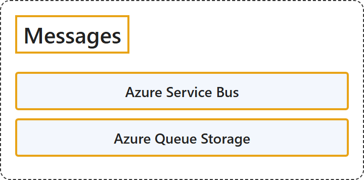

# 10.3 Messages

## Classification

## Glossary

| Term | Definition | 中文翻译 | Source |
|---|---|---|---|
| **Azure Service Bus** Azure 服务总线 | "Azure Service Bus is a **fully managed enterprise message broker** with **message queues and publish-subscribe topics**. Use Service Bus to **decouple applications and services** from each other." | Azure 服务总线是一种**完全托管的企业消息代理**，具有**消息队列和发布-订阅主题**。使用服务总线可以**让应用程序和服务彼此解耦**。 | [Microsoft, 2026, para. 1](https://learn.microsoft.com/en-us/azure/service-bus-messaging/service-bus-messaging-overview#:~:text=is%20a%20fully%20managed%20enterprise%20message%20broker) |
| **Azure Queue Storage** Azure 队列存储 | "Azure Queue Storage is a **service for storing large numbers of messages**. You access messages from anywhere in the world via **authenticated calls using HTTP or HTTPS**." | Azure 队列存储是一种**用于存储大量消息的服务**。你可以从世界任何地方通过**使用 HTTP 或 HTTPS 的经过身份验证的调用**来访问消息。 | [Microsoft, 2023, para. 1](https://learn.microsoft.com/en-us/azure/storage/queues/storage-queues-introduction#:~:text=is%20a%20service%20for%20storing%20large%20numbers%20of%20messages) |

## References

- Microsoft. (2023, November 17). *What is Azure Queue Storage?* Microsoft Learn. https://learn.microsoft.com/en-us/azure/storage/queues/storage-queues-introduction
- Microsoft. (2026, March 13). *What is Azure Service Bus?* Microsoft Learn. https://learn.microsoft.com/en-us/azure/service-bus-messaging/service-bus-messaging-overview
