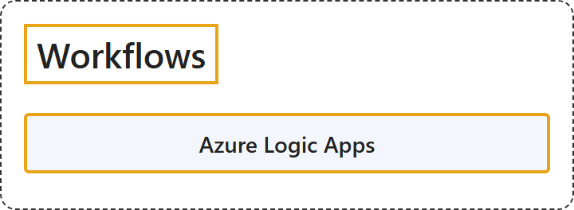

# 10.1 Workflows

## Classification

## Glossary

| Term | Definition | 中文翻译 | Source |
|---|---|---|---|
| **Azure Logic Apps** Azure 逻辑应用 | "Azure Logic Apps is a **cloud service and platform** for **automating enterprise business process workflows** and **integrating services, systems, apps, and data** across **cloud, on-premises, and hybrid environments** with **little or no code**." | Azure Logic Apps 是一个**云服务和平台**，用于**自动化企业业务流程工作流**，以及**集成服务、系统、应用和数据**，范围涵盖**云端、本地和混合环境**，只需**少量代码或无需代码**。 | [Microsoft, 2026, para. 1](https://learn.microsoft.com/en-us/azure/logic-apps/logic-apps-overview#:~:text=Azure%20Logic%20Apps%20is%20a%20cloud%20service%20and%20platform) |

## References

- Microsoft. (2026, September 11). *What is Azure Logic Apps?* Microsoft Learn. https://learn.microsoft.com/en-us/azure/logic-apps/logic-apps-overview
