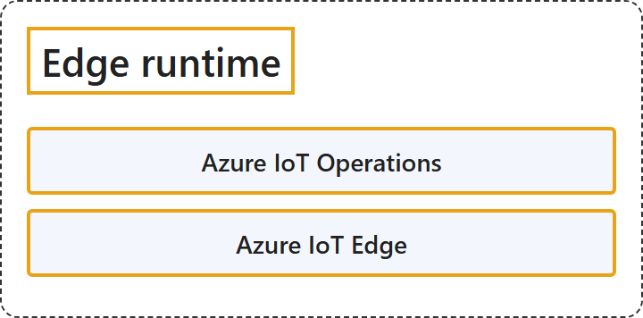

# 12.3 Edge Runtime

## Classification

## Glossary

| Term | Definition | 中文翻译 | Source |
|---|---|---|---|
| **Azure IoT Operations** Azure IoT Operations | "Azure IoT Operations is a **unified data plane for the edge**. It offers **modular and scalable data services** on Azure Arc-enabled Kubernetes clusters." | Azure IoT Operations 是一个**面向边缘的统一数据平面**。它在启用了 Azure Arc 的 Kubernetes 群集上提供**模块化、可扩展的数据服务**。 | [Microsoft, 2026b, para. 1](https://learn.microsoft.com/en-us/azure/iot-operations/overview-iot-operations#:~:text=is%20a%20unified%20data%20plane%20for%20the%20edge) |
| **Azure IoT Edge** Azure IoT Edge | "Azure IoT Edge is a **device-focused runtime** that enables you to **deploy, run, and monitor containerized Linux applications**, bringing analytics closer to your devices for faster insights and offline decision-making." | Azure IoT Edge 是一个**面向设备的运行时**，让你可以**部署、运行和监视容器化的 Linux 应用程序**，把分析带到更靠近设备的地方，以便更快地获得见解并离线做出决策。 | [Microsoft, 2026a, para. 1](https://learn.microsoft.com/en-us/azure/iot-edge/about-iot-edge#:~:text=is%20a%20device-focused%20runtime) |

## References

- Microsoft. (2026a, April 13). *What is Azure IoT Edge*. Microsoft Learn. https://learn.microsoft.com/en-us/azure/iot-edge/about-iot-edge
- Microsoft. (2026b, May 7). *What is Azure IoT Operations?* Microsoft Learn. https://learn.microsoft.com/en-us/azure/iot-operations/overview-iot-operations
