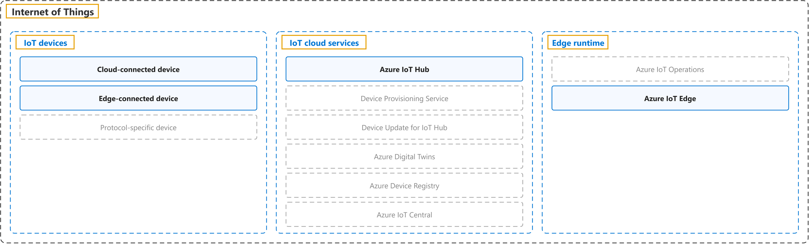

# 10. Internet of Things

## Classification

## Glossary

| Term | Definition | 中文翻译 | Source |
|---|---|---|---|
| **Internet of Things** 物联网 | "**Azure IoT** is Microsoft's **portfolio of services** for **connecting, managing, and deriving intelligence** from **IoT devices** and industrial equipment at scale." | **Azure IoT** 是微软的一组**服务**，用于大规模地**连接和管理 IoT 设备**及工业设备，并**从中获得智能洞察**。 | [Microsoft, 2026a, para. 1](https://learn.microsoft.com/en-us/azure/iot/iot-introduction#:~:text=Azure%20IoT%20is%20Microsoft%27s%20portfolio%20of%20services) |
| **[IoT devices](iot-devices.md)** IoT 设备 | "Both connectivity patterns include **devices** that **collect data** from which you want to **derive business insights**." | 两种连接模式都包含**设备**，它们**收集数据**，你要从这些数据中**获得业务洞察**。 | [Microsoft, 2026a, "Devices and connectivity" section, para. 1](https://learn.microsoft.com/en-us/azure/iot/iot-introduction#:~:text=Both%20connectivity%20patterns%20include%20devices) |
| **[IoT cloud services](iot-cloud-services.md)** IoT 云服务 | "In the **cloud-connected pattern**, **IoT-specific cloud services** provide the infrastructure to **connect, monitor, and control your devices**." | 在**云连接模式**中，**IoT 专用的云服务**提供基础结构，用来**连接、监视和控制你的设备**。 | [Microsoft, 2026a, "Services and applications" section, para. 1](https://learn.microsoft.com/en-us/azure/iot/iot-introduction#:~:text=In%20the%20cloud-connected%20pattern%2C%20IoT-specific%20cloud%20services) |
| **[Edge runtime](edge-runtime.md)** 边缘运行时 | "In the **edge-connected pattern**, the **edge runtime environment** hosts the services to **connect, monitor, and control your devices**." | 在**边缘连接模式**中，**边缘运行时环境**承载那些用来**连接、监视和控制你的设备**的服务。 | [Microsoft, 2026a, "Services and applications" section, para. 1](https://learn.microsoft.com/en-us/azure/iot/iot-introduction#:~:text=In%20the%20edge-connected%20pattern%2C%20the%20edge%20runtime) |

## Coverage

No current Microsoft certification covers Azure IoT; the Azure IoT Developer exam (AZ-220) has been retired.

**CST8911 Introduction to Cloud Computing**

| Week | Group | Terms in the course | Source |
|---|---|---|---|
| 7 | Internet of Things | Internet of Things (IoT) | Lecture 6: slide 8 |

**CST8912 Cloud Solution Architecture**

| Week | Group | Terms in the course | Source |
|---|---|---|---|
| 5 | Internet of Things | Internet of Things (IoT) | Design Cloud Database Solution: slide 7 |

**CST8913 Cloud Migration**

| Week | Group | Terms in the course | Source |
|---|---|---|---|
| 2 | Internet of Things | Internet of Things (IoT) | Introduction to Cloud Computing: slide 5 |

**CST8916 Remote Data and Real-time Applications**

| Week | Group | Terms in the course | Source |
|---|---|---|---|
| 1 | Internet of Things | Internet of Things (IoT) | Introduction to Remote Data and Real-time Applications: slide 35 |
|  | IoT devices | edge device IoT sensor | Introduction to Remote Data and Real-time Applications: slides 29, 37 |
|  | Edge runtime | edge computing | Introduction to Remote Data and Real-time Applications: slide 29 |
| 6 | Internet of Things | IoT connectivity industrial IoT | Popular Cloud Services for Real-time Applications II: slides 4, 23 |
|  | IoT devices | wearable device | Popular Cloud Services for Real-time Applications II: slide 23 |
|  | IoT cloud services | Azure IoT Hub | Popular Cloud Services for Real-time Applications II: slide 20 |
|  | Edge runtime | edge computing Azure IoT Edge | Popular Cloud Services for Real-time Applications II: slide 22 |

## References

- Microsoft. (2026a). *Introduction to Azure IoT*. Microsoft Learn. https://learn.microsoft.com/en-us/azure/iot/iot-introduction
- Microsoft. (2026b). *What is Azure IoT Edge*. Microsoft Learn. https://learn.microsoft.com/en-us/azure/iot-edge/about-iot-edge
