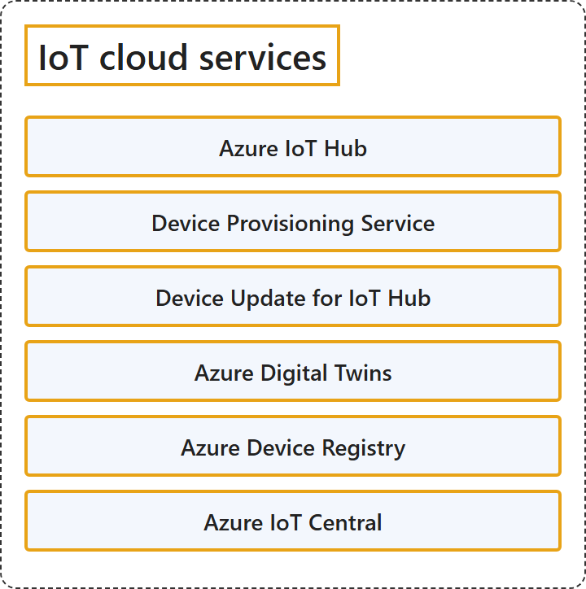

# 12.2 IoT Cloud Services

## Classification

## Glossary

| Term | Definition | 中文翻译 | Source |
|---|---|---|---|
| **Azure IoT Hub** Azure IoT 中心 | "Azure IoT Hub is a **managed service** that acts as a **central message hub in a cloud-based IoT solution**." | Azure IoT 中心是一项**托管服务**，充当**基于云的 IoT 解决方案中的中央消息中心**。 | [Microsoft, 2026c, para. 2](https://learn.microsoft.com/en-us/azure/iot-hub/iot-concepts-and-iot-hub#:~:text=is%20a%20managed%20service%20that%20acts%20as%20a%20central%20message%20hub) |
| **Device Provisioning Service** 设备预配服务 | "The IoT Hub Device Provisioning Service (DPS) is a **helper service for IoT Hub** that enables **zero-touch, just-in-time provisioning** to the right IoT hub **without requiring human intervention**." | IoT 中心设备预配服务 (DPS) 是 **IoT 中心的帮助程序服务**，能够实现**零接触、实时的预配**，把设备预配到正确的 IoT 中心，**无需人工干预**。 | [Microsoft, 2026b, para. 1](https://learn.microsoft.com/en-us/azure/iot-dps/about-iot-dps#:~:text=is%20a%20helper%20service%20for%20IoT%20Hub) |
| **Device Update for IoT Hub** IoT 中心设备更新 | "Device Update for IoT Hub is a service that enables you to **deploy over-the-air updates** for your **IoT devices** in a cloud-based IoT solution." | IoT 中心设备更新是一项服务，让你可以在基于云的 IoT 解决方案中**部署无线 (OTA) 更新**，对象是 **IoT 设备**。 | [Microsoft, 2026d, para. 2](https://learn.microsoft.com/en-us/azure/iot-hub-device-update/understand-device-update#:~:text=is%20a%20service%20that%20enables%20you%20to%20deploy%20over-the-air%20updates) |
| **Azure Digital Twins** Azure 数字孪生 | "Azure Digital Twins is a **platform as a service (PaaS) offering** that enables the **creation of twin graphs based on digital models of entire environments**, which could be buildings, factories, farms, energy networks, railways, stadiums, and more—even entire cities." | Azure 数字孪生是一种**平台即服务 (PaaS) 产品**，它支持**基于整个环境的数字模型创建孪生图**，这些环境可以是建筑、工厂、农场、能源网络、铁路、体育场等，甚至是整座城市。 | [Microsoft, 2025a, para. 1](https://learn.microsoft.com/en-us/azure/digital-twins/overview#:~:text=is%20a%20platform%20as%20a%20service%20%28PaaS%29%20offering) |
| **Azure Device Registry** Azure 设备注册表 | "Azure Device Registry is a **cloud service** that works with both IoT Hub and Azure IoT Operations to provide a **unified view of your devices and industrial assets** as standard Azure resources." | Azure 设备注册表是一项**云服务**，它同时与 IoT 中心和 Azure IoT Operations 配合，以标准 Azure 资源的形式提供**设备和工业资产的统一视图**。 | [Microsoft, 2026a, "Azure Device Registry" section, para. 1](https://learn.microsoft.com/en-us/azure/iot/iot-introduction#:~:text=is%20a%20cloud%20service%20that%20works%20with%20both%20IoT%20Hub%20and%20Azure%20IoT%20Operations) |
| **Azure IoT Central** Azure IoT Central | "IoT Central is an **application platform as a service (aPaaS)** that **reduces the burden and cost of developing, managing, and maintaining cloud-based IoT solutions**." | IoT Central 是一种**应用程序平台即服务 (aPaaS)**，它**降低了开发、管理和维护基于云的 IoT 解决方案的负担和成本**。 | [Microsoft, 2025b, para. 1](https://learn.microsoft.com/en-us/azure/iot-central/core/overview-iot-central#:~:text=IoT%20Central%20is%20an) |

## References

- Microsoft. (2025a, January 28). *What is Azure Digital Twins?* Microsoft Learn. https://learn.microsoft.com/en-us/azure/digital-twins/overview
- Microsoft. (2025b, May 9). *What is Azure IoT Central?* Microsoft Learn. https://learn.microsoft.com/en-us/azure/iot-central/core/overview-iot-central
- Microsoft. (2026a, April 15). *What is Azure Internet of Things (IoT)?* Microsoft Learn. https://learn.microsoft.com/en-us/azure/iot/iot-introduction
- Microsoft. (2026b, January 22). *What is Azure IoT Hub Device Provisioning Service?* Microsoft Learn. https://learn.microsoft.com/en-us/azure/iot-dps/about-iot-dps
- Microsoft. (2026c, May 21). *What is Azure IoT Hub?* Microsoft Learn. https://learn.microsoft.com/en-us/azure/iot-hub/iot-concepts-and-iot-hub
- Microsoft. (2026d, October 5). *What is Device Update for IoT Hub?* Microsoft Learn. https://learn.microsoft.com/en-us/azure/iot-hub-device-update/understand-device-update
