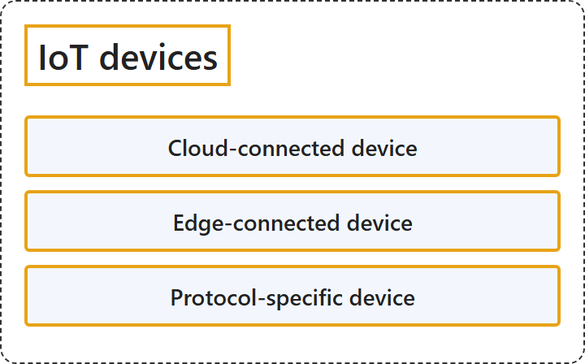

# 12.1 IoT Devices

## Classification

## Glossary

| Term | Definition | 中文翻译 | Source |
|---|---|---|---|
| **Cloud-connected device** 云连接设备 | "**Cloud-connected device (category 1)**: Devices that **connect directly to the cloud**." | **云连接设备 (类别 1)**：**直接连接到云**的设备。 | [Microsoft, 2026, "IoT device categories" section, list item 1](https://learn.microsoft.com/en-us/azure/iot/iot-introduction#:~:text=Devices%20that%20connect%20directly%20to%20the%20cloud) |
| **Edge-connected device** 边缘连接设备 | "**Edge-connected device (category 2)**: Devices that **connect to the cloud through an edge-based proxy or gateway**." | **边缘连接设备 (类别 2)**：**通过基于边缘的代理或网关连接到云**的设备。 | [Microsoft, 2026, "IoT device categories" section, list item 2](https://learn.microsoft.com/en-us/azure/iot/iot-introduction#:~:text=Devices%20that%20connect%20to%20the%20cloud%20through%20an%20edge-based%20proxy%20or%20gateway) |
| **Protocol-specific device** 特定协议设备 | "**Protocol-specific device (category 3)**: These devices **connect to an edge-based runtime through a connector** that enables the devices to **use a specific protocol**." | **特定协议设备 (类别 3)**：这些设备**通过连接器连接到基于边缘的运行时**，连接器让设备能够**使用特定协议**。 | [Microsoft, 2026, "IoT device categories" section, list item 3](https://learn.microsoft.com/en-us/azure/iot/iot-introduction#:~:text=These%20devices%20connect%20to%20an%20edge-based%20runtime%20through%20a%20connector) |

## References

- Microsoft. (2026, April 15). *What is Azure Internet of Things (IoT)?* Microsoft Learn. https://learn.microsoft.com/en-us/azure/iot/iot-introduction
