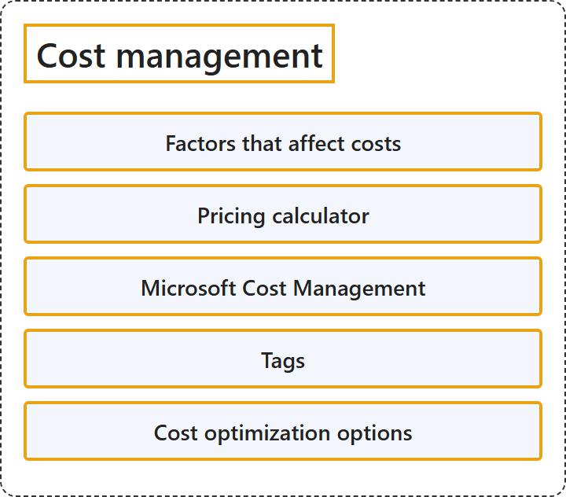

# 20.1 Cost management

## Classification

## Glossary

| Term | Definition | 中文翻译 | Source |
|---|---|---|---|
| **Factors that affect costs** 影响成本的因素 | (context) "A number of factors influence the cost of Azure resources. The **type of resources**, the **settings for the resource**, and the **Azure region** will all have an impact on how much a resource costs." | （语境）许多因素会影响 Azure 资源的成本。**资源的类型**、**资源的设置**和 **Azure 区域**都会影响资源的费用。 | [Microsoft, n.d.-b, "Resource type" section, para. 1](https://learn.microsoft.com/en-us/training/modules/describe-cost-management-azure/2-describe-factors-affect-costs-azure#:~:text=A%20number%20of%20factors%20influence%20the%20cost%20of%20Azure%20resources) |
| **Pricing calculator** 定价计算器 | "The Azure pricing calculator helps you **turn anticipated usage into an estimated cost**, which makes it easier to **plan and budget for your Azure usage**." | Azure 定价计算器帮助你**把预期用量转换为估算成本**，从而更容易**为 Azure 用量做计划和预算**。 | [Microsoft, 2025a, para. 1](https://learn.microsoft.com/en-us/azure/cost-management-billing/costs/pricing-calculator#:~:text=helps%20you%20turn%20anticipated%20usage%20into%20an%20estimated%20cost) |
| **Microsoft Cost Management** Microsoft 成本管理 | "Microsoft Cost Management is a **suite of FinOps tools** that help organizations **analyze, monitor, and optimize their Microsoft Cloud costs**." | Microsoft 成本管理是一套 **FinOps 工具**，帮助组织**分析、监视和优化 Microsoft 云成本**。 | [Microsoft, 2025c, para. 1](https://learn.microsoft.com/en-us/azure/cost-management-billing/costs/overview-cost-management#:~:text=is%20a%20suite%20of%20FinOps%20tools) |
| **Tags** 标记 | "Tags are **metadata elements** that you apply to your Azure resources. They are **key-value pairs** that help you **identify resources** based on settings that are relevant to your organization." | 标记是你应用到 Azure 资源上的**元数据元素**。它们是**键值对**，帮助你根据与组织相关的设置**识别资源**。 | [Microsoft, 2025b, para. 1](https://learn.microsoft.com/en-us/azure/azure-resource-manager/management/tag-resources#:~:text=Tags%20are%20metadata%20elements%20that%20you%20apply%20to%20your%20Azure%20resources) |
| **Cost optimization options** 成本优化选项 | (context) "After estimating and monitoring costs, the next step is **choosing the right pricing option** for **each workload profile**." | （语境）在估算和监视成本之后，下一步是**选择合适的定价选项**，针对**每种工作负载特征**。 | [Microsoft, n.d.-a, para. 1](https://learn.microsoft.com/en-us/training/modules/describe-cost-management-azure/7a-describe-cost-optimization-options#:~:text=After%20estimating%20and%20monitoring%20costs) |

## References

- Microsoft. (n.d.-a). *Describe cost optimization options in Azure* [Training module unit]. Microsoft Learn. Retrieved October 27, 2026, from https://learn.microsoft.com/en-us/training/modules/describe-cost-management-azure/7a-describe-cost-optimization-options
- Microsoft. (n.d.-b). *Describe factors that can affect costs in Azure* [Training module unit]. Microsoft Learn. Retrieved October 27, 2026, from https://learn.microsoft.com/en-us/training/modules/describe-cost-management-azure/2-describe-factors-affect-costs-azure
- Microsoft. (2025a, July 21). *Estimate costs with the Azure pricing calculator*. Microsoft Learn. https://learn.microsoft.com/en-us/azure/cost-management-billing/costs/pricing-calculator
- Microsoft. (2025b, September 15). *Use tags to organize your Azure resources and management hierarchy*. Microsoft Learn. https://learn.microsoft.com/en-us/azure/azure-resource-manager/management/tag-resources
- Microsoft. (2025c, June 27). *What is Microsoft Cost Management*. Microsoft Learn. https://learn.microsoft.com/en-us/azure/cost-management-billing/costs/overview-cost-management
