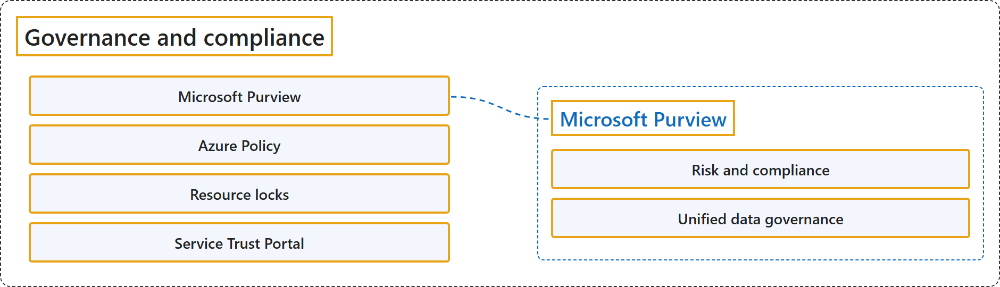

# 20.2 Governance and Compliance

## Classification

## Glossary

| Term | Definition | 中文翻译 | Source |
|---|---|---|---|
| **Microsoft Purview** Microsoft Purview | "Microsoft Purview is a **family of data governance, risk, and compliance solutions** that helps you get a **single, unified view into your data**." | Microsoft Purview 是一系列**数据治理、风险和合规解决方案**，帮助你获得**数据的单一、统一视图**。 | [Microsoft, n.d.-b, para. 1](https://learn.microsoft.com/en-us/training/modules/describe-features-tools-azure-for-governance-compliance/2-describe-purpose-microsoft-purview#:~:text=is%20a%20family%20of%20data%20governance) |
| **Risk and compliance** 风险和合规 | "Microsoft Purview, by **managing and monitoring your data**, helps your team: **Protect sensitive data** across clouds, apps, and devices. **Identify data risks and manage regulatory compliance requirements**. Get started with regulatory compliance." | Microsoft Purview 通过**管理和监控你的数据**，帮助你的团队：跨云、应用和设备**保护敏感数据**；**识别数据风险并管理法规合规要求**；开始着手法规合规。 | [Microsoft, n.d.-b, "Microsoft Purview risk and compliance solutions" section, para. 1 and list](https://learn.microsoft.com/en-us/training/modules/describe-features-tools-azure-for-governance-compliance/2-describe-purpose-microsoft-purview#:~:text=by%20managing%20and%20monitoring%20your%20data) |
| **Unified data governance** 统一数据治理 | "Microsoft Purview has **robust, unified data governance solutions** that help **manage your on-premises, multicloud, and software as a service data**." | Microsoft Purview 拥有**强大、统一的数据治理解决方案**，帮助**管理你的本地、多云和软件即服务数据**。 | [Microsoft, n.d.-b, "Unified data governance" section, para. 1](https://learn.microsoft.com/en-us/training/modules/describe-features-tools-azure-for-governance-compliance/2-describe-purpose-microsoft-purview#:~:text=has%20robust%2C%20unified%20data%20governance%20solutions) |
| **Azure Policy** Azure 策略 | "Azure Policy is a service in Azure that enables you to **create, assign, and manage policies** that **control or audit your resources**." | Azure Policy 是 Azure 中的一项服务，让你能够**创建、分配和管理策略**，用这些策略来**控制或审核你的资源**。 | [Microsoft, n.d.-a, para. 2](https://learn.microsoft.com/en-us/training/modules/describe-features-tools-azure-for-governance-compliance/3-describe-purpose-azure-policy#:~:text=Azure%20Policy%20is%20a%20service%20in%20Azure) |
| **Resource locks** 资源锁 | "A resource lock prevents resources from being **accidentally deleted or changed**." | 资源锁可防止资源被**意外删除或更改**。 | [Microsoft, n.d.-c, para. 1](https://learn.microsoft.com/en-us/training/modules/describe-features-tools-azure-for-governance-compliance/4-describe-purpose-resource-locks#:~:text=A%20resource%20lock%20prevents%20resources) |
| **Service Trust Portal** 服务信任门户 | "The Microsoft Service Trust Portal is a portal that provides access to **various content, tools, and other resources** about **Microsoft security, privacy, and compliance practices**." | Microsoft Service Trust Portal 是一个门户，提供**各种内容、工具和其他资源**，涉及 **Microsoft 的安全、隐私和合规实践**。 | [Microsoft, n.d.-d, para. 1](https://learn.microsoft.com/en-us/training/modules/describe-features-tools-azure-for-governance-compliance/6-describe-purpose-service-trust-portal#:~:text=is%20a%20portal%20that%20provides%20access) |

## References

- Microsoft. (n.d.-a). *Describe the purpose of Azure Policy* [Training unit]. Microsoft Learn. Retrieved October 25, 2026, from <https://learn.microsoft.com/en-us/training/modules/describe-features-tools-azure-for-governance-compliance/3-describe-purpose-azure-policy>
- Microsoft. (n.d.-b). *Describe the purpose of Microsoft Purview* [Training unit]. Microsoft Learn. Retrieved October 25, 2026, from <https://learn.microsoft.com/en-us/training/modules/describe-features-tools-azure-for-governance-compliance/2-describe-purpose-microsoft-purview>
- Microsoft. (n.d.-c). *Describe the purpose of resource locks* [Training unit]. Microsoft Learn. Retrieved October 25, 2026, from <https://learn.microsoft.com/en-us/training/modules/describe-features-tools-azure-for-governance-compliance/4-describe-purpose-resource-locks>
- Microsoft. (n.d.-d). *Describe the purpose of the Service Trust portal* [Training unit]. Microsoft Learn. Retrieved October 25, 2026, from <https://learn.microsoft.com/en-us/training/modules/describe-features-tools-azure-for-governance-compliance/6-describe-purpose-service-trust-portal>
