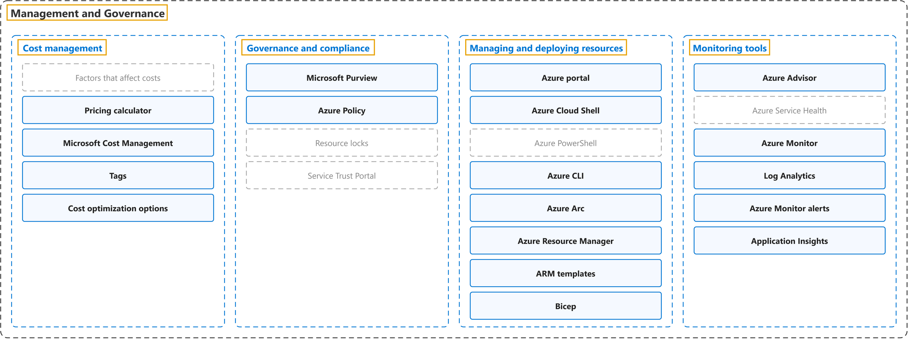

# 14. Management and Governance

## Classification

## Glossary

| Term | Definition | 中文翻译 | Source |
|---|---|---|---|
| **Management and Governance** 管理和治理 | "**Cloud governance** is how an organization **controls its use of cloud services** by **establishing guardrails**." | **云治理**是组织通过**建立护栏**来**控制自己如何使用云服务**的方式。 | [Microsoft, 2025, para. 1](https://learn.microsoft.com/en-us/azure/cloud-adoption-framework/govern/#:~:text=Cloud%20governance%20is%20how%20an%20organization%20controls) |
| **[Cost management](cost-management.md)** 成本管理 | "This module explores methods to **estimate, track, and manage costs** in Azure." | 本模块探讨在 Azure 中**估算、跟踪和管理成本**的方法。 | [Microsoft, 2026a, "Describe cost management in Azure" module](https://learn.microsoft.com/en-us/training/paths/describe-azure-management-governance/#:~:text=This%20module%20explores%20methods%20to%20estimate) |
| **[Governance and compliance](governance-and-compliance.md)** 治理和合规 | "This module introduces you to **tools** that can help with **governance and compliance** within Azure." | 本模块介绍能在 Azure 中帮助实现**治理和合规**的**工具**。 | [Microsoft, 2026a, "Describe features and tools in Azure for governance and compliance" module](https://learn.microsoft.com/en-us/training/paths/describe-azure-management-governance/#:~:text=This%20module%20introduces%20you%20to%20tools) |
| **[Managing and deploying resources](managing-and-deploying-resources.md)** 管理和部署资源 | "This module covers **tools** that help you **manage your Azure and on-premises resources**." | 本模块介绍帮助你**管理 Azure 资源和本地资源**的**工具**。 | [Microsoft, 2026a, "Describe features and tools for managing and deploying Azure resources" module](https://learn.microsoft.com/en-us/training/paths/describe-azure-management-governance/#:~:text=This%20module%20covers%20tools%20that%20help%20you%20manage) |
| **[Monitoring tools](monitoring-tools.md)** 监视工具 | "This module covers **tools** that you can use to **monitor your Azure environment**." | 本模块介绍可以用来**监视你的 Azure 环境**的**工具**。 | [Microsoft, 2026a, "Describe monitoring tools in Azure" module](https://learn.microsoft.com/en-us/training/paths/describe-azure-management-governance/#:~:text=This%20module%20covers%20tools%20that%20you%20can%20use) |

## Coverage

| Certification | Skill area |
|---|---|
| AZ-900 Microsoft Azure Fundamentals | [Describe Azure management and governance (30–35%)](https://learn.microsoft.com/en-us/credentials/certifications/resources/study-guides/az-900#describe-azure-management-and-governance-3035) |
| AZ-104 Microsoft Azure Administrator | [Manage Azure identities and governance (20–25%)](https://learn.microsoft.com/en-us/credentials/certifications/resources/study-guides/az-104#manage-azure-identities-and-governance-2025) [Monitor and maintain Azure resources (10–15%)](https://learn.microsoft.com/en-us/credentials/certifications/resources/study-guides/az-104#monitor-and-maintain-azure-resources-1015) |
| AZ-305 Designing Microsoft Azure Infrastructure Solutions | [Design identity, governance, and monitoring solutions (25–30%)](https://learn.microsoft.com/en-us/credentials/certifications/resources/study-guides/az-305#design-identity-governance-and-monitoring-solutions-2530) |

**CST8911 Introduction to Cloud Computing**

| Week | Group | Terms in the course | Source |
|---|---|---|---|
| 1 | Cost management | budget | Course Section Information: Azure subscription and budget |
| 2 | Cost management | budget (Azure Cost Management) | Lab 1: Resource groups and cleanup (task 8) |
|  | Managing and deploying resources | Azure portal Azure CLI Azure Resource Manager template (ARM template) Bicep | Lab 1: Containers and file shares (tasks 2–3), Command-line tools (before you start) Reading: What is CloudFormation? |
|  | Monitoring tools | Azure Monitor alert (alarm) Log Analytics Application Insights | Lecture 2: slide 9 |
| 3 | Monitoring tools | Log Analytics workspace | Lab 2: Cleanup (task 5) |
| 7 | Management and Governance | governance | Lecture 6: slide 9 |
|  | Cost management | cost optimization tagging | Lecture 6: slides 3, 16 |
|  | Managing and deploying resources | Azure Resource Manager (ARM) | Lecture 6: slide 16 |

**CST8912 Cloud Solution Architecture**

| Week | Group | Terms in the course | Source |
|---|---|---|---|
| 1 | Cost management | Cost Management | Reading: How to connect to Azure |
|  | Managing and deploying resources | Azure portal Azure Resource Manager (ARM) | Reading: How to connect to Azure |
| 2 | Governance and compliance | Azure Policy | Lab 1: Organizing resources (Prerequisites, Task 1) |
|  | Managing and deploying resources | Azure command-line interface (Azure CLI, `az`) Azure Cloud Shell | Lab 1: Organizing resources (Prerequisites, Task 1) |
|  | Monitoring tools | Azure Monitor Log Analytics workspace | Lab 1: Power state and monitoring (Tasks 6–8) |
| 3 | Cost management | pricing calculator | Design Cloud Networking Solution: slide 7 |
| 5 | Management and Governance | governance | Design Cloud Database Solution: slide 15 |
| 6 | Management and Governance | cloud governance | Week 6 – Cloud Architecture best practices: slide 16 |
|  | Cost management | Cost Management (governance discipline) cost optimization cloud cost management | Week 6 – Cloud Architecture best practices: slides 21, 25 |
|  | Monitoring tools | monitor all resources Azure Advisor alerts | Week 6 – Cloud Architecture best practices: slides 4, 25, 27 |

**CST8913 Cloud Migration**

| Week | Group | Terms in the course | Source |
|---|---|---|---|
| 2 | Cost management | total cost of ownership (TCO) Azure Pricing Calculator tagging and naming conventions Microsoft Cost Management | Lab 2: Planning and stakeholders Reading: Cloud Adoption Framework (Units 3, 8, 9–10) |
|  | Governance and compliance | cloud governance policy Azure Policy Microsoft Purview | Reading: Cloud Adoption Framework (Units 8, 9–10) |
|  | Managing and deploying resources | Azure Arc Bicep | Lab 2: Azure services (Lab 2 case study) Reading: Cloud Adoption Framework (Units 4, 9–10) |
|  | Monitoring tools | Azure Advisor Application Insights | Reading: Cloud Adoption Framework (Units 5–7) |
| 3 | Monitoring tools | Azure Monitor | Target Cloud Architecture: slide 8 |

**CST8915 Full-stack Cloud-native Development**

| Week | Group | Terms in the course | Source |
|---|---|---|---|
| 2 | Governance and compliance | Azure Policy | Lab 1: Subscriptions and resources |
|  | Managing and deploying resources | Azure portal | Lab 1: Subscriptions and resources |
|  | Monitoring tools | Azure Monitor | The Twelve-Factor Application: slide 40 |
| 4 | Managing and deploying resources | Azure command-line interface (Azure CLI) | Lab 3: Step 3: Deploy Order-Service and Product-Service on Azure Web App Service |

**CST8916 Remote Data and Real-time Applications**

| Week | Group | Terms in the course | Source |
|---|---|---|---|
| 5 | Monitoring tools | Azure Monitor Application Insights alert | Popular Cloud Services for Real-time Applications I: slide 22 |

## References

- Microsoft. (2025). *Build a cloud governance team*. Cloud Adoption Framework. https://learn.microsoft.com/en-us/azure/cloud-adoption-framework/govern/
- Microsoft. (2026a). *Introduction to cloud infrastructure: Describe Azure management and governance* [Learning path]. Microsoft Learn. https://learn.microsoft.com/en-us/training/paths/describe-azure-management-governance/
- Microsoft. (2026b). *Study guide for Exam AZ-104: Microsoft Azure Administrator*. Microsoft Learn. https://learn.microsoft.com/en-us/credentials/certifications/resources/study-guides/az-104
- Microsoft. (2026c). *Study guide for Exam AZ-305: Designing Microsoft Azure infrastructure solutions*. Microsoft Learn. https://learn.microsoft.com/en-us/credentials/certifications/resources/study-guides/az-305
