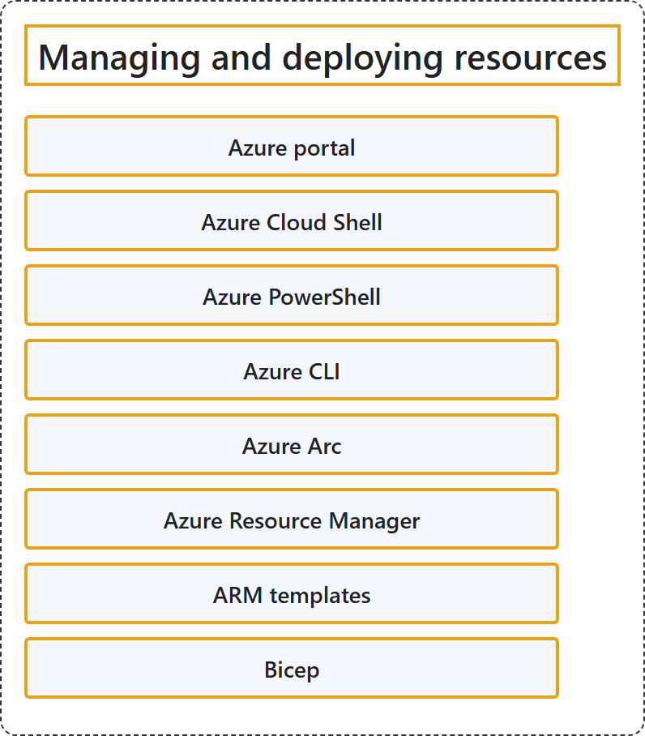

# 20.3 Managing and deploying resources

## Classification

## Glossary

| Term | Definition | 中文翻译 | Source |
|---|---|---|---|
| **Azure portal** Azure 门户 | "The Azure portal is a **web-based, unified console** that you can use to **create and manage all your Azure resources**." | Azure 门户是一个**基于 Web 的统一控制台**，可用来**创建和管理你的所有 Azure 资源**。 | [Microsoft, 2026g, para. 1](https://learn.microsoft.com/en-us/azure/azure-portal/azure-portal-overview#:~:text=is%20a%20web-based%2C%20unified%20console) |
| **Azure Cloud Shell** Azure Cloud Shell | "Azure Cloud Shell is an **interactive, authenticated, browser-accessible terminal** for **managing Azure resources**." | Azure Cloud Shell 是一个**交互式、经过身份验证、可通过浏览器访问的终端**，用于**管理 Azure 资源**。 | [Microsoft, 2026b, para. 1](https://learn.microsoft.com/en-us/azure/cloud-shell/overview#:~:text=is%20an%20interactive%2C%20authenticated%2C%20browser-accessible%20terminal) |
| **Azure PowerShell** Azure PowerShell | "Azure PowerShell is the product name for the **collection of official Microsoft PowerShell modules** for **managing Azure resources**." | Azure PowerShell 是**官方 Microsoft PowerShell 模块集合**的产品名称，这些模块用于**管理 Azure 资源**。 | [Microsoft, 2026c, para. 1](https://learn.microsoft.com/en-us/powershell/azure/what-is-azure-powershell#:~:text=collection%20of%20official%20Microsoft%20PowerShell%20modules) |
| **Azure CLI** Azure CLI | "The Azure Command-Line Interface (CLI) is a **cross-platform command-line tool** to **connect to Azure and execute administrative commands** on Azure resources." | Azure 命令行界面 (CLI) 是一种**跨平台命令行工具**，用于**连接到 Azure 并执行管理命令**，对象是 Azure 资源。 | [Microsoft, 2026f, para. 1](https://learn.microsoft.com/en-us/cli/azure/what-is-azure-cli#:~:text=is%20a%20cross-platform%20command-line%20tool) |
| **Azure Arc** Azure Arc | "Azure Arc simplifies governance and management by delivering a **consistent multicloud and on-premises management platform**." | Azure Arc 通过提供**一致的多云和本地管理平台**来简化治理和管理。 | [Microsoft, 2025, para. 2](https://learn.microsoft.com/en-us/azure/azure-arc/overview#:~:text=consistent%20multicloud%20and%20on-premises%20management%20platform) |
| **Azure Resource Manager** Azure 资源管理器 | "Azure Resource Manager is the **deployment and management service for Azure**. It provides a **management layer** that helps you to **create, update, and delete resources** in your Azure account." | Azure 资源管理器是 **Azure 的部署和管理服务**。它提供一个**管理层**，帮助你在 Azure 帐户中**创建、更新和删除资源**。 | [Microsoft, 2026d, para. 1](https://learn.microsoft.com/en-us/azure/azure-resource-manager/management/overview#:~:text=is%20the%20deployment%20and%20management%20service%20for%20Azure) |
| **ARM templates** ARM 模板 | (context) "To implement **infrastructure as code** for your Azure solutions, use **Azure Resource Manager templates (ARM templates)**." | （语境）要为 Azure 解决方案实现**基础结构即代码**，请使用 **Azure 资源管理器模板 (ARM 模板)**。 | [Microsoft, 2026a, para. 3](https://learn.microsoft.com/en-us/azure/azure-resource-manager/templates/overview#:~:text=To%20implement%20infrastructure%20as%20code%20for%20your%20Azure%20solutions) |
| **Bicep** Bicep | "Bicep is a **domain-specific language** that uses **declarative syntax** to **deploy Azure resources**." | Bicep 是一种**领域特定语言**，使用**声明性语法**来**部署 Azure 资源**。 | [Microsoft, 2026e, para. 1](https://learn.microsoft.com/en-us/azure/azure-resource-manager/bicep/overview#:~:text=is%20a%20domain-specific%20language%20that%20uses%20declarative%20syntax) |

## References

- Microsoft. (2025, August 26). *Azure Arc overview*. Microsoft Learn. https://learn.microsoft.com/en-us/azure/azure-arc/overview
- Microsoft. (2026a, June 26). *What are ARM templates?* Microsoft Learn. https://learn.microsoft.com/en-us/azure/azure-resource-manager/templates/overview
- Microsoft. (2026b, August 7). *What is Azure Cloud Shell?* Microsoft Learn. https://learn.microsoft.com/en-us/azure/cloud-shell/overview
- Microsoft. (2026c, October 6). *What is Azure PowerShell?* Microsoft Learn. https://learn.microsoft.com/en-us/powershell/azure/what-is-azure-powershell
- Microsoft. (2026d, August 4). *What is Azure Resource Manager?* Microsoft Learn. https://learn.microsoft.com/en-us/azure/azure-resource-manager/management/overview
- Microsoft. (2026e, January 8). *What is Bicep?* Microsoft Learn. https://learn.microsoft.com/en-us/azure/azure-resource-manager/bicep/overview
- Microsoft. (2026f, September 1). *What is the Azure CLI?* Microsoft Learn. https://learn.microsoft.com/en-us/cli/azure/what-is-azure-cli
- Microsoft. (2026g, January 26). *What is the Azure portal?* Microsoft Learn. https://learn.microsoft.com/en-us/azure/azure-portal/azure-portal-overview
