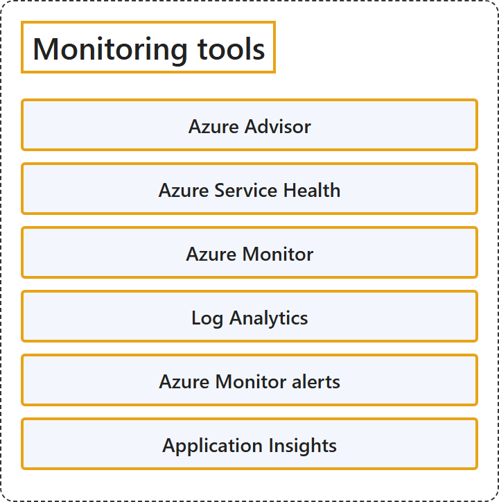

# 20.4 Monitoring tools

## Classification

## Glossary

| Term | Definition | 中文翻译 | Source |
|---|---|---|---|
| **Azure Advisor** Azure 顾问 | "Advisor is a **digital cloud assistant** that helps you **follow best practices to optimize your Azure deployments**." | Advisor 是一个**数字云助手**，帮助你**遵循最佳做法来优化 Azure 部署**。 | [Microsoft, 2026c, para. 2](https://learn.microsoft.com/en-us/azure/advisor/advisor-overview#:~:text=is%20a%20digital%20cloud%20assistant) |
| **Azure Service Health** Azure 服务运行状况 | (context) "Azure offers a suite of experiences to **keep you informed about the health of your cloud resources**. This information includes **current and upcoming issues** such as service impacting events, planned maintenance, and other changes that might affect your availability." | （语境）Azure 提供一套体验，**让你随时了解云资源的运行状况**。这些信息包括**当前和即将发生的问题**，例如影响服务的事件、计划内维护以及可能影响可用性的其他变更。 | [Microsoft, 2025, para. 1](https://learn.microsoft.com/en-us/azure/service-health/overview#:~:text=keep%20you%20informed%20about%20the%20health%20of%20your%20cloud%20resources) |
| **Azure Monitor** Azure Monitor | "Azure Monitor is Microsoft's **unified observability service** for **collecting, analyzing, and acting on telemetry** from cloud and hybrid environments." | Azure Monitor 是 Microsoft 的**统一可观测性服务**，用于**收集、分析遥测数据并据此采取行动**，数据来自云和混合环境。 | [Microsoft, 2026a, para. 1](https://learn.microsoft.com/en-us/azure/azure-monitor/fundamentals/overview#:~:text=unified%20observability%20service) |
| **Log Analytics** Log Analytics | "The Log Analytics tool in the Azure portal lets you **run and edit log queries** against **data in the Azure Monitor Logs store**." | Azure 门户中的 Log Analytics 工具让你可以**运行和编辑日志查询**，查询对象是 **Azure Monitor 日志存储中的数据**。 | [Microsoft, 2026d, para. 1](https://learn.microsoft.com/en-us/azure/azure-monitor/logs/log-analytics-overview#:~:text=lets%20you%20run%20and%20edit%20log%20queries) |
| **Azure Monitor alerts** Azure Monitor 警报 | "Alerts help you **detect and address issues before users notice them** by **proactively notifying you** when Azure Monitor data indicates there might be a problem with your infrastructure or application." | 警报帮助你**在用户注意到问题之前发现并解决问题**，方式是在 Azure Monitor 数据显示基础结构或应用程序可能有问题时**主动通知你**。 | [Microsoft, 2026e, para. 1](https://learn.microsoft.com/en-us/azure/azure-monitor/alerts/alerts-overview#:~:text=Alerts%20help%20you%20detect%20and%20address%20issues%20before%20users%20notice%20them) |
| **Application Insights** Application Insights | "Azure Monitor Application Insights is an **application performance monitoring (APM) feature** of **Azure Monitor**." | Azure Monitor Application Insights 是一项**应用程序性能监视 (APM) 功能**，属于 **Azure Monitor**。 | [Microsoft, 2026b, para. 1](https://learn.microsoft.com/en-us/azure/azure-monitor/app/app-insights-overview#:~:text=is%20an%20application%20performance%20monitoring%20%28APM%29%20feature) |

## References

- Microsoft. (2025, October 31). *What is Azure Service Health?* Microsoft Learn. https://learn.microsoft.com/en-us/azure/service-health/overview
- Microsoft. (2026a, June 23). *Azure Monitor overview*. Microsoft Learn. https://learn.microsoft.com/en-us/azure/azure-monitor/fundamentals/overview
- Microsoft. (2026b, October 9). *Introduction to Application Insights - OpenTelemetry observability*. Microsoft Learn. https://learn.microsoft.com/en-us/azure/azure-monitor/app/app-insights-overview
- Microsoft. (2026c, May 18). *Introduction to Azure Advisor*. Microsoft Learn. https://learn.microsoft.com/en-us/azure/advisor/advisor-overview
- Microsoft. (2026d, July 20). *Overview of Log Analytics in Azure Monitor*. Microsoft Learn. https://learn.microsoft.com/en-us/azure/azure-monitor/logs/log-analytics-overview
- Microsoft. (2026e, July 8). *What are Azure Monitor alerts?* Microsoft Learn. https://learn.microsoft.com/en-us/azure/azure-monitor/alerts/alerts-overview
