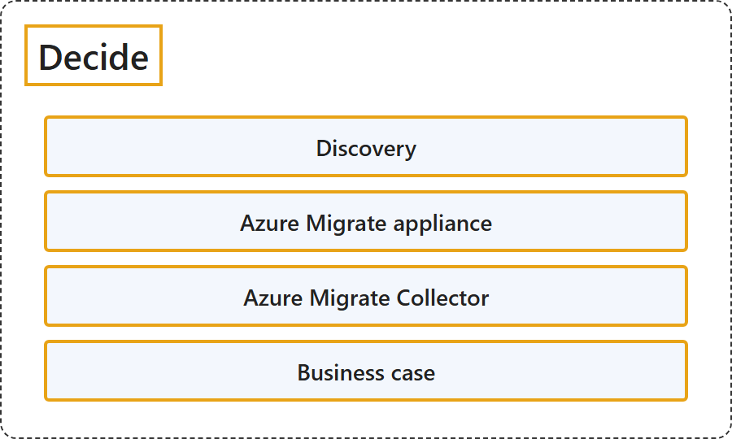

# 24.2 Decide

## Classification

## Glossary

| Term | Definition | 中文解释 | Source |
|---|---|---|---|
| **Decide** 决定 | "The first step in a migration journey is to **identify your workloads**. This process of identification is called **discovery**." | 迁移之旅的第一步是**识别你的工作负载**。这个识别过程称为**发现**。 | [Microsoft, n.d., "Decide" section, para. 1](https://learn.microsoft.com/en-us/azure/migrate/migrate-services-overview#:~:text=The%20first%20step%20in%20a%20migration%20journey%20is%20to%20identify%20your%20workloads) |
| **Azure Migrate project** Azure Migrate 项目 | "A project is used to **store discovery, assessment, and migration metadata** collected from the environment you're assessing or migrating. In a project, you can **track discovered assets**, **create assessments**, and **orchestrate migrations to Azure**." | 项目用于**存储发现、评估和迁移元数据**，这些元数据收集自你正在评估或迁移的环境。在项目中，你可以**跟踪已发现的资产**、**创建评估**，并**编排到 Azure 的迁移**。 | [Microsoft, 2026, para. 2](https://learn.microsoft.com/en-us/azure/migrate/quickstart-create-project?view=migrate#:~:text=A%20project%20is%20used%20to%20store%20discovery) |
| **Discovery** 发现 | "This **process of identification** is called discovery. To discover your workloads, you can **deploy a lightweight Azure Migrate appliance** (recommended approach), **deploy Azure Migrate collector** or **quickly import the inventory data** for your workloads." | 这个**识别过程**称为发现。要发现你的工作负载，你可以**部署轻量级 Azure Migrate 设备**（推荐方式）、**部署 Azure Migrate 收集器**，或者**快速导入工作负载的清单数据**。 | [Microsoft, n.d., "Decide" section, para. 1](https://learn.microsoft.com/en-us/azure/migrate/migrate-services-overview#:~:text=This%20process%20of%20identification%20is%20called%20discovery) |
| **Azure Migrate appliance** Azure Migrate 设备 | "The Azure Migrate appliance is a **virtual appliance** that can be deployed on a **server in your datacenter**. The appliance collects the **configuration and performance data** for your servers and continually sends it to the Azure Migrate service." | Azure Migrate 设备是一种**虚拟设备**，可以部署在**你数据中心的服务器**上。该设备收集服务器的**配置和性能数据**，并持续发送到 Azure Migrate 服务。 | [Microsoft, n.d., "Decide" section, para. 2](https://learn.microsoft.com/en-us/azure/migrate/migrate-services-overview#:~:text=The%20Azure%20Migrate%20appliance%20is%20a%20virtual%20appliance) |
| **Azure Migrate Collector** Azure Migrate 收集器 | "Azure Migrate Collector enables a **quick snapshot discovery** of your on-premises environment **without requiring continuous Azure connectivity**." | Azure Migrate 收集器可对本地环境进行**快速快照式发现**，**无需持续连接 Azure**。 | [Microsoft, n.d., "Decide" section, "Azure Migrate Collector", para. 1](https://learn.microsoft.com/en-us/azure/migrate/migrate-services-overview#:~:text=enables%20a%20quick%20snapshot%20discovery) |
| **Business case** 业务案例 | "A business case helps you **estimate the costs and savings** of **moving to Azure**." | 业务案例帮助你**估算成本和节省**，针对的是**迁移到 Azure**。 | [Microsoft, n.d., "Decide" section, para. 4](https://learn.microsoft.com/en-us/azure/migrate/migrate-services-overview#:~:text=A%20business%20case%20helps%20you%20estimate%20the%20costs%20and%20savings) |

## References

- Microsoft. (n.d.). *About Azure Migrate*. Microsoft Learn. Retrieved October 18, 2026, from <https://learn.microsoft.com/en-us/azure/migrate/migrate-services-overview>
- Microsoft. (2026, May 20). *Quickstart: Create an Azure Migrate project using portal*. Microsoft Learn. <https://learn.microsoft.com/en-us/azure/migrate/quickstart-create-project?view=migrate>
