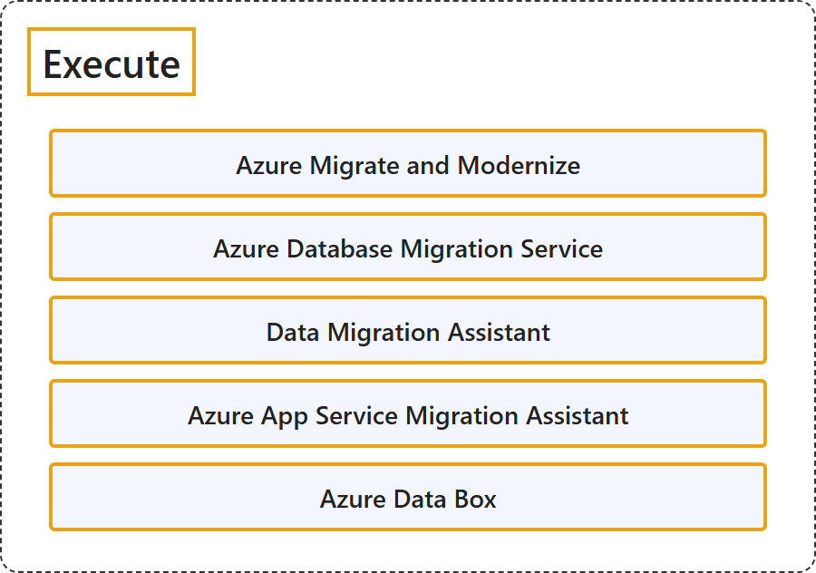

# 16.4 Execute

Sources: [About Azure Migrate: Execute](https://learn.microsoft.com/en-us/azure/migrate/migrate-services-overview#execute).

## Classification

## Glossary

| Term | Definition | 中文解释 | Source |
|---|---|---|---|
| **Execute** 执行 | "In the execution phase, you perform the **migration or modernization** of your workloads to **move to Azure**." | 在执行阶段，你对工作负载进行**迁移或现代化**，以便**转移到 Azure**。 | [Microsoft, n.d., "Execute" section, para. 1](https://learn.microsoft.com/en-us/azure/migrate/migrate-services-overview#:~:text=In%20the%20execution%20phase%2C%20you%20perform%20the%20migration%20or%20modernization) |
| **Azure Migrate and Modernize** Azure Migrate 迁移和现代化 | "Migrate **VMware VMs, Hyper-V VMs, physical servers, other virtualized servers, and public cloud VMs** to Azure." | 把 **VMware VM、Hyper-V VM、物理服务器、其他虚拟化服务器和公有云 VM** 迁移到 Azure。 | [Microsoft, n.d., "Integrated tools and features" section, "Migrate and Modernize" row, Details](https://learn.microsoft.com/en-us/azure/migrate/migrate-services-overview#:~:text=Migrate%20VMware%20VMs%2C%20Hyper%2DV%20VMs%2C%20physical%20servers) |
| **Azure Database Migration Service** Azure 数据库迁移服务 | "Migrate **on-premises databases** to **Azure VMs running SQL Server, Azure SQL Database, or Azure SQL Managed Instance**." | 把**本地数据库**迁移到**运行 SQL Server 的 Azure VM、Azure SQL 数据库或 Azure SQL 托管实例**。 | [Microsoft, n.d., "Integrated tools and features" section, "Azure Database Migration Service" row, Function](https://learn.microsoft.com/en-us/azure/migrate/migrate-services-overview#:~:text=Migrate%20on%2Dpremises%20databases%20to%20Azure%20VMs%20running%20SQL%20Server) |
| **Data Migration Assistant** 数据迁移助手 | "Data Migration Assistant is a **standalone tool to assess SQL servers**. It helps **pinpoint potential problems that block migration**." | 数据迁移助手是**用于评估 SQL 服务器的独立工具**。它帮助**找出阻碍迁移的潜在问题**。 | [Microsoft, n.d., "Integrated tools and features" section, "Data Migration Assistant" row, Details](https://learn.microsoft.com/en-us/azure/migrate/migrate-services-overview#:~:text=Data%20Migration%20Assistant%20is%20a%20standalone%20tool%20to%20assess%20SQL%20servers) |
| **Azure App Service Migration Assistant** Azure App Service 迁移助手 | "Azure App Service Migration Assistant is a **standalone tool to assess on-premises websites** for **migration to Azure App Service**." | Azure App Service 迁移助手是**评估本地网站的独立工具**，用于**迁移到 Azure App Service**。 | [Microsoft, n.d., "Integrated tools and features" section, "Azure App Service Migration Assistant" row, Details](https://learn.microsoft.com/en-us/azure/migrate/migrate-services-overview#:~:text=Azure%20App%20Service%20Migration%20Assistant%20is%20a%20standalone%20tool) |
| **Azure Data Box** Azure Data Box | Defined in [6.4.2 Azure Data Box](../storage/data-migration-options.md). | 定义见 6.4.2 Azure Data Box。 | — |

## References

Microsoft. (n.d.). *About Azure Migrate*. Microsoft Learn. Retrieved October 18, 2026, from <https://learn.microsoft.com/en-us/azure/migrate/migrate-services-overview>
