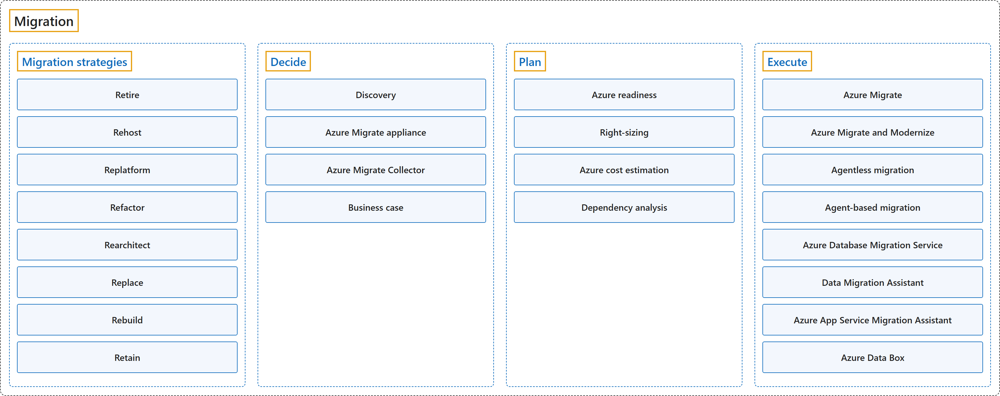

# 24. Migration

## Classification

## Process

## Glossary

| Term | Definition | 中文翻译 | Source |
|---|---|---|---|
| **Migration** 迁移 | "**Cloud migration** is the process of **moving applications and data** from one location, often a company's private, **on-premises servers**, to a **public cloud provider's servers**, but it can also entail moving resources between different clouds." | **云迁移**是把**应用程序和数据**从一个位置（通常是公司自己的**本地服务器**）**迁到公有云提供商的服务器**上的过程，也可以是在不同的云之间迁移资源。 | [Microsoft, n.d., "Cloud migration definition" section, para. 1](https://azure.microsoft.com/en-us/resources/cloud-computing-dictionary/what-is-cloud-migration#:~:text=Cloud%20migration%20is%20the%20process%20of%20moving) |
| **[Migration strategies](migration-strategies.md)** 迁移策略 | "There are **multiple migration strategies**, sometimes known as the **"Rs" of cloud migration**." | 迁移有**多种策略**，有时被称为**云迁移的"R"**。 | [Microsoft, 2025, para. 1](https://learn.microsoft.com/en-us/azure/cloud-adoption-framework/plan/select-cloud-migration-strategy#:~:text=There%20are%20multiple%20migration%20strategies) |
| **Migration phases** 迁移阶段 | "A general **migration journey** includes the following **phases**. Azure Migrate provides support at each phase." | 一般的**迁移之旅**包括以下几个**阶段**。Azure Migrate 在每个阶段都提供支持。 | [Microsoft, 2026b, "Migration phases" section, para. 2](https://learn.microsoft.com/en-us/azure/migrate/migrate-services-overview#:~:text=A%20general%20migration%20journey%20includes) |
| **[Decide](decide.md)** 决策 | "The first step in a migration journey is to **identify your workloads**." | 迁移之旅的第一步是**识别你的工作负载**。 | [Microsoft, 2026b, "Decide" section, para. 1](https://learn.microsoft.com/en-us/azure/migrate/migrate-services-overview#:~:text=The%20first%20step%20in%20a%20migration%20journey) |
| **[Plan](plan.md)** 规划 | "After you make the **decision to migrate** to Azure, the next important phase of migration is **planning**." | 在你**决定迁移**到 Azure 之后，迁移的下一个重要阶段是**规划**。 | [Microsoft, 2026b, "Plan" section, para. 1](https://learn.microsoft.com/en-us/azure/migrate/migrate-services-overview#:~:text=After%20you%20make%20the%20decision%20to%20migrate) |
| **[Execute](execute.md)** 执行 | "In the **execution phase**, you **perform the migration or modernization** of your workloads to move to Azure." | 在**执行阶段**，你对工作负载**进行迁移或现代化**，把它们迁到 Azure。 | [Microsoft, 2026b, "Execute" section, para. 1](https://learn.microsoft.com/en-us/azure/migrate/migrate-services-overview#:~:text=In%20the%20execution%20phase%2C%20you%20perform) |
| **Replication** 复制 | "After setting up the appliance and completing discovery, you can begin **replication** of VMware VMs to Azure." | 设置好设备并完成发现后，就可以开始把 VMware 虚拟机**复制**到 Azure。 | [Microsoft, 2026c, "Execute migrations" section, para. 1](https://learn.microsoft.com/en-us/azure/migrate/tutorial-migrate-vmware#:~:text=After%20setting%20up%20the%20appliance%20and%20completing%20discovery) |
| **Test migration** 测试迁移 | "Test migration **simulates the migration** by creating an Azure VM using replicated data (usually migrating to a non-production VNet in your Azure subscription)." | 测试迁移用复制过来的数据创建一台 Azure 虚拟机，**模拟迁移**（通常迁到 Azure 订阅里一个非生产的虚拟网络）。 | [Microsoft, 2026c, "Run a test migration" section, bullet 2](https://learn.microsoft.com/en-us/azure/migrate/tutorial-migrate-vmware#:~:text=Test%20migration%20simulates%20the%20migration) |
| **Migrate VMs** 迁移虚拟机 | "After you've verified that the test migration works as expected, you can **migrate the source** (on-premises or AVS) machines." | 确认测试迁移符合预期后，就可以**迁移源**（本地或 AVS）计算机。 | [Microsoft, 2026c, "Migrate VMs" section, para. 1](https://learn.microsoft.com/en-us/azure/migrate/tutorial-migrate-vmware#:~:text=After%20you%27ve%20verified%20that%20the%20test%20migration) |
| **Complete migration** 完成迁移 | "This **stops replication** for the source (on-premises or AVS) machine, and **cleans up replication state information** for the VM." | 这一步**停止**源（本地或 AVS）计算机的**复制**，并**清理**该虚拟机的**复制状态信息**。 | [Microsoft, 2026c, "Complete the migration" section, step 1](https://learn.microsoft.com/en-us/azure/migrate/tutorial-migrate-vmware#:~:text=This%20stops%20replication%20for%20the%20source) |

## Coverage

| Certification | Skill area |
|---|---|
| AZ-900 Microsoft Azure Fundamentals | [Describe Azure architecture and services (35–40%)](https://learn.microsoft.com/en-us/credentials/certifications/resources/study-guides/az-900#describe-azure-architecture-and-services-3540) |
| AZ-305 Designing Microsoft Azure Infrastructure Solutions | [Design infrastructure solutions (30–35%)](https://learn.microsoft.com/en-us/credentials/certifications/resources/study-guides/az-305#design-infrastructure-solutions-3035) |

## References

- Microsoft. (n.d.). *What is cloud migration?* Microsoft Azure. Retrieved October 24, 2026, from https://azure.microsoft.com/en-us/resources/cloud-computing-dictionary/what-is-cloud-migration
- Microsoft. (2025). *Select your cloud migration strategies*. Cloud Adoption Framework. https://learn.microsoft.com/en-us/azure/cloud-adoption-framework/plan/select-cloud-migration-strategy
- Microsoft. (2026a). *Study guide for Exam AZ-305: Designing Microsoft Azure infrastructure solutions*. Microsoft Learn. https://learn.microsoft.com/en-us/credentials/certifications/resources/study-guides/az-305
- Microsoft. (2026b). *About Azure Migrate*. Microsoft Learn. https://learn.microsoft.com/en-us/azure/migrate/migrate-services-overview
- Microsoft. (2026c). *Migrate VMware VMs to Azure (agentless)*. Microsoft Learn. https://learn.microsoft.com/en-us/azure/migrate/tutorial-migrate-vmware
